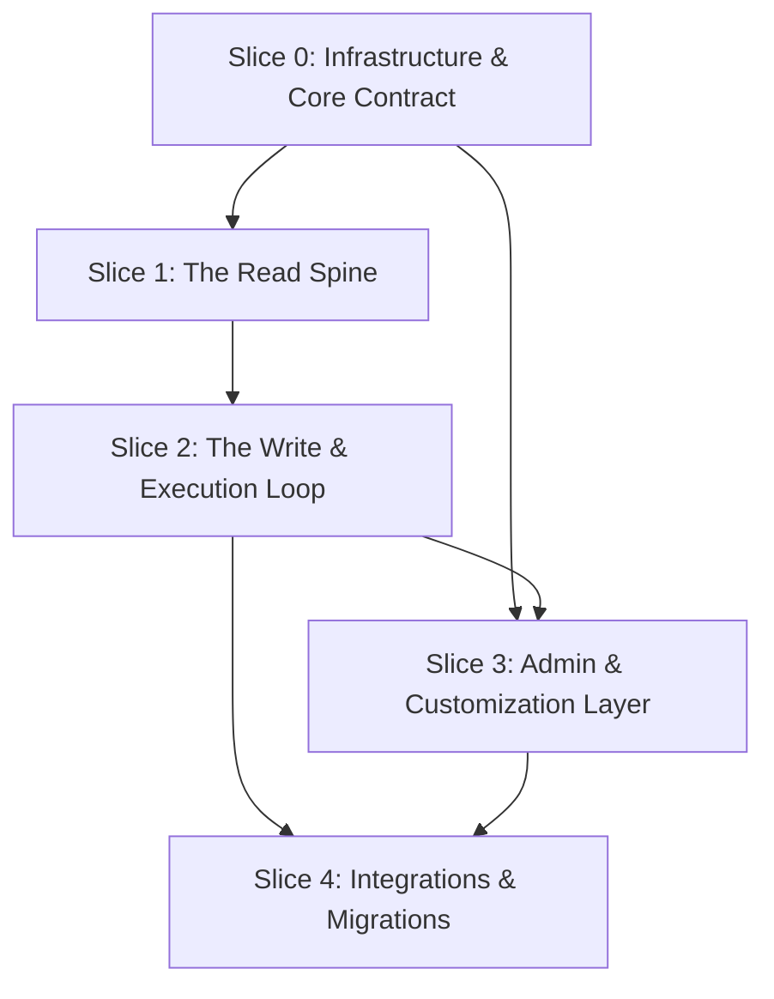

# Vertical Slices Implementation Roadmap: Testify

**Document Status:** Implementation roadmap, updated 2026-10-11 to record what was built
**Date:** September 8, 2026
**Lead System Architect:** Antigravity AI
**Primary Reference:** [`MASTER_ARCHITECTURE_BLUEPRINT.md`](./MASTER_ARCHITECTURE_BLUEPRINT.md)

The original roadmap broke the build into five vertical slices, each with target file trees, libraries, endpoint contracts and verification commands. All five slices are built, apart from attachments, storage and webhooks. Much of the detail ended up different from the targets: libraries that weren't used, commands that were never added, endpoints with other paths. This version keeps the slicing and records, per slice, what was planned, what was built and how it's verified. `docs/changelog.md` has the step-by-step history.

---

## 1. Slicing Strategy

Rather than building by layers (all tables, then all routes, then all screens), Testify was built in vertical slices:
1. **End to end:** each slice delivers working capabilities across migrations, domain logic, API routes and UI.
2. **Following the design:** schemas, state machines, focus rules and permissions follow the RFCs; where the build departed from them, the RFCs have been updated.
3. **Verified as it goes:** every slice has automated tests, all run by `npm test` (Vitest, all workspaces), plus CI on every push.

---

## 2. Slice Dependency Graph

---

## 3. Slices

### 3.1 Slice 0: Infrastructure & Core Contract

**Planned:**
- npm workspaces;
- a Postgres-compatible database layer with migrations and seeds;
- shared domain types;
- a Fastify server with health and system-info routes;
- a React shell with design tokens.

**Built:**
- **Workspaces:** `apps/server` (Fastify), `apps/web` (React + Vite), `packages/core` (domain logic, no database), `packages/db` (Kysely).
- **Database:** `createDbClient()` uses in-memory PGlite without a connection string, and PostgreSQL with one. Migrations are tracked (`packages/db/src/migrations/`, `migrateToLatest` at startup); `001_initial_schema` creates every table and the audit-log triggers.
- **Seeds:** the permission registry and roles, the first admin, dev fixture users, and a sample project for tests only.
- **Health:** `GET /api/v1/health` (no sign-in; 200, or 503 if the database is down). There's no `/api/v1/system/info`.
- **Production:** `npm run build` / `npm start` run one process serving the API and the web app. There's a Dockerfile with Docker Compose and PostgreSQL, and GitHub Actions CI.
- **Different from the plan:**
  - no Zod (validation is hand-written);
  - no `packages/ui-tokens` or CSS variables (inline styles);
  - no `test:migrate`, `test:triggers` or `db:seed` scripts (all of it is in `npm test`).

**Verified by:**
- `packages/db/tests/migrations.test.ts` (fresh build, re-runs, adopting older databases, every `down`);
- `migration_and_crud_integrity.test.ts` (foreign keys, `MUTATION_DENIED` triggers);
- `apps/server/tests/server_restart.test.ts`, `database_config.test.ts`, `production_build.test.ts`, `observability.test.ts`;
- the CI job that runs the production build on PostgreSQL.

### 3.2 Slice 1: The Read Spine

**Planned:**
- a three-pane layout with a virtualized suite tree and case list;
- read-only project, suite and case routes.

**Built:**
- **Layout:** the three-pane workspace with draggable dividers (`components/workspace/`, `components/spec/`, `components/execute/`).
- **Lists:** `VirtualizedSuiteTree` (28px rows), and `TestCaseQueueGrid` (32px) and `SpecCaseListGrid` (38px). They're virtualized by hand (no TanStack).
- **Read routes:**
  - `GET /api/v1/projects` (only projects you can see, with your permissions in each);
  - `GET /api/v1/projects/{projectId}/plans`;
  - `GET /api/v1/projects/{projectId}/spec-tree?test_plan_id=` (the whole suite tree and case list in one request);
  - `GET /api/v1/cases/{caseId}/versions/latest`.
- **Specification mode** grew beyond read-only: creating, editing, moving (drag-and-drop) and deleting suites and cases; the DRAFT → APPROVED → DEPRECATED lifecycle; plan curation; search and filters.
- **Different from the plan:**
  - The planned per-level routes (`/test-suites`, `/test-suites/{id}/test-cases`, `/test-cases/{id}`) weren't built; `spec-tree` replaced them.
  - No react-query, react-resizable-panels or Tailwind; state lives in React hooks.

**Verified by:**
- `apps/server/tests/spec_and_plan_curation.test.ts`, `spec_editing.test.ts`, `case_search.test.ts`, `read_permissions.test.ts`;
- `packages/db/tests/test_case_versioning.repository.test.ts`;
- `apps/web/src/tests/app.smoke.test.tsx`, `suiteTree.test.ts`.

### 3.3 Slice 2: The Write & Execution Loop

**Planned:**
- keyboard focus and hotkeys;
- verdict and plan state machines;
- single and batch result endpoints;
- plan status changes.

**Built:**
- **Hotkeys:** `useFocusFSM` and `useHotkeyEngine` (RFC 02 §4-5), and Execute mode (`useExecution`, `ExecutionPane`) with optimistic updates that roll back on failure.
- **Single results:** `POST /api/v1/runs/{runId}/results`, validated, with the overwrite rule and one transaction.
- **CI results:** `POST /api/v1/runs/{runId}/results/batch`, up to 5,000 results, with an all-or-nothing option.
- **Plans and runs:** created under `/api/v1/projects/{projectId}/plans` and `/api/v1/plans/{planId}/runs`, and edited and deleted at `/api/v1/plans/{planId}` and `/api/v1/runs/{runId}`. Plan status is set by editing the plan (there's no separate `/status` route), and runs are closed and reopened the same way. Runs close themselves the first time every case has a result.
- **Different from the plan:**
  - no xstate or mousetrap;
  - `f`/`b` record the verdict immediately instead of leaving it "in progress";
  - no defect modal;
  - step-level results only through the API, not the web app.

**Verified by:**
- `apps/server/tests/core_loop_e2e.test.ts`, `execution_validation.test.ts`, `batch_results.test.ts`, `batch_and_xml.test.ts`, `result_overwrite.test.ts`, `run_close.test.ts`;
- `apps/web/src/tests/hotkeys.test.ts`, `executionCaseOrder.test.ts`.

### 3.4 Slice 3: Admin & Customization Layer

**Planned:**
- a custom fields engine;
- an RBAC evaluator and middleware;
- project settings.

**Built:**
- **Permissions:** the registry and role templates (`packages/core/src/rbac/`), per-project evaluation and overrides (`middleware/auth.ts`), and escalation guards (`services/adminGuard.ts`).
- **Admin Panel:** user roster, privilege matrix, role templates, security audit log, custom fields, API tokens and email settings, each tab shown according to the user's permissions.
- **Custom fields:** six types on test cases and suites (`packages/core/src/custom-fields/`), with required-field defaults and validation patterns.
- **Sign-ins and accounts:** server-side sessions, the session cookie, lockouts and password resets.
- **Different from the plan:**
  - Custom fields are defined globally (`/api/v1/admin/custom-fields`), not under `/projects/{id}/custom-fields`; imports can still create project-scoped ones.
  - Role permissions are set by editing the role (`PATCH /api/v1/admin/roles/{roleId}`).
  - Projects have no settings form: `allow_draft_plan_linking` has no UI.

**Verified by:**
- `packages/core/tests/rbac.test.ts`, `customFieldValidator.test.ts`, `validationPattern.test.ts`;
- `packages/db/tests/role_templates.test.ts`, `custom_fields.repository.test.ts`, `user_and_rbac.test.ts`;
- `apps/server/tests/admin_roles_and_overrides.test.ts`, `admin_privilege_guard.test.ts`, `custom_fields_admin_and_values.test.ts`, `project_scoping.test.ts`, `project_access.test.ts`, `sessions.test.ts`, `login_throttle.test.ts`, `password_reset.test.ts`.

### 3.5 Slice 4: Integrations & Migrations

**Planned:**
- a streaming XML/CSV importer with dry run and reconciliation;
- machine API tokens;
- out-of-band storage for attachments.

**Built:**
- **Import:** five parsers (TestLink XML, JUnit XML, Testify JSON, CSV, TestRail CSV), `POST /api/v1/projects/{projectId}/imports/dry-run` and `/execute` (multipart, up to 50 MB), and an import wizard with custom-field mapping and duplicate handling (RFC 03 §6).
- **Export:** suite and case definitions, or a run's results, as JSON or CSV (`/api/v1/projects/{projectId}/exports/...`).
- **API tokens:** `tf_ci_...`, created under `/api/v1/projects/{projectId}/api-tokens`, project-bound and capped by the issuer (RFC 04 §4.2).
- **Reports:** a catalog of reports over REST (`/api/v1/projects/{projectId}/reports/...`), a Reports view in the web app, scheduled and manual report emails, and an MCP endpoint (`POST /mcp`) for agents, read-only at first (write tools came with API roadmap step 6) ([reports_api_and_mcp.md](./reports_api_and_mcp.md)).
- **Not built:**
  - attachments and `IStorageProvider`, including the pre-signed upload route;
  - streaming 100 MB+ imports in bounded memory;
  - `tf_live_` tokens;
  - webhooks.

**Verified by:**
- `packages/core/tests/ingestion.test.ts`, `CsvParser.test.ts`, `JUnitXmlParser.test.ts`, `TestRailCsvParser.test.ts`, `reporting.test.ts`;
- `apps/server/tests/batch_and_xml.test.ts`, `import_limits.test.ts`, `external_ids.test.ts`, `exports.test.ts`, `api_tokens.test.ts`, `api_token_auth.test.ts`, `api_token_issuer.test.ts`, `reports.test.ts`, `report_email.test.ts`, `mcp.test.ts`, `rate_limits.test.ts`.

---

## 4. Slice Status

| Slice | Focus | Status |
| :--- | :--- | :--- |
| **0** | Workspaces, database, migrations, production build | Built |
| **1** | Three-pane workspace, suite tree, specification | Built |
| **2** | Hotkeys, results, plans and runs | Built (step-level results API-only) |
| **3** | Permissions, admin, custom fields | Built (no project settings form) |
| **4** | Import, export, API tokens, reports | Built, except attachments, storage, streaming import and webhooks |

How to run everything: `npm test` (every test), `npm run typecheck`, `npm run build`. See `CLAUDE.md` and `README.md`.

---

## 5. Architectural Alignment

The requirement-by-requirement status is in [`MASTER_ARCHITECTURE_BLUEPRINT.md` §7](./MASTER_ARCHITECTURE_BLUEPRINT.md).
