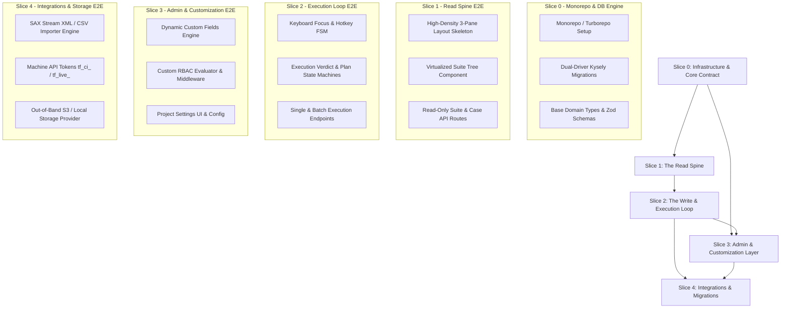

# Vertical Slices Implementation Roadmap: Testify

**Document Status:** Approved Architecture Implementation Guide  
**Date:** September 8, 2026  
**Version:** v1.0 Target Execution Specification  
**Lead System Architect:** Antigravity AI  
**Primary Reference:** [`docs/MASTER_ARCHITECTURE_BLUEPRINT.md`](file:///home/elliot/Documents/Code/testlink-local/docs/MASTER_ARCHITECTURE_BLUEPRINT.md)

---

## 1. Executive Summary & Slicing Strategy

This document establishes the official vertical slicing roadmap for **Testify**, transforming the locked architectural specifications in [`MASTER_ARCHITECTURE_BLUEPRINT.md`](file:///home/elliot/Documents/Code/testlink-local/docs/MASTER_ARCHITECTURE_BLUEPRINT.md) into 5 discrete, E2E executable, and independently testable implementation increments.

### 1.1 Vertical Slicing Principles
Rather than building by horizontal layers (e.g., all database tables first, then all backend routes, then UI screens), Testify is sliced vertically across feature capabilities:
1. **End-to-End Functionality**: Each slice delivers fully functioning capabilities across database migrations, core domain services, REST API endpoints, and user interface components.
2. **Zero Architectural Drift**: Implementation strictly adheres to locked ERD schemas, OpenAPI 3.1 contracts, state machine invariants, keyboard focus zone rules, and RBAC permission matrices defined in the master blueprint.
3. **Continuous Verification**: Every slice specifies deterministic verification commands (`pnpm test:*`) and measurable exit criteria before proceeding to downstream slices.
4. **Parallelization Directives**: Decoupled module contracts enable concurrent development across backend API services, frontend UI components, and storage drivers within each slice.

---

## 2. High-Level Slice Topology & Dependency Graph



---

## 3. Slice Breakdown & Detailed Specifications

---

### 3.1 Slice 0: Infrastructure & Core Contract

#### 3.1.1 Overview & Scope
Slice 0 establishes the monorepo foundation, developer tooling, logging, dual-driver database migrations (SQLite for local development and PostgreSQL for enterprise production via Kysely query builder), core domain TypeScript types, Zod validation contracts, and deterministic data seeding utilities.

#### 3.1.2 Target File Structure & Module Dependencies
```
testlink-local/
├── package.json
├── pnpm-workspace.yaml
├── turbo.json
├── tsconfig.base.json
├── packages/
│   ├── config/
│   │   ├── eslint-config/
│   │   └── tsconfig/
│   ├── db/
│   │   ├── package.json
│   │   ├── src/
│   │   │   ├── index.ts
│   │   │   ├── client.ts                 # Dual-driver Kysely connection pool (SQLite / Postgres)
│   │   │   ├── dialects/
│   │   │   │   ├── sqlite.ts             # better-sqlite3 driver wrapper
│   │   │   │   └── postgres.ts           # pg pool driver wrapper
│   │   │   ├── migrations/
│   │   │   │   ├── 001_initial_schema.ts # Complete initial DDL
│   │   │   │   └── migrator.ts           # Kysely CLI/Programmatic migration runner
│   │   │   └── seeds/
│   │   │       ├── seed_dev_data.ts     # Realistic test project, suites, cases, execution data
│   │   │       └── seed_permissions.ts  # Default roles & permission key registry
│   ├── core/
│   │   ├── package.json
│   │   ├── src/
│   │   │   ├── index.ts
│   │   │   ├── types/                    # Core TypeScript domain models
│   │   │   ├── schemas/                  # Zod validation schemas for entities
│   │   │   ├── utils/
│   │   │   │   ├── uuid.ts               # UUIDv7 generator (timestamp sorted)
│   │   │   │   └── errors.ts             # Domain exception hierarchy (AppError, ValidationError)
│   │   │   └── logger/
│   │   │       └── index.ts              # Pino logger configuration
│   └── ui-tokens/                        # CSS variables & design tokens (32px/28px layout rules)
└── apps/
    └── server/
        ├── package.json
        ├── src/
        │   ├── index.ts                  # Fastify server entry point
        │   ├── app.ts                    # Application builder & plugin registration
        │   ├── config/                   # Environment variable parser (dotenv + Zod)
        │   └── routes/
        │       └── health.ts             # System health check route (/health, /api/v1/system/info)
```

**Module Dependencies:**
- `kysely`, `better-sqlite3`, `pg`, `zod`, `pino`, `uuidv7`, `fastify`, `@fastify/cors`, `turborepo`.

#### 3.1.3 Included Database Tables & Schema Objects
Initial migration (`001_initial_schema.ts`) provisions all master tables and indexes with 100% dialect parity across SQLite and PostgreSQL:

| Table Name | Primary Key | Key Foreign Keys & Indexes | SQLite / Postgres Specifics |
| :--- | :--- | :--- | :--- |
| `projects` | `VARCHAR(36)` (UUIDv7) | `prefix` UNIQUE | Settings JSON column stored as `TEXT` in SQLite / `JSONB` in Postgres. |
| `test_suites` | `VARCHAR(36)` | FK `project_id`, FK `parent_suite_id`; Index `idx_test_suites_project`, `idx_test_suites_parent` | `path` column stores materialized path (e.g. `/uuid1/uuid2`). |
| `test_cases` | `VARCHAR(36)` | FK `project_id`, FK `test_suite_id`; Unique `(project_id, external_id)`; Index `idx_test_cases_suite` | `priority` and `execution_type` check constraints. |
| `test_case_versions` | `VARCHAR(36)` | FK `test_case_id`; Unique `(test_case_id, version_number)`; Index `idx_case_versions_lookup` | `status` check constraint (`DRAFT`, `IN_REVIEW`, `APPROVED`, `DEPRECATED`). |
| `test_steps` | `VARCHAR(36)` | FK `test_case_version_id`; Unique `(test_case_version_id, step_number)` | Sequential step numbers within case version. |
| `test_plans` | `VARCHAR(36)` | FK `project_id`; Index `idx_test_plans_project` | `status` check constraint (`ACTIVE`, `LOCKED`, `ARCHIVED`). |
| `builds` | `VARCHAR(36)` | FK `test_plan_id`; Unique `(test_plan_id, name)` | `status` check constraint (`OPEN`, `CLOSED`). |
| `test_plan_cases` | `VARCHAR(36)` | FK `test_plan_id`, FK `test_case_id`, FK `test_case_version_id`; Unique `(test_plan_id, test_case_id)` | Pinned case version mapping. Index `idx_plan_cases_assigned`. |
| `executions` | `VARCHAR(36)` | FK `build_id`, FK `test_plan_case_id`; Index `idx_executions_build_case`, `idx_executions_verdict` | Immutable historic execution record with snapshots. |
| `execution_steps` | `VARCHAR(36)` | FK `execution_id`, FK `test_step_id` | Step-level execution verdict records. |
| `audit_logs` | `VARCHAR(36)` | Index `idx_audit_logs_actor`, `idx_audit_logs_resource` | Append-only immutability database triggers (`MUTATION_DENIED`). |
| `custom_field_definitions` | `VARCHAR(36)` | FK `project_id`; Unique `(project_id, name)` | Scoped custom field definitions. |
| `custom_field_options` | `VARCHAR(36)` | FK `custom_field_definition_id` | Dropdown/Multi-select options. |
| `custom_field_values` | `VARCHAR(36)` | FK `custom_field_definition_id` | Polymorphic dynamic entity binding. |
| `roles`, `permissions`, `role_permissions` | `VARCHAR(36)` | FKs linking roles to permissions | RBAC default matrix seeds. |
| `user_project_roles`, `user_permission_overrides` | `VARCHAR(36)` | FKs to projects & users | Contextual security bindings. |
| `api_tokens` | `VARCHAR(36)` | FK `project_id`; Unique `token_hash` | Salted token storage (`tf_live_...`, `tf_ci_...`). |

#### 3.1.4 API Endpoints & Request/Response Contracts

##### `GET /health`
- **Description**: Verifies API gateway & DB pool health.
- **Response `200 OK`**:
```json
{
  "status": "healthy",
  "environment": "development",
  "database": {
    "driver": "sqlite",
    "connected": true,
    "latency_ms": 1.2
  },
  "timestamp": "2026-09-08T14:00:00.000Z"
}
```

##### `GET /api/v1/system/info`
- **Description**: Returns platform metadata and migration version status.
- **Response `200 OK`**:
```json
{
  "name": "Testify Core API",
  "version": "1.0.0",
  "api_version": "v1",
  "schema_version": "001_initial_schema",
  "features": {
    "sqlite_support": true,
    "postgres_support": true,
    "dual_driver": true
  }
}
```

#### 3.1.5 UI Components & State Management
- `apps/web` minimal shell using Vite + React + TypeScript.
- Base Design Tokens CSS file (`packages/ui-tokens/src/theme.css`) establishing visual constants:
  - `--density-row-height-pane1: 28px`
  - `--density-row-height-pane2: 32px`
  - Visual theme tokens (Dark Mode & Sleek Slate palette).

#### 3.1.6 Concrete Verification Strategy & Test Commands
1. **SQLite Migration Test**:
   ```bash
   pnpm --filter @testify/db test:migrate:sqlite
   ```
   *Assertion*: Migrates schema cleanly on `better-sqlite3` in-memory DB and executes rollback cleanly.
2. **PostgreSQL Migration Test**:
   ```bash
   pnpm --filter @testify/db test:migrate:postgres
   ```
   *Assertion*: Migrates schema cleanly on PostgreSQL instance.
3. **Database Trigger Immutability Assertion**:
   ```bash
   pnpm --filter @testify/db test:triggers
   ```
   *Assertion*: Executing `UPDATE audit_logs ...` or `DELETE FROM audit_logs ...` raises an error with message `MUTATION_DENIED`.
4. **Seed Validation Test**:
   ```bash
   pnpm --filter @testify/db db:seed
   ```
   *Assertion*: Populates seed project (`PRJ-01`), 10 suites, 50 test cases, 5 test plans, and default RBAC roles without FK constraint failures.

#### 3.1.7 Prerequisite Dependencies & Parallel Execution Directives
- **Prerequisites**: Node.js >= 20.0.0, pnpm >= 9.0.0, Docker (optional for PostgreSQL local test).
- **Parallel Workstreams**:
  - Developer A: `packages/db` migrations and dual-driver client setup.
  - Developer B: `packages/core` Zod schemas and UUIDv7 utilities.
  - Developer C: `apps/server` Fastify setup and `/health` endpoints.

---

### 3.2 Slice 1: The Read Spine

#### 3.2.1 Overview & Scope
Slice 1 delivers the full read-only spine of Testify. It implements the high-density 3-Pane UI layout skeleton, virtualized tree rendering for recursive suite structures, high-performance case queue tables, and read-only RESTful API endpoints for projects, suites, cases, versions, steps, plans, and builds.

#### 3.2.2 Target File Structure & Module Dependencies
```
apps/
├── server/
│   ├── src/
│   │   ├── services/
│   │   │   ├── ProjectService.ts        # Project fetching & validation
│   │   │   ├── SuiteTreeService.ts      # Recursive suite tree query builder with materialized path parsing
│   │   │   ├── TestCaseService.ts       # Test case query & step hydration
│   │   │   └── TestPlanService.ts       # Test plan & build query service
│   │   └── routes/
│   │       ├── projects.ts              # GET /api/v1/projects
│   │       ├── suites.ts                # GET /api/v1/projects/:projectId/test-suites
│   │       ├── cases.ts                 # GET /api/v1/test-suites/:suiteId/test-cases, GET /api/v1/test-cases/:id
│   │       └── plans.ts                 # GET /api/v1/projects/:projectId/test-plans, GET /api/v1/test-plans/:id/builds
└── web/
    ├── src/
    │   ├── api/                         # TanStack Query API hooks & fetchers
    │   │   ├── useProjects.ts
    │   │   ├── useSuiteTree.ts
    │   │   ├── useTestCases.ts
    │   │   └── useTestPlans.ts
    │   ├── store/
    │   │   └── useWorkspaceStore.ts     # Selected project, plan, suite, case state
    │   ├── components/
    │   │   ├── layout/
    │   │   │   ├── ThreePaneLayout.tsx   # Resizable 3-Pane container layout
    │   │   │   └── HeaderBar.tsx        # Project, plan, build dropdown selectors
    │   │   ├── tree/
    │   │   │   ├── VirtualizedSuiteTree.tsx # @tanstack/react-virtualized tree (28px height)
    │   │   │   └── SuiteTreeNode.tsx
    │   │   ├── queue/
    │   │   │   ├── TestCaseQueueGrid.tsx  # @tanstack/react-virtual queue table (32px height)
    │   │   │   └── QueueRow.tsx
    │   │   └── detail/
    │   │       ├── CaseDetailPane.tsx   # Pane 3 case specification reader & step list
    │   │       └── StepTable.tsx
```

**Module Dependencies:**
- `@tanstack/react-query`, `@tanstack/react-virtual`, `lucide-react`, `clsx`, `tailwind-merge`, `react-resizable-panels`.

#### 3.2.3 Included Database Tables & Schema Objects
- Read operations against: `projects`, `test_suites`, `test_cases`, `test_case_versions`, `test_steps`, `test_plans`, `builds`, `test_plan_cases`.
- **Query Optimization**: Leverages materialized path prefix matching (`LIKE '/root_id/%'`) and composite index `idx_case_versions_lookup(test_case_id, status)` to resolve active approved versions instantly.

#### 3.2.4 API Endpoints & Request/Response Contracts

##### `GET /api/v1/projects`
- **Response `200 OK`**:
```json
{
  "data": [
    {
      "id": "018f3a21-7b00-7000-8000-000000000001",
      "name": "E-Commerce Core Platform",
      "prefix": "SHOP",
      "description": "Primary web & mobile store backend",
      "created_at": "2026-09-08T10:00:00Z"
    }
  ]
}
```

##### `GET /api/v1/projects/{project_id}/test-suites`
- **Description**: Returns complete recursive suite hierarchy for the given project.
- **Response `200 OK`**:
```json
{
  "project_id": "018f3a21-7b00-7000-8000-000000000001",
  "suites": [
    {
      "id": "018f3a21-7b00-7000-8000-000000000010",
      "parent_suite_id": null,
      "name": "Authentication & OAuth2",
      "position": 1,
      "path": "/018f3a21-7b00-7000-8000-000000000010",
      "case_count": 14,
      "children": [
        {
          "id": "018f3a21-7b00-7000-8000-000000000011",
          "parent_suite_id": "018f3a21-7b00-7000-8000-000000000010",
          "name": "Token Refresh Engine",
          "position": 1,
          "path": "/018f3a21-7b00-7000-8000-000000000010/018f3a21-7b00-7000-8000-000000000011",
          "case_count": 4,
          "children": []
        }
      ]
    }
  ]
}
```

##### `GET /api/v1/test-suites/{suite_id}/test-cases`
- **Response `200 OK`**:
```json
{
  "suite_id": "018f3a21-7b00-7000-8000-000000000011",
  "cases": [
    {
      "id": "018f3a21-7b00-7000-8000-000000000100",
      "external_id": "SHOP-104",
      "title": "OAuth2 PKCE Token Exchange Validation",
      "priority": "HIGH",
      "execution_type": "MANUAL",
      "active_version": {
        "id": "018f3a21-7b00-7000-8000-000000000101",
        "version_number": 1,
        "status": "APPROVED",
        "summary": "Verifies PKCE authorization code exchange flow with code_verifier.",
        "preconditions": "User must have active staging credentials."
      }
    }
  ]
}
```

##### `GET /api/v1/test-cases/{case_id}`
- **Response `200 OK`**: Returns full test case record including all versions and steps.

#### 3.2.5 UI Components & State Management
- **3-Pane Topology Spec**:
  - Pane 1 (Tree): Width 260px - 340px. Node row height `28px`.
  - Pane 2 (Queue): Width 380px - 480px. Tabular grid row height `32px`.
  - Pane 3 (Workspace): Fluid remaining width. High-density case spec display.
- **Virtualization Ceiling**: `@tanstack/react-virtual` limits mounted DOM nodes to maximum ~45 elements in Pane 1 and Pane 2 regardless of total suite size (e.g. 5,000+ items).
- **Selection State Flow**:
  - Selecting Suite in Pane 1 updates `activeSuiteId` in `useWorkspaceStore` -> triggers refetch of Pane 2 cases.
  - Selecting Case in Pane 2 updates `activeCaseId` -> hydrates Pane 3 detail pane.

#### 3.2.6 Concrete Verification Strategy & Test Commands
1. **Suite Tree Materialized Path Query Test**:
   ```bash
   pnpm --filter server test:unit:suites
   ```
   *Assertion*: Deeply nested suite hierarchy (5 levels deep) returns correctly ordered JSON tree structure.
2. **Read Performance Benchmark**:
   ```bash
   pnpm --filter server test:bench:read-spine
   ```
   *Assertion*: Fetching tree with 1,000 suites and 10,000 cases executes in <35ms.
3. **UI Render & Virtualization E2E Test**:
   ```bash
   pnpm --filter web test:e2e:read-spine
   ```
   *Assertion*: Playwright verifies scrolling through 5,000 test case rows maintains 60fps frame rate and total DOM node count remains under 100 elements.

#### 3.2.7 Prerequisite Dependencies & Parallel Execution Directives
- **Prerequisite**: Slice 0 core database schema and seeds.
- **Parallel Workstreams**:
  - Backend Developer: Implement `SuiteTreeService` and suite/case REST routes.
  - Frontend Developer: Build `ThreePaneLayout` skeleton and `@tanstack/react-virtual` tree/queue components using mock API responses.

---

### 3.3 Slice 2: The Write/Execution Loop

#### 3.3.1 Overview & Scope
Slice 2 adds full state management, keyboard shortcut execution engine (`j`, `k`, `p`, `f`, `b`, `s`, `e`), keyboard Focus Zone State Machine (Zone 1..5), test case version status transitions, execution run logging (single and high-throughput `/executions/batch`), and plan/build locking invariants (HTTP 422 `PLAN_LOCKED` / `BUILD_CLOSED`).

#### 3.3.2 Target File Structure & Module Dependencies
```
packages/
└── core/
    └── src/
        └── state-machines/
            ├── caseVersionFSM.ts        # Draft -> In Review -> Approved -> Deprecated
            ├── planBuildFSM.ts          # Active/Locked/Archived & Open/Closed
            ├── executionFSM.ts          # Untested -> In Progress -> Completed/Aborted
            └── focusFSM.ts              # Focus Zone 1..5 transition rules
apps/
├── server/
│   ├── src/
│   │   ├── services/
│   │   │   ├── ExecutionService.ts      # Single & batch execution writer
│   │   │   └── TestPlanLockService.ts   # Plan & Build locking validation service
│   │   └── routes/
│   │       ├── executions.ts            # POST /api/v1/test-plans/:planId/builds/:buildId/executions/batch
│   │       ├── cases_write.ts           # POST /api/v1/test-suites/:suiteId/test-cases
│   │       └── plan_locks.ts            # PUT /api/v1/test-plans/:planId/status
└── web/
    ├── src/
    │   ├── hooks/
    │   │   ├── useHotkeyEngine.ts       # Global single-key hotkey listener & focus check
    │   │   └── useFocusFSM.ts           # Active zone tracking (Zone 1..5)
    │   ├── components/
    │   │   ├── execution/
    │   │   │   ├── DockedActionBar.tsx  # Bottom bar with Hotkey Active badge & verdict buttons
    │   │   │   ├── StepExecutionDrawer.tsx # Drawer for step-level evaluation
    │   │   │   └── DefectModal.tsx       # Defect logging modal (Zone 5)
    │   │   └── common/
    │   │       └── FocusIndicatorBadge.tsx # Visual indicator of hotkey status
```

**Module Dependencies:**
- `xstate` (optional or light custom FSM), `mousetrap` / custom keydown handler, `@tanstack/react-query`.

#### 3.3.3 Included Database Tables & Schema Objects
- Write operations against: `executions`, `execution_steps`, `test_case_versions`, `test_cases`, `test_steps`, `test_plan_cases`, `builds`, `test_plans`, `audit_logs`.
- **Invariants**:
  - `executions` rows are immutable once committed (`status='COMPLETED'`).
  - Attempting execution on `CLOSED` build or `LOCKED` plan aborts transaction and returns `HTTP 422`.

#### 3.3.4 API Endpoints & Request/Response Contracts

##### `POST /api/v1/test-plans/{plan_id}/builds/{build_id}/executions/batch`
- **Description**: High-throughput CI/CD & manual batch execution recording.
- **Query Parameters**: `all_or_nothing=false` (boolean).
- **Request Body**:
```json
{
  "environment": "staging-us-east-1",
  "runner_info": {
    "name": "GitHub Actions",
    "run_id": "98124712",
    "commit_sha": "a1b2c3d4e5f67890123456789abcdef012345678"
  },
  "executions": [
    {
      "case_identifier": { "external_id": "SHOP-104" },
      "verdict": "PASSED",
      "status": "COMPLETED",
      "duration_ms": 3420,
      "executed_at": "2026-09-08T14:15:00Z",
      "notes": "Execution verified via PKCE helper.",
      "step_results": [
        { "step_number": 1, "verdict": "PASSED", "actual_result": "Token generated." },
        { "step_number": 2, "verdict": "PASSED", "actual_result": "Exchange successful." }
      ]
    }
  ]
}
```
- **Response `207 Multi-Status` / `200 OK`**:
```json
{
  "summary": {
    "total": 1,
    "succeeded": 1,
    "failed": 0
  },
  "results": [
    {
      "index": 0,
      "status": "SUCCESS",
      "execution_id": "018f3a21-7b00-7000-8000-000000000999",
      "case_external_id": "SHOP-104",
      "verdict": "PASSED"
    }
  ]
}
```

##### `PUT /api/v1/test-plans/{plan_id}/status`
- **Request Body**: `{ "status": "LOCKED" }`
- **Response `200 OK`**: Plan status updated; subsequent execution posts return `422 Unprocessable Entity`.

#### 3.3.5 UI Components & State Management

##### Focus Zone State Machine Rules:
- **ZONE 1**: Tree Navigation (Pane 1)
- **ZONE 2**: List Queue (Pane 2)
- **ZONE 3**: Execution Container (Pane 3) — **Single-key hotkeys ACTIVE (`p`, `f`, `b`, `s`, `j`, `k`, `e`)**.
- **ZONE 4**: Text Input / Form Editing — **Hotkeys AUTO-PAUSED** (Typing mode). `Ctrl+Enter` submits notes.
- **ZONE 5**: Modal Dialog (Defect/Setup) — Focus trapped in modal. `Esc` closes.

##### Docked Action Bar:
- Displays active state badge:
  - `⚡ HOTKEYS ACTIVE (ON)` (Green) when focus is in Zone 3 and user has `EXECUTE_RUN`.
  - `✏️ TYPING MODE - AUTO PAUSED` (Yellow) when focused in input/textarea (Zone 4).
  - `🔒 READ ONLY - NO PERMISSION` (Red) when user lacks `EXECUTE_RUN`.

##### Master Hotkey Handlers:
- `j` / `Down`: Move selection down in Queue (Pane 2/3).
- `k` / `Up`: Move selection up in Queue (Pane 2/3).
- `p`: Commit `PASSED` verdict -> Auto-advance to next case in queue.
- `f`: Set `FAILED` verdict -> Focus notes textarea (Zone 4).
- `b`: Set `BLOCKED` verdict -> Open Defect Modal (Zone 5).
- `s`: Commit `SKIPPED` verdict -> Auto-advance to next case.
- `Ctrl+Enter`: Submit notes & commit execution.

#### 3.3.6 Concrete Verification Strategy & Test Commands
1. **State Machine Unit Tests**:
   ```bash
   pnpm --filter @testify/core test:unit:fsm
   ```
   *Assertion*: Verifies all valid/invalid transitions for Case Version, Test Plan, Execution Run, and Focus Zone state machines.
2. **Locked Plan Guard Test**:
   ```bash
   pnpm --filter server test:integration:locks
   ```
   *Assertion*: Posting an execution to a `LOCKED` plan returns `HTTP 422` with code `PLAN_LOCKED`.
3. **Batch Execution API Stress Test**:
   ```bash
   pnpm --filter server test:integration:batch-executions
   ```
   *Assertion*: Submitting batch of 500 execution results completes in <150ms in a single DB transaction.
4. **Playwright Hotkey Navigation & Focus E2E**:
   ```bash
   pnpm --filter web test:e2e:hotkeys
   ```
   *Assertion*: 
   - Pressing `j` moves row selection down.
   - Pressing `p` records pass verdict and auto-advances.
   - Pressing `f` moves focus into notes textarea and changes badge to `TYPING MODE - AUTO PAUSED`.
   - Pressing `p` while inside notes textarea types the character 'p' instead of triggering verdict submit.

#### 3.3.7 Prerequisite Dependencies & Parallel Execution Directives
- **Prerequisite**: Slice 1 Read Spine.
- **Parallel Workstreams**:
  - Backend Developer: Implement `ExecutionService`, `/executions/batch` route, and locked plan validation.
  - Frontend Developer: Implement `useHotkeyEngine`, `FocusFSM`, `DockedActionBar`, and verdict submit hooks.

---

### 3.4 Slice 3: Admin & Customization Layer

#### 3.4.1 Overview & Scope
Slice 3 implements dynamic runtime extensions and governance controls. It includes the dynamic Custom Fields engine (types: `TEXT`, `NUMBER`, `CHECKBOX`, `DROPDOWN`, `MULTI_SELECT`, `DATE`; scoping; snapshotting on test plan case linking and execution save), granular RBAC evaluator engine (16 permission keys, 5 system/project role tiers, context precedence hierarchy), and Project Settings governance.

#### 3.4.2 Target File Structure & Module Dependencies
```
packages/
└── core/
    └── src/
        ├── rbac/
        │   ├── permissionRegistry.ts   # 16 master permission keys definition
        │   └── permissionEvaluator.ts  # Precedence evaluator (User Project > User System > Project Role > Global Role > Default Deny)
        └── custom-fields/
            ├── customFieldValidator.ts # Dynamic field type parsing & validation
            └── snapshotEngine.ts       # JSON freeze snapshot builder for executions
apps/
├── server/
│   ├── src/
│   │   ├── middleware/
│   │   │   └── rbacMiddleware.ts      # Fastify request permission guard
│   │   └── routes/
│   │       ├── admin_custom_fields.ts  # CRUD for custom field definitions
│   │       ├── admin_roles.ts          # Role permission matrix management
│   │       └── project_settings.ts     # Project settings & governance configuration
└── web/
    ├── src/
    │   ├── components/
    │   │   ├── admin/
    │   │   │   ├── CustomFieldManager.tsx   # Custom field definition builder
    │   │   │   ├── RolePermissionMatrix.tsx # High-density permission matrix toggle grid
    │   │   │   └── ProjectSettingsForm.tsx  # Settings editor
    │   │   └── custom-fields/
    │   │       └── CustomFieldRenderer.tsx  # Dynamic form field renderer
```

#### 3.4.3 Included Database Tables & Schema Objects
- `custom_field_definitions`, `custom_field_options`, `custom_field_values`, `roles`, `permissions`, `role_permissions`, `user_project_roles`, `user_permission_overrides`, `projects`.

#### 3.4.4 API Endpoints & Request/Response Contracts

##### `POST /api/v1/projects/{project_id}/custom-fields`
- **Request Body**:
```json
{
  "name": "Target Environment",
  "label": "Target Test Environment",
  "field_type": "DROPDOWN",
  "target_entity": "EXECUTION",
  "is_required": true,
  "default_value": "STAGING",
  "options": [
    { "label": "Dev Local", "value": "DEV" },
    { "label": "Staging", "value": "STAGING" },
    { "label": "Production Canary", "value": "PROD_CANARY" }
  ]
}
```
- **Response `201 Created`**: Custom field definition initialized.

##### `PUT /api/v1/admin/roles/{role_id}/permissions`
- **Request Body**:
```json
{
  "permissions": [
    "SPEC_VIEW",
    "SPEC_CREATE",
    "SPEC_EDIT",
    "EXECUTE_RUN"
  ]
}
```
- **Response `200 OK`**: Role permission grants updated.

#### 3.4.5 UI Components & State Management

##### RBAC Matrix Grid Component:
- Tabular grid displaying 16 permission keys against role columns (Admin, Test Lead, Tester, Automation Service, Viewer).
- Instant toggle switches backed by optimism updates and batch permission save API calls.

##### Custom Field Dynamic Renderer:
- Polymorphic form builder in Pane 3 and execution forms rendering inputs based on `field_type` (`TEXT`, `NUMBER`, `CHECKBOX`, `DROPDOWN`, `MULTI_SELECT`, `DATE`).

##### Snapshot Invariant:
- When an execution is saved, the current state of custom fields is frozen in `executions.custom_fields_snapshot` JSON text column. Future edits to `custom_field_definitions` do not modify historical execution snapshots.

#### 3.4.6 Concrete Verification Strategy & Test Commands
1. **RBAC Precedence Unit Test**:
   ```bash
   pnpm --filter @testify/core test:unit:rbac
   ```
   *Assertion*: Evaluates all 5 levels of the precedence equation:
   $$\text{User Project Override} \succ \text{User System Override} \succ \text{Project Role Grant} \succ \text{Global Role Grant} \succ \text{Default Deny}$$
2. **Forbidden Access Middleware Test**:
   ```bash
   pnpm --filter server test:integration:rbac-middleware
   ```
   *Assertion*: Accessing `POST /test-suites` without `SPEC_CREATE` key returns `HTTP 403 Forbidden` with detailed error response.
3. **Custom Field Snapshot Verification**:
   ```bash
   pnpm --filter server test:integration:custom-fields
   ```
   *Assertion*: Modifying custom field options after recording execution leaves `execution.custom_fields_snapshot` unaltered.

#### 3.4.7 Prerequisite Dependencies & Parallel Execution Directives
- **Prerequisite**: Slice 0 (DB Schema) & Slice 2 (Execution Loop).
- **Parallel Workstreams**:
  - Backend Developer A: Implement dynamic custom fields CRUD and snapshot builder.
  - Backend Developer B: Implement RBAC permission evaluator and Fastify route middleware.
  - Frontend Developer: Build `RolePermissionMatrix` grid and `CustomFieldRenderer` component.

---

### 3.5 Slice 4: Integrations & Migrations

#### 3.5.1 Overview & Scope
Slice 4 completes the platform capabilities by delivering enterprise ingestion, machine API security, export utilities, and out-of-band artifact storage. It includes the multi-format ingestion engine (`IFileParser`: SAX XML parser for legacy TestLink XML, JSON Schema parser, CSV parser with strict memory bounds <64MB heap), dry-run diff preview and interactive reconciliation modals, Machine API Token management (`tf_live_...`, `tf_ci_...`), CSV export streaming, and out-of-band attachments storage via `IStorageProvider` (Local FS and AWS S3/MinIO).

#### 3.5.2 Target File Structure & Module Dependencies
```
packages/
└── core/
    └── src/
        ├── ingestion/
        │   ├── IFileParser.ts           # Parser interface
        │   ├── SaxXmlParser.ts          # Sax-js streaming XML parser (<64MB heap bound)
        │   ├── JsonSchemaParser.ts      # Native JSON spec parser
        │   ├── CsvParser.ts             # PapaParse stream CSV parser
        │   └── ImportDiffEngine.ts      # Dry-run reconciliation diff generator
        └── storage/
            ├── IStorageProvider.ts      # Out-of-band attachment interface
            ├── LocalStorageProvider.ts  # Local disk filesystem provider
            └── S3StorageProvider.ts     # AWS S3 / MinIO pre-signed URL provider
apps/
├── server/
│   ├── src/
│   │   ├── middleware/
│   │   │   └── tokenAuthMiddleware.ts   # Machine API token validator (tf_live_ / tf_ci_)
│   │   └── routes/
│   │       ├── imports.ts               # POST /imports/dry-run, POST /imports/execute
│   │       ├── exports.ts               # GET /exports/csv
│   │       ├── api_tokens.ts            # POST /projects/:projectId/api-tokens
│   │       └── attachments.ts           # POST /executions/:id/attachments/presign
└── web/
    ├── src/
    │   ├── components/
    │   │   ├── import/
    │   │   │   ├── ImportWizard.tsx     # Step-by-step import modal wizard
    │   │   │   ├── DryRunPreviewModal.tsx # Dry-run diff preview
    │   │   │   ├── CustomFieldReconciliationModal.tsx # Route/Auto-create field mapping
    │   │   │   └── DuplicateResolutionModal.tsx   # Overwrite/Version Up/Skip duplicate cases
    │   │   └── tokens/
    │   │       └── ApiTokenManager.tsx  # CI/CD Machine API token management UI
```

**Module Dependencies:**
- `sax`, `papaparse`, `@aws-sdk/client-s3`, `@aws-sdk/s3-request-presigner`, `argon2`.

#### 3.5.3 Included Database Tables & Schema Objects
- `api_tokens`, `audit_logs`, `test_suites`, `test_cases`, `test_case_versions`, `test_steps`, `custom_field_definitions`, `custom_field_values`.

#### 3.5.4 API Endpoints & Request/Response Contracts

##### `POST /api/v1/imports/dry-run`
- **Description**: Parses payload via streaming SAX parser and returns dry-run diff preview without mutating database.
- **Request**: `multipart/form-data` (file: `legacy_testlink.xml`, format: `TESTLINK_XML`).
- **Response `200 OK`**:
```json
{
  "summary": {
    "total_suites_detected": 12,
    "total_cases_detected": 145,
    "new_cases": 130,
    "duplicate_cases": 15,
    "custom_fields_detected": 3
  },
  "unmapped_custom_fields": ["testlink_node_id", "execution_type_code"],
  "duplicates": [
    {
      "external_id": "SHOP-101",
      "existing_title": "User Authentication via Password",
      "imported_title": "User Authentication via Password"
    }
  ]
}
```

##### `POST /api/v1/imports/execute`
- **Description**: Commits import payload based on user reconciliation decisions.
- **Request Body**:
```json
{
  "import_token": "imp_dry_run_987123",
  "duplicate_strategy": "VERSION_UP",
  "custom_field_mappings": {
    "testlink_node_id": "MAP_TO_EXISTING_CF_10",
    "execution_type_code": "AUTO_CREATE_FIELD"
  }
}
```
- **Response `200 OK`**: `{ "status": "COMPLETED", "imported_cases_count": 145 }`

##### `POST /api/v1/projects/{project_id}/api-tokens`
- **Request Body**:
```json
{
  "name": "GitHub Actions CI Runner",
  "token_type": "CI_CD",
  "capabilities": ["EXECUTE_RUN", "SPEC_VIEW"]
}
```
- **Response `201 Created`**:
```json
{
  "id": "018f3a21-7b00-7000-8000-000000000555",
  "name": "GitHub Actions CI Runner",
  "raw_token": "tf_ci_9a8b7c6d5e4f3a2b1c0d9e8f7a6b5c4d3e2f1a0b",
  "capabilities": ["EXECUTE_RUN", "SPEC_VIEW"],
  "warning": "Copy this token now. It will never be shown again."
}
```

##### `POST /api/v1/executions/{id}/attachments/presign`
- **Request Body**: `{ "filename": "screenshot_failure.png", "mime_type": "image/png", "size_bytes": 1048576 }`
- **Response `200 OK`**:
```json
{
  "upload_url": "https://testify-bucket.s3.amazonaws.com/attachments/exec_100/screenshot_failure.png?X-Amz-Signature=...",
  "attachment_id": "att_991283",
  "file_key": "attachments/exec_100/screenshot_failure.png"
}
```

#### 3.5.5 UI Components & State Management
- **Import Wizard Flow**:
  1. File Upload Screen (Drag & Drop XML/JSON/CSV).
  2. Streaming Dry-Run Progress Bar.
  3. Interactive Reconciliation Modals (Custom Field setup & Duplicate Title resolution).
  4. Execution Progress & Completion Summary.
- **Machine Token UI**: Token generation modal with one-time copy button and warning callout.

#### 3.5.6 Concrete Verification Strategy & Test Commands
1. **SAX Parser Memory Bound Profiling Test**:
   ```bash
   pnpm --filter @testify/core test:perf:xml-memory
   ```
   *Assertion*: Parsing a 100MB TestLink XML file containing 10,000 test cases maintains NodeJS heap memory below **64MB** maximum threshold throughout stream execution.
2. **Multi-Format Ingestion Parity Test**:
   ```bash
   pnpm --filter @testify/core test:unit:importers
   ```
   *Assertion*: Parses TestLink XML, Native JSON Schema, and CSV files into identical internal `TestCaseSpec` structures.
3. **Machine Token Authentication Test**:
   ```bash
   pnpm --filter server test:integration:api-tokens
   ```
   *Assertion*: Requests header `Authorization: Bearer tf_ci_...` successfully authenticates and enforces scoped capability bounds.
4. **S3 Pre-signed URL Attachment Integration Test**:
   ```bash
   pnpm --filter server test:integration:attachments
   ```
   *Assertion*: Verifies generation of valid S3 pre-signed upload URLs and out-of-band binary storage flow.

#### 3.5.7 Prerequisite Dependencies & Parallel Execution Directives
- **Prerequisite**: Slices 0, 1, 2, and 3.
- **Parallel Workstreams**:
  - Backend Developer A: SAX XML Parser and Multi-format streaming importers.
  - Backend Developer B: Machine API Token generation, hashing, and authentication middleware.
  - Backend Developer C: `IStorageProvider` (Local FS & S3 drivers) and pre-signed URL handler.
  - Frontend Developer: Import Wizard modal sequence and Token Management UI.

---

## 4. Master Slicing Matrix & Verification Directives

| Slice ID | Target Focus | Key Deliverables | Primary Verification Commands | Exit Gate Criteria |
| :--- | :--- | :--- | :--- | :--- |
| **Slice 0** | Infrastructure & Core Contract | Monorepo setup, dual-driver Kysely DB migrations (SQLite/Postgres), domain models, test seed generators | `pnpm --filter @testify/db test:migrate:sqlite`<br>`pnpm --filter @testify/db test:migrate:postgres`<br>`pnpm --filter @testify/db test:triggers` | Clean migrations on SQLite & Postgres; DB trigger enforces append-only `audit_logs` (`MUTATION_DENIED`). |
| **Slice 1** | The Read Spine | High-density 3-Pane UI layout (28px/32px height rules), virtualized tree/queue components, read-only API routes | `pnpm --filter server test:bench:read-spine`<br>`pnpm --filter web test:e2e:read-spine` | 5,000 suite tree query <35ms; Playwright virtualized list maintains 60fps at <100 DOM nodes. |
| **Slice 2** | The Write & Execution Loop | Single-key hotkeys (`j/k/p/f/b/s/e`), Focus Zone FSM (Zone 1..5), batch execution ingestion (`/executions/batch`), plan lock HTTP 422 | `pnpm --filter @testify/core test:unit:fsm`<br>`pnpm --filter server test:integration:batch-executions`<br>`pnpm --filter web test:e2e:hotkeys` | Batch ingestion of 500 cases <150ms; locked plan posts return HTTP 422; typing in text inputs auto-pauses hotkeys. |
| **Slice 3** | Admin & Customization | Dynamic custom fields engine, RBAC permission evaluator (16 keys, precedence matrix), project settings | `pnpm --filter @testify/core test:unit:rbac`<br>`pnpm --filter server test:integration:custom-fields` | 5-tier RBAC precedence equation validated; dynamic custom fields snapshot cleanly into execution history. |
| **Slice 4** | Integrations & Migrations | SAX XML/JSON/CSV stream importer (<64MB heap), dry-run reconciliation, machine API tokens (`tf_ci_...`), S3 storage provider | `pnpm --filter @testify/core test:perf:xml-memory`<br>`pnpm --filter server test:integration:api-tokens`<br>`pnpm --filter server test:integration:attachments` | 100MB XML file parsed with <64MB heap memory; API token authentication enforces scoped permissions; pre-signed S3 upload URLs valid. |

---

## 5. Architectural Alignment Verification

This vertical slicing roadmap directly satisfies all 14 locked requirements established in [`MASTER_ARCHITECTURE_BLUEPRINT.md`](file:///home/elliot/Documents/Code/testlink-local/docs/MASTER_ARCHITECTURE_BLUEPRINT.md):

```
+-------------------------------------------------------------------------------------------------------+
|                                    REQUIREMENT COVERAGE VERIFICATION                                  |
+-------------------------------------------------------------------------------------------------------+
|  [✓] Req  1: 365-Day Data Retention Threshold          ---> Implemented in Slice 3 & Slice 4 Config   |
|  [✓] Req  2: Out-of-Band Attachments (IStorageProvider) ---> Implemented in Slice 4 S3/Local Driver    |
|  [✓] Req  3: Append-Only Audit Log Triggers            ---> Implemented in Slice 0 DB DDL Migrations  |
|  [✓] Req  4: Suite Tree Structural Mutability          ---> Implemented in Slice 1 & Slice 2 Services |
|  [✓] Req  5: Version Freezing & Custom Field Snapshot  ---> Implemented in Slice 2 & Slice 3 Engine   |
|  [✓] Req  6: Draft Case Linking Rules (HTTP 422)       ---> Implemented in Slice 2 Validation Service |
|  [✓] Req  7: Locked Plan / Closed Build Guard (HTTP 422)---> Implemented in Slice 2 PlanLockService |
|  [✓] Req  8: Hotkey Active Scope in Execution Pane     ---> Implemented in Slice 2 Focus FSM & Badge  |
|  [✓] Req  9: Input Text Focus Auto-Pauses Hotkeys      ---> Implemented in Slice 2 useHotkeyEngine    |
|  [✓] Req 10: RBAC Hotkey Gate (EXECUTE_RUN Key)        ---> Implemented in Slice 2 & Slice 3 RBAC     |
|  [✓] Req 11: Multi-Format Ingestion Engine             ---> Implemented in Slice 4 IFileParser        |
|  [✓] Req 12: Import Reconciliation Setup Modals        ---> Implemented in Slice 4 UI Wizard           |
|  [✓] Req 13: SAX Stream Memory Bound (<64MB Heap)      ---> Implemented in Slice 4 SaxXmlParser        |
|  [✓] Req 14: Dual-Driver DB Parity (SQLite/Postgres)   ---> Implemented in Slice 0 Kysely DB Client   |
+-------------------------------------------------------------------------------------------------------+
```

---
*End of Vertical Slices Implementation Roadmap — Testify v1.0 Production Baseline*
