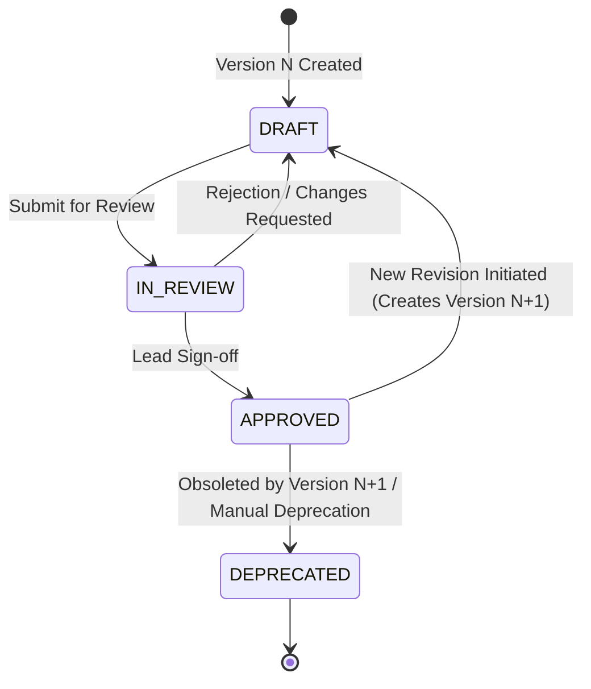
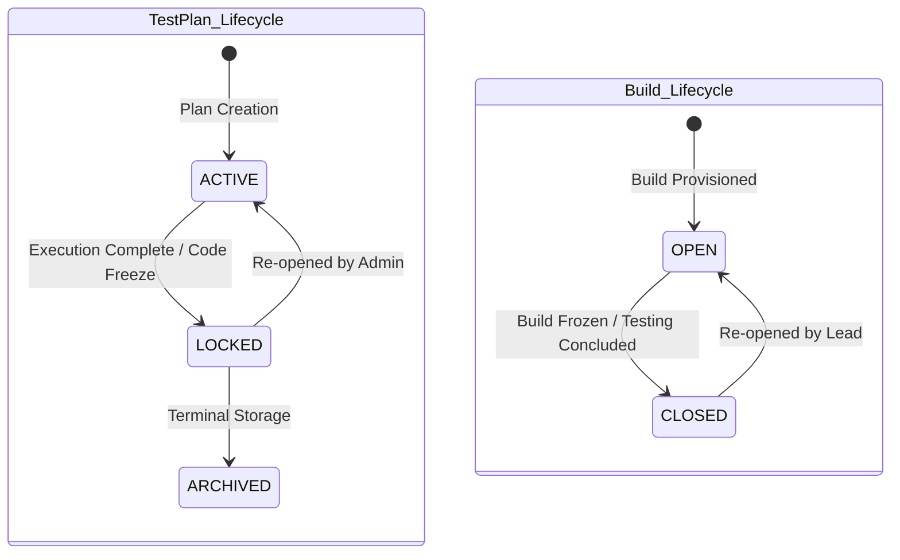
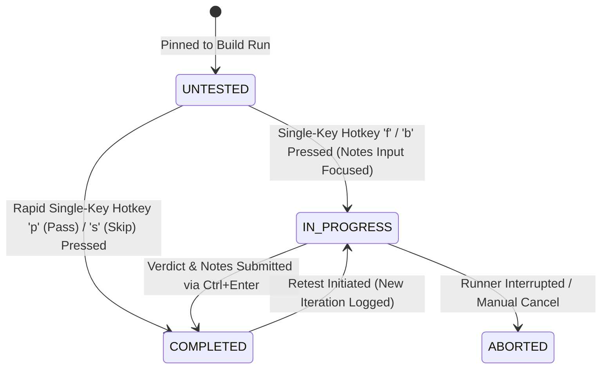
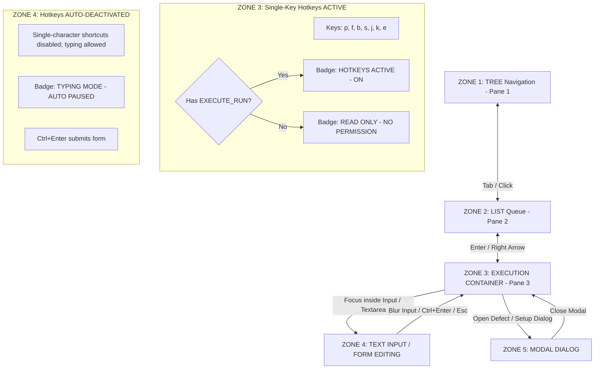
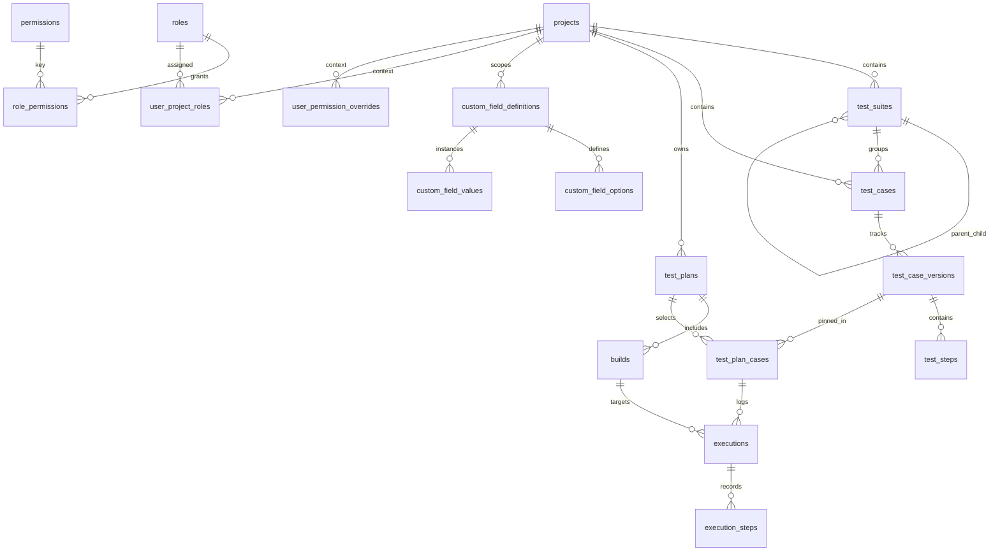

# Master Architecture Blueprint: TestLink Sequel (Next-Gen Test Management Platform)

**Document Status:** Approved & Locked Master Blueprint  
**Date:** September 8, 2026  
**Version:** v1.0 Production Baseline  
**Synthesized From:**  
- [`docs/00_requirements_alignment.md`](file:///home/elliot/Documents/Code/testlink-local/docs/00_requirements_alignment.md)  
- [`docs/rfc_01_domain_model.md`](file:///home/elliot/Documents/Code/testlink-local/docs/rfc_01_domain_model.md)  
- [`docs/rfc_02_ux_density_and_hotkeys.md`](file:///home/elliot/Documents/Code/testlink-local/docs/rfc_02_ux_density_and_hotkeys.md)  
- [`docs/rfc_03_api_and_xml_contracts.md`](file:///home/elliot/Documents/Code/testlink-local/docs/rfc_03_api_and_xml_contracts.md)  
- [`docs/rfc_04_rbac_security_matrix.md`](file:///home/elliot/Documents/Code/testlink-local/docs/rfc_04_rbac_security_matrix.md)  

---

## 1. Executive Summary & System Architecture

TestLink Sequel is an enterprise-grade, modernized test management and execution platform engineered to eliminate TestLink's historical frictions—slow iframe page reloads, fragmented suite navigation, lost step-level history, clunky version branching, and brittle database migrations—while strictly maintaining core enterprise QA mental models (**Test Projects, Test Suites, Test Cases, Test Case Versions, Test Plans, Builds, Executions, and Dynamic Custom Fields**).

```
+---------------------------------------------------------------------------------------------------+
|                                      PRESENTATION & UX LAYER                                      |
|  +---------------------------------------------------------------------------------------------+  |
|  | 3-Pane Topology Workspace (Tree Navigation | Test Queue Grid | Execution & Detail Pane)      |  |
|  | High-Density 32px Layout | Keyboard Focus FSM | RBAC-Gated Hotkeys (p, f, b, s, j, k)       |  |
|  +---------------------------------------------------------------------------------------------+  |
+-------------------------------------------------|-------------------------------------------------+
                                                  | HTTP / RESTful JSON / WebSockets
                                                  v
+---------------------------------------------------------------------------------------------------+
|                                        APPLICATION & API GATEWAY                                  |
|  +---------------------------------------------------------------------------------------------+  |
|  | OpenAPI 3.1 Routing | RFC 7807 Error Handler | Token Bucket Rate Limiter (1,000 / 10,000 rpm)    |  |
|  | Security Middleware | JWT & Machine API Token Validator (tl_live_..., tl_ci_...)              |  |
|  +---------------------------------------------------------------------------------------------+  |
|  +-------------------------------------+       +-----------------------------------------------+  |
|  | Core Spec & Execution Services      |       | Extensible Ingestion & Migration Engine       |  |
|  | (Projects, Suites, Cases, Plans)      |       | (SAX XML, Native JSON Schema, CSV Parsers)    |  |
|  +-------------------------------------+       +-----------------------------------------------+  |
+-------------------------------------------------|-------------------------------------------------+
                                                  | Query Builder Abstraction (Kysely)
                                                  v
+---------------------------------------------------------------------------------------------------+
|                                       DATA & STORAGE PERSISTENCE                                  |
|  +---------------------------------------------------------------------------------------------+  |
|  | Dual-Driver Database Layer: SQLite (Local/Dev) <---> PostgreSQL (Prod/Enterprise)          |  |
|  | UUIDv7 Primary Keys | Strict FK Rules | Append-Only Audit Triggers | Version Freezing     |  |
|  +---------------------------------------------------------------------------------------------+  |
|  +---------------------------------------------------------------------------------------------+  |
|  | Out-of-Band Attachments & Log Storage (`IStorageProvider`: Local FS / AWS S3 MinIO)         |  |
|  +---------------------------------------------------------------------------------------------+  |
+---------------------------------------------------------------------------------------------------+
```

---

## 2. System State Machines

### 2.1 Test Case Version Lifecycle



- **Invariant:** Only `APPROVED` test case versions can be linked to active `TestPlans` (unless the project setting `allow_draft_plan_linking` is explicitly enabled by an Admin).

---

### 2.2 Test Plan & Build Lifecycles



- **HTTP 422 Operational Restriction:** Attempting `POST`, `PUT`, or `DELETE` execution operations against a `CLOSED` Build or `LOCKED`/`ARCHIVED` Test Plan returns **HTTP 422 Unprocessable Entity** (`BUILD_CLOSED` or `PLAN_LOCKED`). Completed execution history remains permanently viewable and exportable.

---

### 2.3 Execution Run & Verdict State Machine



- **Verdict Constants:** `PASSED`, `FAILED`, `BLOCKED`, `SKIPPED`, `RETEST_REQUIRED`, `KNOWN_ISSUE`.

---

### 2.4 Keyboard Focus State Machine



---

## 3. Relational ERD & Database Schema (PostgreSQL & SQLite)

### 3.1 Entity Relationship Diagram (ERD)



---

### 3.2 Unified Dual-Driver SQL DDL

```sql
-- 1. Projects Table
CREATE TABLE projects (
    id VARCHAR(36) NOT NULL PRIMARY KEY, -- UUIDv7
    name VARCHAR(255) NOT NULL,
    prefix VARCHAR(50) NOT NULL UNIQUE,
    description TEXT,
    settings TEXT NOT NULL DEFAULT '{}',
    created_at VARCHAR(30) NOT NULL, -- ISO 8601 UTC
    updated_at VARCHAR(30) NOT NULL
);

-- 2. Recursive Test Suites Table
CREATE TABLE test_suites (
    id VARCHAR(36) NOT NULL PRIMARY KEY,
    project_id VARCHAR(36) NOT NULL REFERENCES projects(id) ON DELETE RESTRICT,
    parent_suite_id VARCHAR(36) REFERENCES test_suites(id) ON DELETE RESTRICT,
    name VARCHAR(255) NOT NULL,
    description TEXT,
    position INT NOT NULL DEFAULT 0,
    path VARCHAR(1000) NOT NULL, -- Materialized path e.g. '/root_uuid/child_uuid'
    created_at VARCHAR(30) NOT NULL,
    updated_at VARCHAR(30) NOT NULL
);
CREATE INDEX idx_test_suites_project ON test_suites(project_id);
CREATE INDEX idx_test_suites_parent ON test_suites(parent_suite_id);

-- 3. Test Cases Master Table
CREATE TABLE test_cases (
    id VARCHAR(36) NOT NULL PRIMARY KEY,
    project_id VARCHAR(36) NOT NULL REFERENCES projects(id) ON DELETE RESTRICT,
    test_suite_id VARCHAR(36) NOT NULL REFERENCES test_suites(id) ON DELETE RESTRICT,
    external_id VARCHAR(100) NOT NULL,
    title VARCHAR(255) NOT NULL,
    priority VARCHAR(10) NOT NULL DEFAULT 'HIGH' CHECK (priority IN ('HIGH', 'MEDIUM', 'LOW', 'CRITICAL', 'P1', 'P2', 'P3', 'P4')),
    execution_type VARCHAR(20) NOT NULL DEFAULT 'MANUAL' CHECK (execution_type IN ('MANUAL', 'AUTOMATED')),
    created_at VARCHAR(30) NOT NULL,
    updated_at VARCHAR(30) NOT NULL,
    CONSTRAINT uq_test_case_external UNIQUE (project_id, external_id)
);
CREATE INDEX idx_test_cases_suite ON test_cases(test_suite_id);

-- 4. Test Case Versions Table
CREATE TABLE test_case_versions (
    id VARCHAR(36) NOT NULL PRIMARY KEY,
    test_case_id VARCHAR(36) NOT NULL REFERENCES test_cases(id) ON DELETE CASCADE,
    version_number INT NOT NULL,
    status VARCHAR(20) NOT NULL DEFAULT 'DRAFT' CHECK (status IN ('DRAFT', 'IN_REVIEW', 'APPROVED', 'DEPRECATED')),
    summary TEXT,
    preconditions TEXT,
    author_id VARCHAR(36) NOT NULL,
    reviewer_id VARCHAR(36),
    created_at VARCHAR(30) NOT NULL,
    updated_at VARCHAR(30) NOT NULL,
    CONSTRAINT uq_case_version UNIQUE (test_case_id, version_number)
);
CREATE INDEX idx_case_versions_lookup ON test_case_versions(test_case_id, status);

-- 5. Test Steps Table
CREATE TABLE test_steps (
    id VARCHAR(36) NOT NULL PRIMARY KEY,
    test_case_version_id VARCHAR(36) NOT NULL REFERENCES test_case_versions(id) ON DELETE CASCADE,
    step_number INT NOT NULL,
    action TEXT NOT NULL,
    expected_result TEXT NOT NULL,
    execution_type VARCHAR(20) NOT NULL DEFAULT 'MANUAL' CHECK (execution_type IN ('MANUAL', 'AUTOMATED')),
    created_at VARCHAR(30) NOT NULL,
    updated_at VARCHAR(30) NOT NULL,
    CONSTRAINT uq_step_order UNIQUE (test_case_version_id, step_number)
);

-- 6. Test Plans Table
CREATE TABLE test_plans (
    id VARCHAR(36) NOT NULL PRIMARY KEY,
    project_id VARCHAR(36) NOT NULL REFERENCES projects(id) ON DELETE RESTRICT,
    name VARCHAR(255) NOT NULL,
    description TEXT,
    status VARCHAR(20) NOT NULL DEFAULT 'ACTIVE' CHECK (status IN ('ACTIVE', 'LOCKED', 'ARCHIVED')),
    created_at VARCHAR(30) NOT NULL,
    updated_at VARCHAR(30) NOT NULL
);
CREATE INDEX idx_test_plans_project ON test_plans(project_id, status);

-- 7. Builds Table
CREATE TABLE builds (
    id VARCHAR(36) NOT NULL PRIMARY KEY,
    test_plan_id VARCHAR(36) NOT NULL REFERENCES test_plans(id) ON DELETE RESTRICT,
    name VARCHAR(255) NOT NULL,
    description TEXT,
    status VARCHAR(20) NOT NULL DEFAULT 'OPEN' CHECK (status IN ('OPEN', 'CLOSED')),
    release_date VARCHAR(30),
    created_at VARCHAR(30) NOT NULL,
    updated_at VARCHAR(30) NOT NULL,
    CONSTRAINT uq_build_plan_name UNIQUE (test_plan_id, name)
);

-- 8. Test Plan Cases Mapping Table
CREATE TABLE test_plan_cases (
    id VARCHAR(36) NOT NULL PRIMARY KEY,
    test_plan_id VARCHAR(36) NOT NULL REFERENCES test_plans(id) ON DELETE RESTRICT,
    test_case_id VARCHAR(36) NOT NULL REFERENCES test_cases(id) ON DELETE RESTRICT,
    test_case_version_id VARCHAR(36) NOT NULL REFERENCES test_case_versions(id) ON DELETE RESTRICT,
    assigned_user_id VARCHAR(36),
    position INT NOT NULL DEFAULT 0,
    custom_fields_snapshot TEXT DEFAULT '{}',
    created_at VARCHAR(30) NOT NULL,
    updated_at VARCHAR(30) NOT NULL,
    CONSTRAINT uq_plan_case UNIQUE (test_plan_id, test_case_id)
);
CREATE INDEX idx_plan_cases_assigned ON test_plan_cases(test_plan_id, assigned_user_id);

-- 9. Executions Table (Immutable Historic Runs)
CREATE TABLE executions (
    id VARCHAR(36) NOT NULL PRIMARY KEY,
    build_id VARCHAR(36) NOT NULL REFERENCES builds(id) ON DELETE RESTRICT,
    test_plan_case_id VARCHAR(36) NOT NULL REFERENCES test_plan_cases(id) ON DELETE RESTRICT,
    tester_id VARCHAR(36) NOT NULL,
    status VARCHAR(20) NOT NULL DEFAULT 'COMPLETED' CHECK (status IN ('UNTESTED', 'IN_PROGRESS', 'COMPLETED', 'ABORTED')),
    verdict VARCHAR(50) NOT NULL CHECK (verdict IN ('PASSED', 'FAILED', 'BLOCKED', 'SKIPPED', 'RETEST_REQUIRED', 'KNOWN_ISSUE')),
    execution_duration_ms INT DEFAULT 0,
    notes TEXT,
    custom_fields_snapshot TEXT DEFAULT '{}',
    execution_timestamp VARCHAR(30) NOT NULL,
    created_at VARCHAR(30) NOT NULL,
    updated_at VARCHAR(30) NOT NULL
);
CREATE INDEX idx_executions_build_case ON executions(build_id, test_plan_case_id);
CREATE INDEX idx_executions_verdict ON executions(verdict);

-- 10. Execution Steps Table
CREATE TABLE execution_steps (
    id VARCHAR(36) NOT NULL PRIMARY KEY,
    execution_id VARCHAR(36) NOT NULL REFERENCES executions(id) ON DELETE CASCADE,
    test_step_id VARCHAR(36) NOT NULL REFERENCES test_steps(id) ON DELETE RESTRICT,
    step_number INT NOT NULL,
    verdict VARCHAR(50) NOT NULL CHECK (verdict IN ('PASSED', 'FAILED', 'BLOCKED', 'SKIPPED', 'UNTESTED')),
    actual_result TEXT,
    created_at VARCHAR(30) NOT NULL
);

-- 11. Append-Only Audit Logs Table
CREATE TABLE audit_logs (
    id VARCHAR(36) NOT NULL PRIMARY KEY,
    actor_id VARCHAR(36) NOT NULL,
    actor_type VARCHAR(32) NOT NULL CHECK (actor_type IN ('USER', 'SERVICE_ACCOUNT', 'SYSTEM')),
    action VARCHAR(64) NOT NULL,
    resource_type VARCHAR(64) NOT NULL,
    resource_id VARCHAR(36) NOT NULL,
    project_id VARCHAR(36),
    diff TEXT NOT NULL DEFAULT '{}',
    ip_address VARCHAR(45),
    user_agent TEXT,
    created_at VARCHAR(30) NOT NULL
);
CREATE INDEX idx_audit_logs_actor ON audit_logs(actor_id, created_at);
CREATE INDEX idx_audit_logs_resource ON audit_logs(resource_type, resource_id);

-- PostgreSQL Immutability Triggers for audit_logs
-- CREATE OR REPLACE FUNCTION suppress_audit_log_mutation() RETURNS TRIGGER AS $$
-- BEGIN RAISE EXCEPTION 'MUTATION_DENIED: audit_logs table is append-only.'; END; $$ LANGUAGE plpgsql;
-- CREATE TRIGGER trg_prevent_audit_update BEFORE UPDATE ON audit_logs FOR EACH ROW EXECUTE FUNCTION suppress_audit_log_mutation();
-- CREATE TRIGGER trg_prevent_audit_delete BEFORE DELETE ON audit_logs FOR EACH ROW EXECUTE FUNCTION suppress_audit_log_mutation();

-- SQLite Immutability Triggers for audit_logs
-- CREATE TRIGGER trg_prevent_audit_update_sq BEFORE UPDATE ON audit_logs BEGIN SELECT RAISE(FAIL, 'MUTATION_DENIED'); END;
-- CREATE TRIGGER trg_prevent_audit_delete_sq BEFORE DELETE ON audit_logs BEGIN SELECT RAISE(FAIL, 'MUTATION_DENIED'); END;
```

---

## 4. Master Hotkey & Interaction Topology

### 4.1 3-Pane Topology Layout Spec

```
+-------------------------------------------------------------------------------------------------------------------------------+
| TOP HEADER: Project Selector | Test Plan Dropdown | Build Selector | Search Bar (/) | User Profile | Global Settings          |
+------------------------------------+------------------------------------+-----------------------------------------------------+
| PANE 1: Suite Tree Navigation      | PANE 2: Suite Test Case Queue      | PANE 3: Execution & Detail Workspace                |
| (260px - 340px Adjustable)         | (380px - 480px Adjustable)         | (Fluid Remaining Width)                             |
|------------------------------------+------------------------------------+-----------------------------------------------------|
| [ Quick Filter Bar               ] | [ Suite: Authentication Engine  ] | [ TC-104: OAuth2 PKCE Token Exchange ] [APPROVED]   |
| [ Status | Priority | Assignee   ] | [ Search Cases... (Ctrl+F)       ] | Priority: HIGH | Assignee: Alex Dev | Build: v2.4.0-rc1   |
|------------------------------------+------------------------------------+-----------------------------------------------------|
| v Auth Suite          [ 12/15 P ]  | [P] TC-101 Login via Password      | > Preconditions (Collapsible)                       |
|   > OAuth2 Sub-suite  [  4/4  P ]  | [P] TC-102 Login via SAML2 SSO     |   User must have valid client credentials in vault. |
|   v Token Refresh     [  1/2  F ]  | > [F] TC-104 OAuth2 PKCE Exchange  |-----------------------------------------------------|
|     * TC-104 PKCE     (Active)     | [B] TC-105 Token Expire Revoke     | Step | Action           | Expected      | Verdict | Notes   |
|     * TC-105 Revoke   [  1/1  B ]  | [S] TC-106 Multi-Tenant Scopes     |   1  | POST /oauth/token| HTTP 200 OK   |  [P]    | OK      |
| > Database Suite      [  0/30 U ]  | [U] TC-107 PKCE Code Verifier      |   2  | Invalid Secret   | HTTP 401 Auth |  [F]    | 500 Err |
| > API Endpoint Suite  [ 50/50 P ]  | [U] TC-108 State Parameter Rej     |-----------------------------------------------------|
|                                    |                                    | Docked Action Bar  [⚡ HOTKEYS: ACTIVE (ON) [p,f,b,s]] |
|                                    |                                    | [P] Pass (p) | [F] Fail (f) | [B] Block (b) | [S] Skip |
+------------------------------------+------------------------------------+-----------------------------------------------------+
| FOOTER: Keyboard Focus Zone: [Pane 3 - Execution Form] | Hotkeys: ACTIVE | Sync Status: Connected (0 pending ops)             |
+-------------------------------------------------------------------------------------------------------------------------------+
```

- **Row Density Rules:** Pane 2 tabular grid height locked to `32px` (`4px` padding). Pane 1 tree nodes locked to `28px` (`3px` padding).
- **Virtual Scrolling:** Virtualized DOM list rendering via `@tanstack/react-virtual` capping DOM nodes at `~45` items for 5,000+ item suites (<50ms keystroke target budget).

---

### 4.2 Master Hotkey Matrix

| Key | Action Description | Target Scope | Conditions & Auto-Advance Behavior | RBAC Key Required |
| :--- | :--- | :--- | :--- | :--- |
| `j` / `Down` | Move to next test case in queue | Pane 2 / Pane 3 | Shifts active row selection down by 1. | `SPEC_VIEW` |
| `k` / `Up` | Move to prev test case in queue | Pane 2 / Pane 3 | Shifts active row selection up by 1. | `SPEC_VIEW` |
| `[` | Collapse current suite in tree | Pane 1 Navigation | Toggles suite folder collapse state. | `SPEC_VIEW` |
| `]` | Expand current suite in tree | Pane 1 Navigation | Toggles suite folder expand state. | `SPEC_VIEW` |
| `/` | Focus search & filter bar | Global Top Bar | Focuses search input; auto-pauses single-key hotkeys. | `SPEC_VIEW` |
| `Esc` | Clear focus / return to list nav | Any Input / Modal | Blurs input; re-engages execution hotkeys. | N/A |
| `p` | Mark active case as **PASSED** | Pane 3 Execution | Commits `verdict=PASSED`, `status=COMPLETED`; advances case. | `EXECUTE_RUN` |
| `f` | Mark active case as **FAILED** | Pane 3 Execution | Sets `verdict=FAILED`, `status=IN_PROGRESS`; focuses notes input. | `EXECUTE_RUN` |
| `b` | Mark active case as **BLOCKED** | Pane 3 Execution | Sets `verdict=BLOCKED`, `status=IN_PROGRESS`; opens defect modal. | `EXECUTE_RUN` |
| `s` | Mark active case as **SKIPPED** | Pane 3 Execution | Commits `verdict=SKIPPED`, `status=COMPLETED`; advances case. | `EXECUTE_RUN` |
| `e` | Toggle step execution drawer | Pane 3 Execution | Opens step-by-step evaluation drawer. | `EXECUTE_RUN` |
| `Ctrl+Enter` | Submit execution form & notes | Pane 3 Form | Commits `status=COMPLETED`, `verdict`, and input notes. | `EXECUTE_RUN` |

---

## 5. Complete OpenAPI 3.1 Specification & Ingestion Pipeline

### 5.1 Core Endpoint Catalog

- `GET /api/v1/projects/{project_id}/test-suites` - List recursive suite tree
- `POST /api/v1/test-suites/{suite_id}/test-cases` - Create test case & `v1` draft spec
- `POST /api/v1/projects/{project_id}/test-plans` - Create Test Plan
- `PUT /api/v1/test-plans/{plan_id}/status` - Transition plan status (`ACTIVE`, `LOCKED`, `ARCHIVED`)
- `POST /api/v1/test-plans/{plan_id}/builds` - Provision new build iteration
- `POST /api/v1/test-plans/{plan_id}/builds/{build_id}/executions/batch` - High-throughput CI/CD batch ingestion
- `POST /api/v1/imports/dry-run` - Multi-format streaming dry-run diff preview
- `POST /api/v1/imports/execute` - Multi-format stream commit pipeline
- `POST /api/v1/executions/{id}/attachments/presign` - Direct S3 pre-signed upload URL generation

---

### 5.2 High-Throughput CI/CD Ingestion Schema (`POST /executions/batch`)

`POST /api/v1/test-plans/{plan_id}/builds/{build_id}/executions/batch?all_or_nothing=false`

```json
{
  "environment": "staging-us-east-1",
  "runner_info": {
    "name": "GitHub Actions",
    "run_id": "98124712",
    "commit_sha": "a1b2c3d4e5f67890123456789abcdef012345678"
  },
  "executions": [
    {
      "case_identifier": { "external_id": "TC-Auth-102" },
      "verdict": "PASSED",
      "status": "COMPLETED",
      "duration_ms": 3420,
      "executed_at": "2026-09-08T13:15:00Z",
      "notes": "Test executed successfully in Chrome headless.",
      "step_results": [
        { "step_number": 1, "verdict": "PASSED", "actual_result": "Tokens generated." },
        { "step_number": 2, "verdict": "PASSED", "actual_result": "Token family revoked." }
      ]
    },
    {
      "case_identifier": {
        "by_path_title": { "suite_path": "Payments / Checkout", "title": "Stripe 3DS Flow" }
      },
      "verdict": "FAILED",
      "status": "COMPLETED",
      "duration_ms": 12450,
      "executed_at": "2026-09-08T13:15:05Z",
      "stack_trace": "TimeoutError: element (#stripe-iframe) not visible",
      "step_results": [
        { "step_number": 1, "verdict": "PASSED", "actual_result": "Cart initialized." },
        { "step_number": 2, "verdict": "FAILED", "actual_result": "Iframe timeout." }
      ]
    }
  ]
}
```

---

### 5.3 Extensible Multi-Format Ingestion Engine (`IFileParser`)

The ingestion engine parses legacy **TestLink XML**, **Native JSON Schema**, and **CSV** tabular spec sheets using streaming SAX parsers (<64MB memory heap bound on 100MB+ files).

```
[Import Payload (XML/JSON/CSV)] ---> [SAX Event Stream Parser (<64MB Heap)]
                                                     |
                                                     v
                                [Phase 1: Dry-Run Inspection & Modals]
                                ├── Custom Field Setup Modal (Drop / Auto-Create / Route)
                                └── Duplicate Reconciliation Modal (Create / Overwrite / Version Up / Skip)
                                                     |
                                                     v
                                [Phase 2: Atomic Batch Write Engine (POST /imports/execute)]
```

---

### 5.4 Out-of-Band Attachments Driver (`IStorageProvider`)

- Execution history default retention: **365 days (1 year)**, admin-modifiable.
- Log snippets >4KB and binary attachments are stored out-of-band via `IStorageProvider`:
  - `LocalStorageProvider` (Local FS for dev/SQLite).
  - `S3StorageProvider` (MinIO/S3 pre-signed upload URLs for prod/PostgreSQL).

---

## 6. Granular RBAC, Security & Audit Matrix

### 6.1 Permission Key Registry & Role Matrix

| Permission Key | Namespace | Admin | Test Lead | Tester / QA | Automation Service | Viewer |
| :--- | :--- | :---: | :---: | :---: | :---: | :---: |
| `SYSTEM_ADMIN` | System | **✓ (Global)** | ✗ | ✗ | ✗ | ✗ |
| `PROJECT_CREATE` | Workspace | **✓ (Global)** | ✗ | ✗ | ✗ | ✗ |
| `PROJECT_DELETE` | Workspace | **✓** | ✗ | ✗ | ✗ | ✗ |
| `USER_MANAGE` | System | **✓** | ✗ | ✗ | ✗ | ✗ |
| `SPEC_VIEW` | Authoring | **✓** | **✓** | **✓** | **✓** | **✓** |
| `SPEC_CREATE` | Authoring | **✓** | **✓** | **✓** | ✗ | ✗ |
| `SPEC_EDIT` | Authoring | **✓** | **✓** | **✓** | ✗ | ✗ |
| `SPEC_APPROVE` | Authoring | **✓** | **✓** | ✗ | ✗ | ✗ |
| `SPEC_DELETE` | Authoring | **✓** | **✓** | ✗ | ✗ | ✗ |
| `PLAN_MANAGE` | Execution | **✓** | **✓** | ✗ | ✗ | ✗ |
| `BUILD_MANAGE` | Execution | **✓** | **✓** | ✗ | **✓ (Read)** | ✗ |
| `EXECUTE_RUN` | Execution | **✓** | **✓** | **✓** | **✓** | ✗ |
| `EXECUTE_OVERWRITE` | Execution | **✓** | **✓** | ✗ | ✗ | ✗ |
| `IMPORT_DATA` | Integrations | **✓** | **✓** | ✗ | ✗ | ✗ |
| `EXPORT_DATA` | Integrations | **✓** | **✓** | **✓** | ✗ | **✓** |
| `API_TOKEN_MANAGE` | Integrations | **✓** | **✓** | ✗ | ✗ | ✗ |

- **Precedence Order:** $$\text{User Project Override} \succ \text{User System Override} \succ \text{Project Role Grant} \succ \text{Global Role Grant} \succ \text{Default Deny}$$

---

### 6.2 Machine API Token Security Protocol

- **Token Format:** Prefixed entropy strings (`tl_live_...`, `tl_ci_...`).
- **Disclosure:** Revealed **strictly once** in UI/API response upon creation.
- **Storage:** Argon2id or SHA-256 salted hashes stored in `api_tokens` table.
- **Scoping:** Bound strictly to target `project_id` and allowed capability array (`['EXECUTE_RUN', 'SPEC_VIEW']`).

---

## 7. End-to-End Requirement Verification Matrix

| # | Requirement Topic | Specific Requirement Rule | Primary Target RFC Section | Blueprint Section | Verification Method | Status |
| :--- | :--- | :--- | :--- | :--- | :--- | :--- |
| 1 | **Data Retention** | Default purge threshold 365 days; admin-modifiable. | `00_alignment` §1, `rfc_01` §2.5 | Section 5.4 | Cron job unit test & admin config validation | Locked |
| 2 | **Attachments Storage** | Out-of-band storage via `IStorageProvider` (Local FS / S3). | `00_alignment` §1, `rfc_03` §5.2 | Section 5.4 | Pre-signed URL integration test | Locked |
| 3 | **Audit Retention** | Append-only in primary DB; no auto-deletion; DB triggers block UPDATE/DELETE. | `00_alignment` §1, `rfc_04` §5.2 | Section 3.2 | Trigger rejection SQL test (`MUTATION_DENIED`) | Locked |
| 4 | **Suite Mutability** | Suite tree structure is mutable across historical Test Plans. | `00_alignment` §2, `rfc_01` §2.2 | Section 2.1 | Suite move tree test without execution breakage | Locked |
| 5 | **Version Freezing** | Locking/archiving Test Plan freezes `TestCaseVersion` & custom fields snapshot. | `00_alignment` §2, `rfc_01` §2.3 | Section 2.1 | Case spec edit assertion on locked plan | Locked |
| 6 | **Draft Case Rule** | Draft cases disallowed in active Test Plans by default. | `00_alignment` §2, `rfc_01` §2.3 | Section 2.1 | Linking API rejection test (`HTTP 422`) | Locked |
| 7 | **Locked Plan Writes** | Read-only access; write posts return HTTP 422 (`BUILD_CLOSED`/`PLAN_LOCKED`). | `00_alignment` §2, `rfc_03` §4.1 | Section 2.2 | `POST /executions/batch` HTTP 422 assertion | Locked |
| 8 | **Hotkey Scope** | Hotkeys active ONLY in Execution Pane; visual state badge indicator. | `00_alignment` §3, `rfc_02` §5.1 | Section 4.1 | React component focus state test | Locked |
| 9 | **Input Protection** | Focus into text input/area auto-deactivates hotkeys (no `Esc` required). | `00_alignment` §3, `rfc_02` §5.3 | Section 2.4 | Playwright E2E typing focus test | Locked |
| 10 | **RBAC Hotkey Gate** | Single-key execution hotkeys gated behind `EXECUTE_RUN` permission key. | `rfc_02` §5.3, `rfc_04` §3.2 | Section 4.2 | Unprivileged user keypress toast test | Locked |
| 11 | **Multi-Format Import** | Extensible parser engine supporting TestLink XML, JSON Schema, and CSV. | `00_alignment` §4, `rfc_03` §6.1 | Section 5.3 | Multi-format streaming parser unit test | Locked |
| 12 | **Import Reconciliation**| Setup modals for Custom Field mapping and Duplicate title resolution. | `00_alignment` §4, `rfc_03` §6.4 | Section 5.3 | Interactive dry-run import API test | Locked |
| 13 | **Streaming Ingestion**| SAX stream parsing bounded to <64MB heap on 100MB+ files. | `00_alignment` §4, `rfc_03` §6.3 | Section 5.3 | Memory heap profiling test on 100MB XML | Locked |
| 14 | **Dual-Driver Parity** | 100% parity across SQLite (local/dev) and PostgreSQL (production). | `rfc_01` §4.2 | Section 3.2 | Cross-database integration test suite | Locked |
