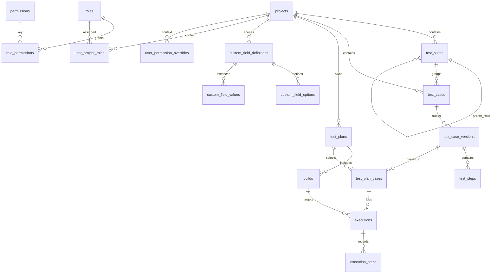
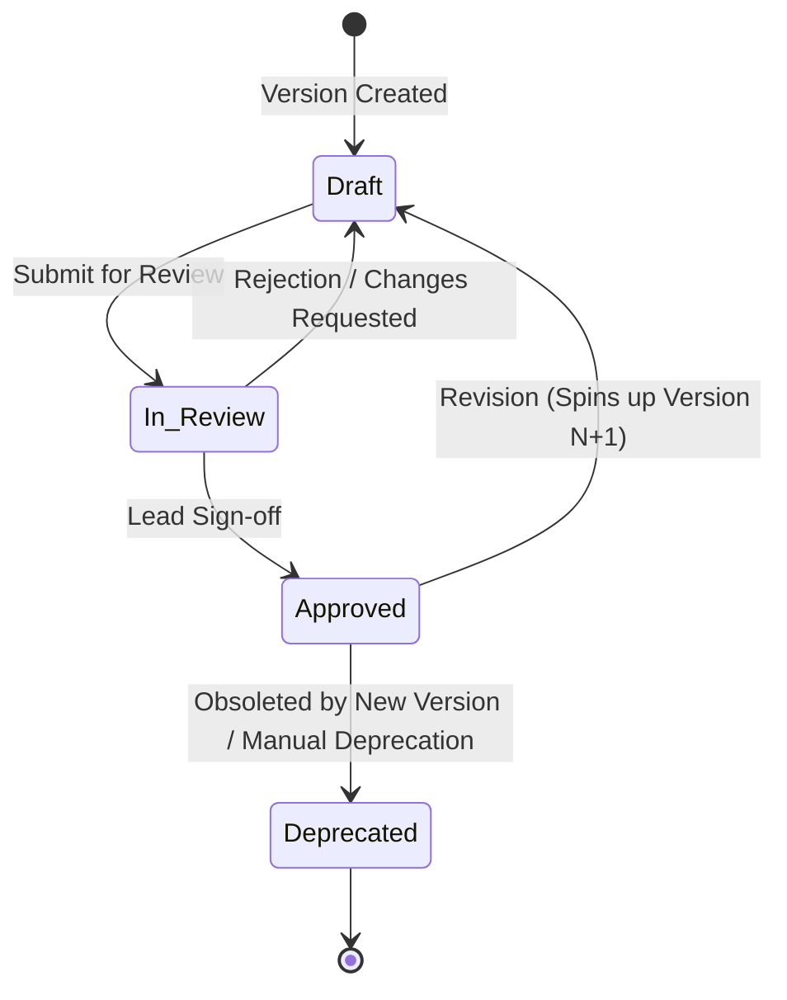
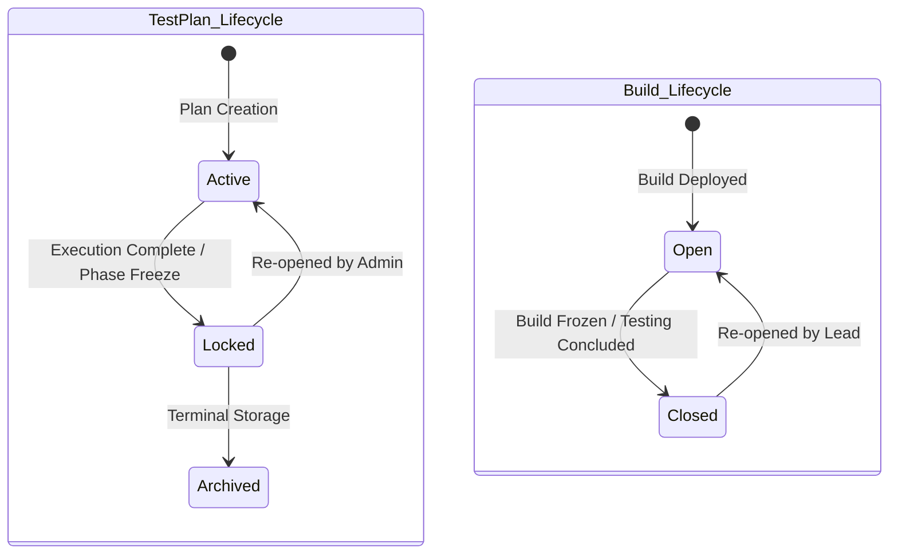
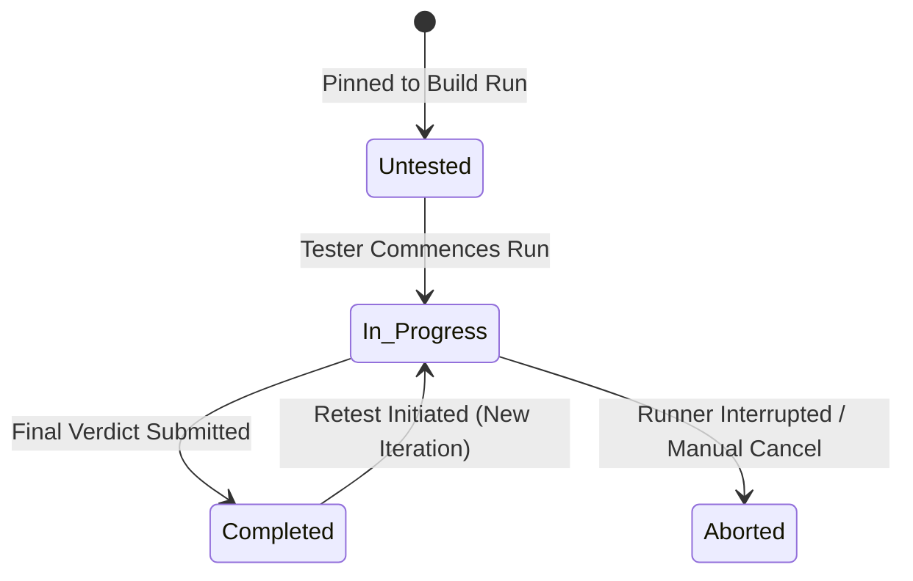

# RFC 01: Core Domain Model, Relational Architecture & State Machines

**Status:** Draft / Approved Design (Amended 2026-09-11)  
**Author:** Lead System Architect & QA Domain Specialist  
**Target Platform:** TestLink Sequel Modernized Execution & Management Platform  
**Date:** September 8, 2026  

> **2026-09-11 amendment:** Section 4 originally specified a dual-driver database layer
> supporting both a native SQLite engine and PostgreSQL. That native SQLite driver
> (`better-sqlite3`) proved unreliable across dev machines and CI runners -- its prebuilt
> binary is sensitive to the host's glibc version and frequently fails to load. The project
> dropped native SQLite support and standardized on a single Postgres-compatible SQL dialect:
> an embedded, zero-config `PGlite` (WASM Postgres) instance for local/offline use, and a real
> PostgreSQL server for production/team deployments. Section 4 below reflects that decision;
> the rest of this document (domain model, ERD, state machines, RBAC, custom fields) is
> unaffected and still describes the current architecture. See `AGENTS.md` for implementation
> detail.

---

## 1. Executive Summary & Foundational Architectural Constraints

This Request for Comments (RFC) establishes the foundational domain model, database normalization schema, state machines, granular permission matrix, and dynamic extension engine for the modernized TestLink platform. The architecture is engineered to eliminate TestLink’s legacy pain points—such as slow tree rendering, step-level data loss during re-runs, ambiguous build assignments, and schema upgrade lock-in—while strictly preserving core enterprise QA abstractions: **Test Projects, Test Suites, Test Cases, Test Case Versions, Test Plans, Builds, Executions, and Dynamic Custom Fields**.

```
                           +-------------------------------------+
                           |            Test Project             |
                           +-------------------------------------+
                                              | 1
                                              |
                                              | N
                           +-------------------------------------+
                           |      Test Suite Tree (Recursive)    |
                           +-------------------------------------+
                                              | 1
                                              |
                                              | N
                           +-------------------------------------+
                           |              Test Case              |
                           +-------------------------------------+
                                              | 1
                                              |
                                              | N
                           +-------------------------------------+
                           |  Test Case Version (Mutable Draft)  |
                           +-------------------------------------+
                                              |
                                     (Pinned / Frozen Snapshot)
                                              |
                                              v
+-----------------------+ 1                  N +-------------------------------------+
|       Test Plan       |--------------------->|           Test Plan Case            |
+-----------------------+                      +-------------------------------------+
            | 1                                                   | 1
            |                                                     |
            | N                                                   | N
+-----------------------+                      +-------------------------------------+
|         Build         |--------------------->|         Test Run Execution          |
+-----------------------+ 1                  N +-------------------------------------+
                                                                  | 1
                                                                  | N
                                               +-------------------------------------+
                                               |           Execution Step            |
                                               +-------------------------------------+
```

### Core Constraints & Guarantees

1. **Single Postgres-Compatible Dialect:** The system targets Postgres-compatible SQL everywhere: a zero-config, embedded `PGlite` (WASM Postgres) instance for local/offline use and evaluation, and a real multi-node PostgreSQL server for high-scale enterprise teams -- the same SQL dialect in both cases, so there is no cross-dialect compatibility surface to maintain. Vendor-specific SQL ENUMs and procedures remain avoided in favor of string constants with `CHECK` constraints, matching the schema's original intent, but for portability of the schema and tooling rather than dual-driver necessity.
2. **Domain Separation (Spec vs. Execution):** Test specifications (suites, test case versions, steps) are mutable design assets. Executions (test plan cases, build runs, step verdicts) are immutable historic snapshots. Mutating a test specification after execution never alters past test execution history or audit logs.
3. **Primary Key Standard:** All primary keys utilize **UUIDv7** (128-bit time-ordered UUIDs). This guarantees monotonic indexing performance comparable to auto-incrementing integers while allowing client-side safe ID generation and distributed multi-region safety.
4. **Admin Extensibility:** Dynamic Custom Fields, RBAC permission overrides, and verdict workflows are defined via data schemas rather than code modifications.

---

## 2. Specification vs. Execution Boundary & Version Freezing

### 2.1 Domain Separation Architecture

The domain model enforces a strict architectural wall between the **Test Specification Domain** (authoring and maintaining test cases) and the **Test Execution Domain** (planning, building, running, and auditing test results).

```
===================================================================================
                       TEST SPECIFICATION DOMAIN (MUTABLE)
===================================================================================
  [Project] ---> [TestSuite Tree] ---> [TestCase] ---> [TestCaseVersion (Draft/Approved)]
                                                                |
                                                                | (Test Steps)
                                                                v
                                                         [TestStep 1..N]
===================================================================================
                                      ||  PINNED FREEZE BOUNDARY
                                      \/
===================================================================================
                        TEST EXECUTION DOMAIN (IMMUTABLE)
===================================================================================
  [TestPlan] ---> [Build (Open/Closed)] ---> [TestPlanCase (Pinned Version + Custom Fields Snapshot)]
                                                          |
                                                          v
                                             [Execution Run (Iteration 1..N)]
                                                          |
                                                          v
                                             [ExecutionStep Verdicts 1..N]
===================================================================================
```

### 2.2 Suite Hierarchy Mutability

Unlike rigid snapshot systems that clone entire suite trees for every test plan, the **Test Suite Tree is live and mutable**:
- Reordering, moving, or renaming test suites does not force a suite-tree snapshot. This maintains rapid navigation and low storage overhead.
- When querying historical execution metrics for a suite path, the execution records resolve the case's current suite placement or historic suite path at execution time, recorded in the immutable execution log.

### 2.3 Version Freezing & Pinning Mechanics

1. **Explicit Version Pinning:** When a `TestCase` is attached to a `TestPlan`, a `test_plan_cases` mapping row is generated, locking `(test_plan_id, test_case_id, test_case_version_id)`. Only versions in the `Approved` state can be linked to active test plans (unless the project-level setting `allow_draft_plan_linking` is explicitly enabled).
2. **Specification Isolation:** If an author creates a new revision of an approved test case, the system increments `version_number` and sets the state to `Draft`. The existing `test_plan_cases` mapping remains pinned to the previously approved `test_case_version_id`.
3. **Explicit Version Upgrade:** A Test Lead can selectively trigger a version upgrade for a test plan case. Upgrades overwrite `test_case_version_id` in `test_plan_cases` for *unexecuted* runs. Completed executions retain their original `test_case_version_id` reference forever.
4. **Custom Field Freezing:** At the moment of execution creation (`executions` row), the current definitions and values of custom fields attached to the `TestCaseVersion` and `TestPlanCase` are serialized into `custom_fields_snapshot` (JSON). Future edits to custom field definitions do not distort historical execution records.

### 2.4 Operational Restrictions on Closed Entities

- **Closed Builds & Locked Plans:** If a `Build` is set to `Closed` or a `TestPlan` is set to `Locked` / `Archived`, the application server enforces a strict write block.
- **HTTP Error Contract:** Any `POST`, `PUT`, or `DELETE` mutation targeting executions against a locked plan or closed build immediately terminates with **HTTP 422 Unprocessable Entity** carrying error codes `PLAN_LOCKED` or `BUILD_CLOSED`.

### 2.5 Retention, Archival & Attachment Storage

- **Execution History Retention:** Execution data remains active for a default threshold of **365 days** (configurable per project/system). Administrative batch routines clean up older executions while preserving high-level aggregate pass/fail metrics.
- **Audit Logs:** The `audit_logs` table is an append-only ledger with **no automatic deletion**. Deletions can only be executed by a System Administrator.
- **Binary & Log Storage Abstraction:** Large log outputs, stack traces, and test attachments are stored **out-of-band** (not as SQL text/BLOB columns).
  - **Local / Zero-Config (PGlite):** Stored on the local filesystem (`/var/app/data/attachments/`).
  - **Production (PostgreSQL):** Stored via S3 abstraction API (AWS S3, MinIO, or Cloudflare R2).

---

## 3. Comprehensive Relational Schema & Data Dictionary

### 3.1 Entity Relationship Diagram (ERD)



---

### 3.2 SQL DDL Specifications & Tables Data Dictionary

#### 3.2.1 Core Test Specification Tables

```sql
-- Projects Table
CREATE TABLE projects (
    id VARCHAR(36) NOT NULL PRIMARY KEY, -- UUIDv7
    name VARCHAR(255) NOT NULL,
    prefix VARCHAR(50) NOT NULL UNIQUE, -- e.g. 'TL', 'CORE'
    description TEXT,
    settings TEXT NOT NULL DEFAULT '{}', -- JSON configuration object
    created_at VARCHAR(30) NOT NULL, -- ISO 8601 UTC
    updated_at VARCHAR(30) NOT NULL
);

-- Recursive Test Suites Table
CREATE TABLE test_suites (
    id VARCHAR(36) NOT NULL PRIMARY KEY,
    project_id VARCHAR(36) NOT NULL REFERENCES projects(id) ON DELETE RESTRICT,
    parent_suite_id VARCHAR(36) REFERENCES test_suites(id) ON DELETE RESTRICT,
    name VARCHAR(255) NOT NULL,
    description TEXT,
    position INT NOT NULL DEFAULT 0,
    path VARCHAR(1000) NOT NULL, -- Materialized path e.g. '/root_uuid/child_uuid'
    created_at VARCHAR(30) NOT NULL,
    updated_at VARCHAR(30) NOT NULL
);
CREATE INDEX idx_test_suites_project ON test_suites(project_id);
CREATE INDEX idx_test_suites_parent ON test_suites(parent_suite_id);
CREATE INDEX idx_test_suites_path ON test_suites(path);

-- Test Cases Master Table
CREATE TABLE test_cases (
    id VARCHAR(36) NOT NULL PRIMARY KEY,
    project_id VARCHAR(36) NOT NULL REFERENCES projects(id) ON DELETE RESTRICT,
    test_suite_id VARCHAR(36) NOT NULL REFERENCES test_suites(id) ON DELETE RESTRICT,
    external_id VARCHAR(100) NOT NULL, -- e.g. 'TL-101'
    title VARCHAR(255) NOT NULL,
    priority VARCHAR(10) NOT NULL DEFAULT 'HIGH' CHECK (priority IN ('HIGH', 'MEDIUM', 'LOW', 'CRITICAL', 'P1', 'P2', 'P3', 'P4')),
    execution_type VARCHAR(20) NOT NULL DEFAULT 'MANUAL' CHECK (execution_type IN ('MANUAL', 'AUTOMATED')),
    created_at VARCHAR(30) NOT NULL,
    updated_at VARCHAR(30) NOT NULL,
    CONSTRAINT uq_test_case_external UNIQUE (project_id, external_id)
);
CREATE INDEX idx_test_cases_suite ON test_cases(test_suite_id);

-- Test Case Versions Table
CREATE TABLE test_case_versions (
    id VARCHAR(36) NOT NULL PRIMARY KEY,
    test_case_id VARCHAR(36) NOT NULL REFERENCES test_cases(id) ON DELETE CASCADE,
    version_number INT NOT NULL,
    status VARCHAR(20) NOT NULL DEFAULT 'DRAFT' CHECK (status IN ('DRAFT', 'IN_REVIEW', 'APPROVED', 'DEPRECATED')),
    summary TEXT,
    preconditions TEXT,
    author_id VARCHAR(36) NOT NULL,
    reviewer_id VARCHAR(36),
    created_at VARCHAR(30) NOT NULL,
    updated_at VARCHAR(30) NOT NULL,
    CONSTRAINT uq_case_version UNIQUE (test_case_id, version_number)
);
CREATE INDEX idx_case_versions_lookup ON test_case_versions(test_case_id, status);

-- Test Steps Table
CREATE TABLE test_steps (
    id VARCHAR(36) NOT NULL PRIMARY KEY,
    test_case_version_id VARCHAR(36) NOT NULL REFERENCES test_case_versions(id) ON DELETE CASCADE,
    step_number INT NOT NULL,
    action TEXT NOT NULL,
    expected_result TEXT NOT NULL,
    execution_type VARCHAR(20) NOT NULL DEFAULT 'MANUAL' CHECK (execution_type IN ('MANUAL', 'AUTOMATED')),
    created_at VARCHAR(30) NOT NULL,
    updated_at VARCHAR(30) NOT NULL,
    CONSTRAINT uq_step_order UNIQUE (test_case_version_id, step_number)
);
```

#### 3.2.2 Test Execution Tables

```sql
-- Test Plans Table
CREATE TABLE test_plans (
    id VARCHAR(36) NOT NULL PRIMARY KEY,
    project_id VARCHAR(36) NOT NULL REFERENCES projects(id) ON DELETE RESTRICT,
    name VARCHAR(255) NOT NULL,
    description TEXT,
    status VARCHAR(20) NOT NULL DEFAULT 'ACTIVE' CHECK (status IN ('ACTIVE', 'LOCKED', 'ARCHIVED')),
    created_at VARCHAR(30) NOT NULL,
    updated_at VARCHAR(30) NOT NULL
);
CREATE INDEX idx_test_plans_project ON test_plans(project_id, status);

-- Builds Table
CREATE TABLE builds (
    id VARCHAR(36) NOT NULL PRIMARY KEY,
    test_plan_id VARCHAR(36) NOT NULL REFERENCES test_plans(id) ON DELETE RESTRICT,
    name VARCHAR(255) NOT NULL,
    description TEXT,
    status VARCHAR(20) NOT NULL DEFAULT 'OPEN' CHECK (status IN ('OPEN', 'CLOSED')),
    release_date VARCHAR(30),
    created_at VARCHAR(30) NOT NULL,
    updated_at VARCHAR(30) NOT NULL,
    CONSTRAINT uq_build_plan_name UNIQUE (test_plan_id, name)
);

-- Test Plan Cases Mapping Table (Pinned Versions)
CREATE TABLE test_plan_cases (
    id VARCHAR(36) NOT NULL PRIMARY KEY,
    test_plan_id VARCHAR(36) NOT NULL REFERENCES test_plans(id) ON DELETE RESTRICT,
    test_case_id VARCHAR(36) NOT NULL REFERENCES test_cases(id) ON DELETE RESTRICT,
    test_case_version_id VARCHAR(36) NOT NULL REFERENCES test_case_versions(id) ON DELETE RESTRICT,
    assigned_user_id VARCHAR(36),
    position INT NOT NULL DEFAULT 0,
    custom_fields_snapshot TEXT DEFAULT '{}', -- JSON Snapshot at assignment
    created_at VARCHAR(30) NOT NULL,
    updated_at VARCHAR(30) NOT NULL,
    CONSTRAINT uq_plan_case UNIQUE (test_plan_id, test_case_id)
);
CREATE INDEX idx_plan_cases_assigned ON test_plan_cases(test_plan_id, assigned_user_id);

-- Executions Table (Immutable Historical Runs)
CREATE TABLE executions (
    id VARCHAR(36) NOT NULL PRIMARY KEY,
    build_id VARCHAR(36) NOT NULL REFERENCES builds(id) ON DELETE RESTRICT,
    test_plan_case_id VARCHAR(36) NOT NULL REFERENCES test_plan_cases(id) ON DELETE RESTRICT,
    tester_id VARCHAR(36) NOT NULL,
    status VARCHAR(20) NOT NULL DEFAULT 'COMPLETED' CHECK (status IN ('UNTESTED', 'IN_PROGRESS', 'COMPLETED', 'ABORTED')),
    verdict VARCHAR(50) NOT NULL CHECK (verdict IN ('PASSED', 'FAILED', 'BLOCKED', 'SKIPPED', 'RETEST_REQUIRED', 'KNOWN_ISSUE')),
    execution_duration_ms INT DEFAULT 0,
    notes TEXT,
    custom_fields_snapshot TEXT DEFAULT '{}', -- Frozen custom fields
    execution_timestamp VARCHAR(30) NOT NULL,
    created_at VARCHAR(30) NOT NULL,
    updated_at VARCHAR(30) NOT NULL
);
CREATE INDEX idx_executions_build_case ON executions(build_id, test_plan_case_id);
CREATE INDEX idx_executions_verdict ON executions(verdict);
CREATE INDEX idx_executions_timestamp ON executions(execution_timestamp);

-- Execution Steps Table
CREATE TABLE execution_steps (
    id VARCHAR(36) NOT NULL PRIMARY KEY,
    execution_id VARCHAR(36) NOT NULL REFERENCES executions(id) ON DELETE CASCADE,
    test_step_id VARCHAR(36) NOT NULL REFERENCES test_steps(id) ON DELETE RESTRICT,
    step_number INT NOT NULL,
    verdict VARCHAR(50) NOT NULL CHECK (verdict IN ('PASSED', 'FAILED', 'BLOCKED', 'SKIPPED', 'UNTESTED')),
    actual_result TEXT,
    created_at VARCHAR(30) NOT NULL
);
CREATE INDEX idx_exec_steps_run ON execution_steps(execution_id);
```

#### 3.2.3 Admin & Extensibility Tables

```sql
-- Audit Logs Table
CREATE TABLE audit_logs (
    id VARCHAR(36) NOT NULL PRIMARY KEY,
    entity_type VARCHAR(50) NOT NULL,
    entity_id VARCHAR(36) NOT NULL,
    action VARCHAR(50) NOT NULL, -- e.g. 'CREATE', 'UPDATE', 'EXECUTE', 'ROLE_CHANGE'
    actor_id VARCHAR(36) NOT NULL,
    metadata TEXT NOT NULL DEFAULT '{}', -- JSON payload of change diff
    created_at VARCHAR(30) NOT NULL
);
CREATE INDEX idx_audit_entity ON audit_logs(entity_type, entity_id);
CREATE INDEX idx_audit_actor ON audit_logs(actor_id);

-- Custom Field Definitions
CREATE TABLE custom_field_definitions (
    id VARCHAR(36) NOT NULL PRIMARY KEY,
    project_id VARCHAR(36) REFERENCES projects(id) ON DELETE RESTRICT, -- NULL = System Global
    entity_type VARCHAR(50) NOT NULL CHECK (entity_type IN ('TestCaseVersion', 'TestSuite', 'Execution', 'Project')),
    name VARCHAR(100) NOT NULL,
    field_label VARCHAR(255) NOT NULL,
    field_type VARCHAR(30) NOT NULL CHECK (field_type IN ('STRING', 'NUMBER', 'BOOLEAN', 'DATE', 'SINGLE_SELECT', 'MULTI_SELECT', 'MARKDOWN_TEXT')),
    is_required BOOLEAN NOT NULL DEFAULT 0,
    default_value TEXT,
    validation_regex VARCHAR(255),
    created_at VARCHAR(30) NOT NULL,
    updated_at VARCHAR(30) NOT NULL,
    CONSTRAINT uq_custom_field_name UNIQUE (project_id, entity_type, name)
);

-- Custom Field Dropdown Options
CREATE TABLE custom_field_options (
    id VARCHAR(36) NOT NULL PRIMARY KEY,
    custom_field_definition_id VARCHAR(36) NOT NULL REFERENCES custom_field_definitions(id) ON DELETE CASCADE,
    option_label VARCHAR(255) NOT NULL,
    option_value VARCHAR(255) NOT NULL,
    position INT NOT NULL DEFAULT 0
);

-- Custom Field Normalized Storage
CREATE TABLE custom_field_values (
    id VARCHAR(36) NOT NULL PRIMARY KEY,
    custom_field_definition_id VARCHAR(36) NOT NULL REFERENCES custom_field_definitions(id) ON DELETE RESTRICT,
    entity_type VARCHAR(50) NOT NULL,
    entity_id VARCHAR(36) NOT NULL,
    string_value TEXT,
    number_value REAL,
    boolean_value BOOLEAN,
    date_value VARCHAR(30),
    json_value TEXT, -- Used for MULTI_SELECT array or composite data
    created_at VARCHAR(30) NOT NULL,
    updated_at VARCHAR(30) NOT NULL,
    CONSTRAINT uq_field_value_entity UNIQUE (custom_field_definition_id, entity_type, entity_id)
);
CREATE INDEX idx_field_values_lookup ON custom_field_values(entity_type, entity_id);

-- RBAC Roles
CREATE TABLE roles (
    id VARCHAR(36) NOT NULL PRIMARY KEY,
    name VARCHAR(100) NOT NULL UNIQUE,
    description TEXT,
    is_system_role BOOLEAN NOT NULL DEFAULT 0,
    created_at VARCHAR(30) NOT NULL,
    updated_at VARCHAR(30) NOT NULL
);

-- Permissions Register
CREATE TABLE permissions (
    id VARCHAR(36) NOT NULL PRIMARY KEY,
    permission_key VARCHAR(100) NOT NULL UNIQUE, -- e.g. 'SPEC_EDIT', 'RUN_EXECUTE'
    description TEXT,
    module VARCHAR(50) NOT NULL
);

-- Role-Permissions Junction
CREATE TABLE role_permissions (
    role_id VARCHAR(36) NOT NULL REFERENCES roles(id) ON DELETE CASCADE,
    permission_id VARCHAR(36) NOT NULL REFERENCES permissions(id) ON DELETE CASCADE,
    PRIMARY KEY (role_id, permission_id)
);

-- User Project Role Assignments
CREATE TABLE user_project_roles (
    id VARCHAR(36) NOT NULL PRIMARY KEY,
    user_id VARCHAR(36) NOT NULL,
    project_id VARCHAR(36) REFERENCES projects(id) ON DELETE CASCADE, -- NULL = System-wide role
    role_id VARCHAR(36) NOT NULL REFERENCES roles(id) ON DELETE RESTRICT,
    created_at VARCHAR(30) NOT NULL,
    CONSTRAINT uq_user_proj_role UNIQUE (user_id, project_id, role_id)
);

-- Granular Direct User Permission Overrides
CREATE TABLE user_permission_overrides (
    id VARCHAR(36) NOT NULL PRIMARY KEY,
    user_id VARCHAR(36) NOT NULL,
    project_id VARCHAR(36) REFERENCES projects(id) ON DELETE CASCADE, -- NULL = System-wide
    permission_id VARCHAR(36) NOT NULL REFERENCES permissions(id) ON DELETE CASCADE,
    is_granted BOOLEAN NOT NULL, -- 1 = EXPLICIT GRANT, 0 = EXPLICIT REVOKE
    created_at VARCHAR(30) NOT NULL,
    CONSTRAINT uq_user_perm_override UNIQUE (user_id, project_id, permission_id)
);

-- Key-Value System Settings Table
CREATE TABLE system_settings (
    key VARCHAR(100) NOT NULL PRIMARY KEY,
    value TEXT NOT NULL, -- JSON stringified value
    description TEXT,
    updated_at VARCHAR(30) NOT NULL
);
```

---

## 4. Database Engine: Single Postgres-Compatible Dialect (PGlite + PostgreSQL)

*(Amended 2026-09-11 -- originally titled "Dual-Driver Database Normalization (SQLite + PostgreSQL)"; see the amendment note at the top of this document.)*

### 4.1 Why one dialect instead of two

The original design ran two independent SQL engines end to end: `better-sqlite3` (a native Node binding) for local/offline use, and PostgreSQL for production, with application code written against a lowest-common-denominator dialect so both would behave identically. In practice, `better-sqlite3`'s prebuilt native binary is tied to the host's glibc version and Node ABI, and rebuilding it from source requires a C++ toolchain and network access to fetch Node headers -- none of which can be assumed on every contributor's machine or CI runner. That fragility, on top of the ongoing cost of validating every schema change against two real SQL dialects, wasn't worth it for the benefit it bought.

`@electric-sql/pglite` (a WASM build of real PostgreSQL) removes the dilemma: it's a genuine Postgres engine, so it needs no native binary and no separate server process, yet speaks the exact same SQL dialect as production PostgreSQL. There is now exactly one SQL dialect in this system:

- **Local / offline / CI:** an ephemeral, zero-config `PGlite` instance, created in-process with no connection string.
- **Production / team deployments:** a real PostgreSQL server, connected to via a standard connection string (`DATABASE_URL`).

Both paths run through the same Kysely `PostgresDialect`-compatible interface and the same migrations, with no per-dialect branching in application or migration code.

### 4.2 Driver Abstraction Layer (Kysely Query Builder)

All application database interactions execute through Kysely (a strongly typed TypeScript SQL query builder). Raw SQL strings are avoided in application code except where Kysely has no builder API for a construct (e.g. trigger/function DDL in migrations), and even there the SQL is standard PostgreSQL syntax with no dialect branching.

### 4.3 Type & Column Conventions

With a single dialect, these are conventions chosen for clarity and portability of the schema, not constraints imposed by needing to satisfy two engines at once:

| Aspect | Convention | Notes |
| :--- | :--- | :--- |
| **Primary Keys** | `VARCHAR(36)` storing a **UUIDv7** string. | Monotonic, time-ordered, safe to generate client-side. A native `UUID` column type would also work under Postgres/PGlite; `VARCHAR(36)` was kept for simplicity and to match the original design. |
| **Timestamps** | `VARCHAR(30)` ISO 8601 UTC strings (`YYYY-MM-DDTHH:mm:ss.sssZ`). | Could move to native `TIMESTAMPTZ` now that only one engine is in play; not yet done -- flagged as a possible future cleanup rather than required. |
| **ENUM-like fields** | **String constants** with SQL `CHECK` constraints, not native `CREATE TYPE ... AS ENUM`. | Kept for schema portability and because `ALTER TYPE ... ADD VALUE` migrations are more awkward than adjusting a `CHECK` constraint; not a dual-driver requirement anymore, just a still-reasonable default. |
| **JSON Columns** | Serialized JSON strings via the driver abstraction layer (not native `JSONB` operators in application queries). | Postgres/PGlite's native `JSONB` type and `->>`/`@>` operators are available and could be adopted directly; not yet done. |
| **Boolean Values** | Native `BOOLEAN` (`TRUE`/`FALSE`). | No `0`/`1` integer-flag translation needed now that SQLite is gone. |
| **Foreign Keys** | Standard relational `ON DELETE RESTRICT` / `ON DELETE CASCADE` behavior, enforced natively by the engine. | No connection-level `PRAGMA foreign_keys = ON;` step needed (that was SQLite-specific); Postgres/PGlite enforce FKs by default. |

---

## 5. Dynamic Custom Field Engine & Metadata Architecture

### 5.1 Storage Design Analysis & Decision

Three storage architectures were evaluated for dynamic administrator-defined attributes:

1. **Pure Entity-Attribute-Value (EAV):** High query overhead with multi-table JOINs; difficult to filter efficiently.
2. **Pure JSON Column:** Schema-less flexibility, but lacks constraint validation and indexed scalar search compared to typed columns.
3. **Chosen Hybrid Architecture:**
   - Definitions (`custom_field_definitions`) and Dropdown Options (`custom_field_options`) are strongly typed.
   - Active entity values (`custom_field_values`) are stored in a typed relational table supporting indexed scalar queries (`string_value`, `number_value`, `boolean_value`, `date_value`).
   - At the time of execution, custom field values are **frozen into JSON snapshots** (`executions.custom_fields_snapshot`) for fast, immutable historical retrieval.

### 5.2 Supported Types & Validation Rules

- `STRING`: Single-line text, validated via optional `validation_regex`.
- `NUMBER`: Floating-point / double precision values.
- `BOOLEAN`: Native `TRUE` / `FALSE`.
- `DATE`: ISO 8601 calendar date (`YYYY-MM-DD`).
- `SINGLE_SELECT`: Constrained to options in `custom_field_options`.
- `MULTI_SELECT`: Array of option values stored in `json_value`.
- `MARKDOWN_TEXT`: Multi-line rich text field.

---

## 6. Granular RBAC & Permission Resolution Engine

### 6.1 Permission Evaluation Algorithm

When a user requests an operation requiring permission key $P$ on project $PR$, the engine evaluates access following strict priority ordering:

```
                          +-----------------------------------+
                          |     Incoming Authorization Check  |
                          |     User U, Permission P, Proj PR |
                          +-----------------------------------+
                                            |
                                            v
                          +-----------------------------------+
                          |  Direct User Override on Proj PR? |
                          +-----------------------------------+
                                   /                 \
                             YES  /                   \ NO
                                 v                     v
                    +-----------------------+  +-------------------------------+
                    | Override Granted?     |  | Direct System User Override?  |
                    +-----------------------+  +-------------------------------+
                      /           \              /                           \
               YES   /             \ NO    YES  /                             \ NO
                    v               v          v                               v
            [ALLOW ACCESS]   [DENY ACCESS] [Check Granted]           +-------------------+
                                                                     | User Role in Proj |
                                                                     +-------------------+
                                                                               |
                                                                               v
                                                                     +-------------------+
                                                                     | Role Has Perm P?  |
                                                                     +-------------------+
                                                                       /               \
                                                                 YES  /                 \ NO
                                                                     v                   v
                                                               [ALLOW ACCESS]   +------------------+
                                                                                | Check Global Role|
                                                                                +------------------+
                                                                                  /              \
                                                                            YES  /                \ NO
                                                                                v                  v
                                                                          [ALLOW ACCESS]     [DENY ACCESS]
```

### 6.2 Precedence Order

$$\text{User Project Override} \succ \text{User System Override} \succ \text{Project Role Grant} \succ \text{Global Role Grant} \succ \text{Default Deny}$$

---

## 7. Formal State Machine Specifications

### 7.1 Test Case Version Lifecycle



- **Invariant:** Only `Approved` versions can be assigned to active `TestPlans` (unless `allow_draft_plan_linking` is set to true in system settings).
- **Disallowed Transition:** Moving directly from `Draft` to `Deprecated` without sign-off is restricted.

---

### 7.2 Test Plan & Build Lifecycles



- **Invariant:** When a `Build` is `Closed` or a `TestPlan` is `Locked`, any attempt to write execution results returns **HTTP 422 (`BUILD_CLOSED` / `PLAN_LOCKED`)**.

---

### 7.3 Execution & Verdict State Machine



- **Verdict Types:** `Passed`, `Failed`, `Blocked`, `Skipped`, plus optional admin custom verdicts (`Retest_Required`, `Known_Issue`).

---

## 8. Concurrency, High-Throughput Batch Writes & Locking Design

### 8.1 Parallel Ingestion Transaction Boundaries

High-throughput CI/CD runners submit test execution batches via `POST /api/v1/executions/batch`. To maintain throughput while avoiding table locking deadlocks, the following transactional rules apply:

```
[CI/CD Runner] ---> POST /executions/batch (Payload N=500 results)
                          |
                          v
        +-----------------------------------+
        |  Validate Plan & Build States     | (Reject with 422 if Closed)
        +-----------------------------------+
                          |
                          v
        +-----------------------------------+
        | Batch Fetch TestPlanCase IDs      | (Single SELECT IN query)
        +-----------------------------------+
                          |
                          v
        +-----------------------------------+
        | BEGIN TRANSACTION                 |
        | Bulk INSERT INTO executions       |
        | Bulk INSERT INTO execution_steps  |
        | COMMIT TRANSACTION                |
        +-----------------------------------+
```

### 8.2 Simultaneous Updates & Optimistic Concurrency Control (OCC)

When multiple automated runners or manual testers update identical execution records simultaneously:
- Execution rows feature an auto-incrementing `version` sequence or ISO timestamp match.
- Writes specify `WHERE id = :id AND version = :expected_version`. If zero rows are affected, the API responds with **HTTP 409 Conflict**, requiring client retry.
