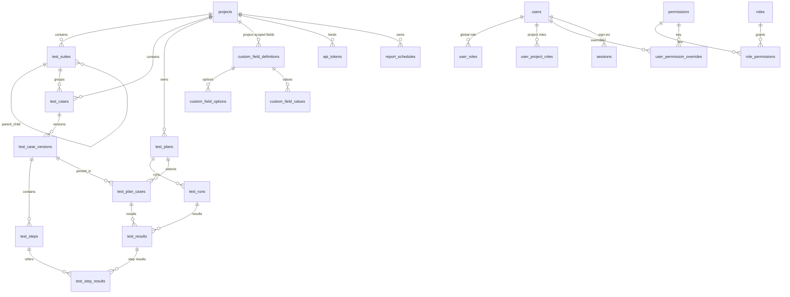
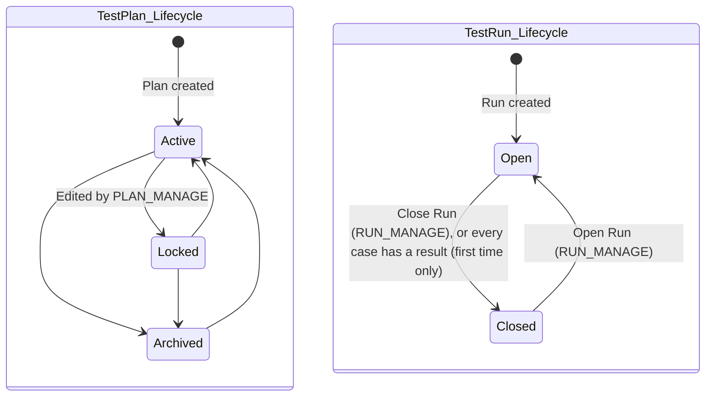

# RFC 01: Core Domain Model, Relational Architecture & State Machines

**Status:** Design document, updated 2026-10-11 to match what's built
**Author:** Lead System Architect & QA Domain Specialist
**Target Platform:** Testify
**Date:** September 8, 2026

> **Database engine (changed 2026-09-11):** the original design ran two SQL engines, native SQLite for local use and PostgreSQL for production. The SQLite driver (`better-sqlite3`) proved unreliable across machines, so Testify uses one Postgres-compatible dialect: an embedded `PGlite` (WASM Postgres) instance for development and tests, and a real PostgreSQL server in production. See §4.

---

## 1. Executive Summary & Foundational Architectural Constraints

This RFC sets out the domain model, schema, state machines and extension model. The aim is to remove TestLink's pain points (slow tree rendering, step-level data loss on re-runs, ambiguous build assignments, schema-upgrade lock-in) while keeping the core abstractions: **Projects, Test Suites, Test Cases, Test Case Versions, Test Plans, Test Runs (builds), Executions (results) and Custom Fields**.

```
                           +-------------------------------------+
                           |            Test Project             |
                           +-------------------------------------+
                                              | 1
                                              | N
                           +-------------------------------------+
                           |      Test Suite Tree (Recursive)    |
                           +-------------------------------------+
                                              | 1
                                              | N
                           +-------------------------------------+
                           |              Test Case              |
                           +-------------------------------------+
                                              | 1
                                              | N
                           +-------------------------------------+
                           |   Test Case Version (+ Test Steps)  |
                           +-------------------------------------+
                                              |
                                     (pinned per plan)
                                              v
+-----------------------+ 1                  N +-------------------------------------+
|       Test Plan       |--------------------->|    Test Plan Case (plan membership) |
+-----------------------+                      +-------------------------------------+
            | 1                                                   | 1
            | N                                                   | N
+-----------------------+ 1                  N +-------------------------------------+
|   Test Run            |--------------------->|          Result                     |
+-----------------------+                      +-------------------------------------+
                                                                  | 1
                                                                  | N
                                               +-------------------------------------+
                                               |      Step Result                    |
                                               +-------------------------------------+
```

Tables: `test_runs`, `test_results`, `test_step_results` (renamed from `builds`, `executions` and `execution_steps` in migration `007`). The API calls them runs and results too (`/runs/{runId}/results`, `test_run_id`, `test_result_id`); only audit rows written before 2026-10-12 still say `BUILD_*` / `EXECUTION_*`.

### Core Constraints & Guarantees

1. **One Postgres-compatible dialect:** PGlite in development and tests, PostgreSQL in production; the same SQL and the same migrations for both (§4).
2. **Specification vs. execution:** suites, cases and versions are editable design assets. Results are append-only: they're never edited, and a new result becomes the latest. Changing a specification never alters past results.
3. **Primary keys** are `VARCHAR(36)` UUID strings. Repositories generate time-ordered UUIDv7; some routes still generate UUIDv4. Both work, since nothing relies on id order.
4. **Admin extensibility:** custom fields, role templates and permission overrides are data, not code.

---

## 2. Specification vs. Execution Boundary & Version Pinning

### 2.1 Domain Separation

```
===================================================================================
                       TEST SPECIFICATION DOMAIN (EDITABLE)
===================================================================================
  [Project] ---> [TestSuite Tree] ---> [TestCase] ---> [TestCaseVersion (Draft/Approved/Deprecated)]
                                                                |
                                                                v
                                                         [TestStep 1..N]
===================================================================================
                                      ||  version pinned per plan
                                      \\/
===================================================================================
                        TEST EXECUTION DOMAIN (APPEND-ONLY RESULTS)
===================================================================================
  [TestPlan] ---> [TestPlanCase (pinned version; may be retired)]
       |                     |
       v                     v
  [Test Run (Open/Closed)] -> [Result 1..N per case per run] -> [Step Results 1..N]
===================================================================================
```

### 2.2 Suite Hierarchy

The suite tree is live and editable; it's never snapshotted per plan. Moving or renaming suites (including by drag-and-drop) takes effect everywhere at once. Reports group results by each case's **current** suite; results don't record the suite path they were run under.

### 2.3 Version Pinning

1. **Pinning:** adding a case to a plan creates a `test_plan_cases` row that pins `(test_plan_id, test_case_id, test_case_version_id)`. Only cases whose latest version is APPROVED can be added, unless the project setting `allow_draft_plan_linking` is true. DEPRECATED cases can never be added.
2. **Editing an approved case** ("Edit") creates a new DRAFT version (`version_number` + 1) that copies the latest version's content. Plans stay pinned to the approved version, so Execute mode keeps showing it.
3. **Approving re-pins:** approving a draft, or restoring a deprecated case, moves the pin to that version in every **ACTIVE** plan. LOCKED and ARCHIVED plans keep their pin. Old results keep their step results, which reference the old version's steps; versions are never deleted while results use them.
4. **Custom fields aren't frozen into results:** custom field values belong to the case itself, aren't versioned, and results don't record them. A result shows the case's current values. (A `custom_fields_snapshot` column was planned for this but never used, and was dropped in migration `006_drop_unused_columns`.)
5. **Removing a case from a plan:**
   - A case with no results is unlinked.
   - A case with results is **retired** after a confirmation: the link gets `removed_at`/`removed_by` instead of being deleted. Earlier runs keep showing the case where it has a result, read-only.
   - Re-adding it creates a fresh link, and the case can then be tested again, even in older runs.

### 2.4 Closed Runs & Locked Plans

- Recording a result in a CLOSED run, or in a LOCKED or ARCHIVED plan, fails with **HTTP 422** `RUN_CLOSED` / `PLAN_LOCKED`. Results can't be edited or deleted at all.
- A run closes itself the first time every case in its plan has a result recorded in the web app or one at a time; it can be reopened, and won't auto-close again. CI batches and JUnit uploads never auto-close a run (a build may send several files or be re-run); they close it only with `close_run=true`.

### 2.5 Retention & Attachments

- **Results are kept forever.** The planned 365-day purge isn't built.
- **Audit logs** are append-only with no automatic deletion, enforced by database triggers (RFC 04 §5).
- **Logs and attachments:** failure messages and stack traces are stored as text on the result row. Attachments (screenshots, files) and out-of-band storage aren't built (RFC 03 §5).

---

## 3. Relational Schema & Data Dictionary

The migrations in `packages/db/src/migrations/` are the source of truth; this section summarizes them as of migration `006`. Column types are as stored: text ids, ISO-timestamp strings, and some booleans as integer 0/1 (§4.3).

### 3.1 Entity Relationship Diagram



### 3.2 Tables

#### Specification

| Table | Key columns | Notes |
| :--- | :--- | :--- |
| `projects` | `name`, `prefix` (unique), `description`, `settings` (JSON text) | `settings.allow_draft_plan_linking`. The prefix is locked once the project has cases. |
| `test_suites` | `project_id`, `parent_suite_id` (null = top level), `name`, `description`, `position`, `path` | `path` is a materialized path of ids, used to find subtrees. FKs are RESTRICT; deleting is done in order by the repository (§7.4). |
| `test_cases` | `project_id`, `test_suite_id`, `external_id`, `title`, `priority`, `execution_type` | `UNIQUE (project_id, external_id)`. External ids are `PREFIX-n`. Priority is `HIGH`/`MEDIUM`/`LOW` (new cases default to MEDIUM in the app); the column default is still `HIGH`. |
| `test_case_versions` | `test_case_id`, `version_number`, `status`, `summary`, `preconditions`, `author_id`, `reviewer_id` | `UNIQUE (test_case_id, version_number)`. Status is `DRAFT`, `APPROVED` or `DEPRECATED`. Cascades from `test_cases`. |
| `test_steps` | `test_case_version_id`, `step_number`, `action`, `expected_result`, `execution_type` | `UNIQUE (test_case_version_id, step_number)`. Cascades from versions. |

#### Execution

| Table | Key columns | Notes |
| :--- | :--- | :--- |
| `test_plans` | `project_id`, `name`, `description`, `status` | Status is `ACTIVE`, `LOCKED` or `ARCHIVED`. |
| `test_runs` | `test_plan_id`, `name`, `description`, `status`, `release_date` | `UNIQUE (test_plan_id, name)`. Status is `OPEN` or `CLOSED`. |
| `test_plan_cases` | `test_plan_id`, `test_case_id`, `test_case_version_id`, `position`, `removed_at`, `removed_by` | Partial unique index `(test_plan_id, test_case_id) WHERE removed_at IS NULL`: one active link per case per plan, any number of retired ones. |
| `test_results` | `test_run_id`, `test_plan_case_id`, `tester_id`, `status`, `verdict`, `duration_ms`, `notes`, `failure_message`, `stack_trace`, `environment` (JSON), `runner` (JSON: name, run id, job, commit SHA, URL), `source` (`UI`/`API`), `execution_timestamp` | Verdicts: `PASSED`, `FAILED`, `BLOCKED`, `SKIPPED`, `RETEST_REQUIRED`, `KNOWN_ISSUE`. Status: `COMPLETED` (default), `IN_PROGRESS`, `ABORTED`. Duration is null for manual results. `tester_id` is the user or API token that recorded it. |
| `test_step_results` | `test_result_id`, `test_step_id`, `step_number`, `verdict`, `actual_result` | Step verdicts: `PASSED`, `FAILED`, `BLOCKED`, `SKIPPED`, `UNTESTED`. `test_step_id` is RESTRICT, so steps with results are kept. |

#### Custom fields

| Table | Key columns | Notes |
| :--- | :--- | :--- |
| `custom_field_definitions` | `project_id` (null = global), `entity_type`, `name`, `field_label`, `field_type`, `is_required`, `default_value`, `validation_regex` | Entity types: `TestCase`, `TestSuite`. Field types: `TEXT`, `NUMBER`, `CHECKBOX`, `DATE`, `SINGLE_SELECT`, `MULTI_SELECT`. Names are unique per scope (two partial unique indexes: global, and per project). |
| `custom_field_options` | `custom_field_definition_id`, `option_label`, `option_value`, `position` | For the select types. |
| `custom_field_values` | `custom_field_definition_id`, `entity_type`, `entity_id`, `string_value`, `number_value`, `boolean_value`, `date_value`, `json_value` | One typed column per value; `json_value` holds MULTI_SELECT arrays. |

#### Users, access and administration

| Table | Key columns | Notes |
| :--- | :--- | :--- |
| `users` | `username`, `email` (both unique), `password_hash`, `status`, `must_change_password`, `failed_login_count`, `locked_until` | Status `ACTIVE` or `DISABLED`. |
| `user_roles` | `user_id`, `role` | The user's global role, by role name. |
| `user_project_roles` | `user_id`, `project_id`, `role` | A role in one project, by role name; replaces the global role there. |
| `roles`, `permissions`, `role_permissions` | role `name`, `description`, `is_system_role`; `permission_key`, `module` | The editable role templates and the permission registry (seeded from `packages/core/src/rbac/registry.ts`). |
| `user_permission_overrides` | `user_id`, `project_id` (null = global), `permission_id`, `is_granted` | Per-user grants and denials. |
| `sessions` | `user_id`, `created_at`, `expires_at`, `revoked_at` | Server-side sign-ins (RFC 04 §4.1). |
| `api_tokens` | `project_id`, `name`, `token_prefix`, `token_hash` (unique), `capabilities` (JSON), `created_by`, `expires_at`, `is_revoked`, `last_used_at` | RFC 04 §4.2. |
| `audit_logs` | `actor_id`, `actor_type`, `action`, `resource_type`, `resource_id`, `project_id`, `diff`, `ip_address`, `user_agent` | Append-only (RFC 04 §5). |
| `system_settings` | `key`, `value` | SMTP settings (the password encrypted) and the public app address. |
| `report_schedules` | `project_id`, `name`, `sections` (JSON), `recipients`, `frequency`, `weekday`, `time_of_day`, `timezone`, `only_when_new_run`, `enabled`, `next_run_at`, `last_*`, `created_by` | Scheduled report emails. |
| `last_email` | `subject`, `recipients`, `html`, `text_body`, `status`, `error` | The most recent email only, for admins to review. |

`kysely_migration` and `kysely_migration_lock` record which migrations have run.

---

## 4. Database Engine: Single Postgres-Compatible Dialect (PGlite + PostgreSQL)

### 4.1 Why one dialect instead of two

The original design ran two SQL engines end to end: `better-sqlite3` (a native Node binding) for local use, and PostgreSQL for production, with code written to a lowest-common-denominator dialect. In practice, `better-sqlite3`'s prebuilt binary is tied to the host's glibc version and Node ABI, and rebuilding it needs a C++ toolchain and network access, none of which can be assumed on every machine or CI runner. That fragility, plus validating every schema change against two dialects, wasn't worth it.

`@electric-sql/pglite` (a WASM build of real PostgreSQL) removes the dilemma: a genuine Postgres engine with no native binary and no server process. There's one SQL dialect:

- **Development and tests:** an in-memory PGlite instance (`createDbClient()` with no connection string; `DATABASE_URL=memory` for the server).
- **Production:** a real PostgreSQL server (`DATABASE_URL=postgres://...`).

Both go through Kysely and the same migrations, with no per-dialect branching. The production build has been run against PostgreSQL 17, and CI does so on every push.

### 4.2 Query Layer (Kysely) and Migrations

All database access goes through Kysely, a typed TypeScript query builder. Raw SQL appears only where Kysely has no builder for it: trigger DDL, window functions in reporting queries, and advisory locks.

Migrations are tracked in `kysely_migration` and applied at startup (`migrateToLatest`), under a Postgres advisory lock so concurrent starts are safe. A schema change is a new migration file with `up` and `down`; a migration that has shipped is never edited.

### 4.3 Type & Column Conventions

| Aspect | Convention |
| :--- | :--- |
| **Primary keys** | `VARCHAR(36)` UUID strings (§1). |
| **Timestamps** | `VARCHAR(30)` ISO 8601 UTC strings. Native `TIMESTAMPTZ` would work; not done. |
| **Enum-like fields** | Plain strings. The allowed values are checked in application code (`packages/core`, route validation), not by database `CHECK` constraints. |
| **JSON** | Stored as text and parsed in code; no `JSONB` operators. |
| **Booleans** | Mixed: older tables use integer 0/1 (`roles.is_system_role`, `api_tokens.is_revoked`, `custom_field_definitions.is_required`, `custom_field_values.boolean_value`, `user_permission_overrides.is_granted`); newer ones use native `BOOLEAN`. |
| **Foreign keys** | Mostly `ON DELETE RESTRICT`, so deletes happen in order in code (§7.4); versions, steps and step results `CASCADE`. |

---

## 5. Custom Field Engine

### 5.1 Storage Design

Three storage designs were considered:
1. **Pure entity-attribute-value:** heavy joins, hard to filter.
2. **A JSON column:** flexible, but no validation or indexed search.
3. **Chosen hybrid:**
   - Typed definitions and options tables.
   - A typed values table with one column per value type.
   - Validation in code (`packages/core/src/custom-fields`).

Results don't record custom field values (see §2.3, point 4).

### 5.2 Types & Rules

- `TEXT`: free text, optionally checked against a validation regex. The regex runs with a 50 ms time limit, so a pathological pattern can't freeze the server.
- `NUMBER`: a number.
- `CHECKBOX`: true or false. Never-set and explicitly unchecked are different (null vs `false`); filters treat both as unchecked. CHECKBOX fields can't be required.
- `DATE`: `YYYY-MM-DD`.
- `SINGLE_SELECT`: one of the field's options.
- `MULTI_SELECT`: a set of the field's options.

Behavior around definitions:
- **Scope:** fields are defined globally by admins, for test cases or test suites. Imports can create **project-scoped** fields.
- **Required fields:** a required field must always have a usable default. Creating a field writes its default into every existing case or suite. Making a field required fills blank values with the default.
- **Options:** removing an option deselects it everywhere.

---

## 6. Permission Resolution

Permissions are evaluated for the project a request touches. RFC 04 §3.3 has the details:
1. **Base:** the user's project role in that project, if any, which replaces the global role there. Otherwise the global role (`user_roles`). `SYSTEM_ADMIN` means the whole registry.
2. **Overrides:** global overrides, then the project's. The last one applied wins, so project overrides beat global ones, and overrides beat roles.
3. **Check:** the required key, or `SYSTEM_ADMIN`; otherwise deny.

API tokens use their capabilities, intersected with their issuer's current permissions in the token's project.

---

## 7. State Machines

### 7.1 Test Case Version Lifecycle

```mermaid
stateDiagram-v2
    [*] --> Draft : Case created (or Approved, with SPEC_AUTO_APPROVE)
    Draft --> Approved : Approve (SPEC_APPROVE; required custom fields satisfied)
    Approved --> Deprecated : Deprecate (SPEC_APPROVE)
    Deprecated --> Approved : Restore (SPEC_APPROVE)
    Approved --> Draft : Edit (creates version N+1)
```



- Only the latest version moves through these states. A draft can't be deprecated, and a deprecated case can't be edited until it's restored.
- DEPRECATED cases are hidden from the spec tree unless "Show deprecated" is on, and can't be added to plans. Plans that already have them keep them.
- There's no IN_REVIEW state.

### 7.2 Test Plan & Test Run Lifecycles



- A plan's status can be set to any of the three in the plan editor.
- Results can't be recorded in a closed run or a locked or archived plan (HTTP 422).

### 7.3 Results

Results aren't a state machine: each one is an immutable row.
- **"Untested"** means a case has no result in that run.
- **The latest result** for a case in a run, by `executed_at` then `created_at`, is the case's verdict there. Recording another result needs `EXECUTE_OVERWRITE`, except re-sending your own latest verdict with notes.
- **Status values:** CI can send `IN_PROGRESS` or `ABORTED`; the web app always records `COMPLETED`.

### 7.4 Deleting

Projects, suites, cases, plans and runs warn before deleting anything that has content: the first request returns `409` with counts, and a second with `force=true` deletes. The repositories delete in an order that satisfies the RESTRICT foreign keys:
1. results (their step results cascade);
2. runs;
3. plan links;
4. plans;
5. custom field values;
6. cases (their versions and steps cascade);
7. suites, leaves first.

---

## 8. Concurrency & Batch Writes

### 8.1 Batch Results

CI sends results to `POST /api/v1/runs/{runId}/results/batch` (request and response in RFC 03 §3):

```
[CI runner] ---> POST /runs/{runId}/results/batch (up to 5,000 results)
                          |
                          v
        +-----------------------------------+
        | Check run and plan state          | (422 if closed / locked)
        | Validate every item               | (400 with every problem)
        +-----------------------------------+
                          |
                          v
        +-----------------------------------+
        | Load the plan's cases and steps   | (bulk)
        +-----------------------------------+
                          |
                          v
        +-----------------------------------+
        | BEGIN                             |
        | auto-links, results, step results | (multi-row inserts, 500 at a time)
        | audit row                         |
        | COMMIT                            |
        +-----------------------------------+
```

### 8.2 Concurrent Writes

- **No optimistic-concurrency versions:** results are never updated, so two testers or runners recording the same case just add two results, and the later one is the verdict.
- **External ids:** creating cases or importing assigns them under a per-project Postgres advisory lock (`TestCaseRepository.lockExternalIds`). Concurrent creation can't produce duplicates; verified with 12 simultaneous requests on PostgreSQL.
- **Scheduled emails:** each send is claimed with a compare-and-set update, so several server instances never send the same email twice.
