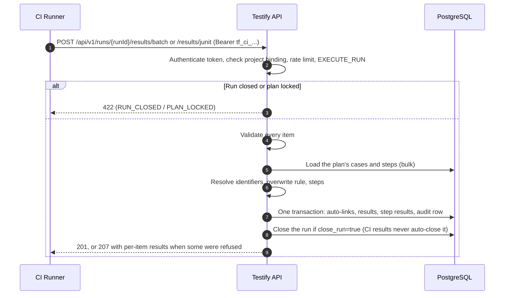
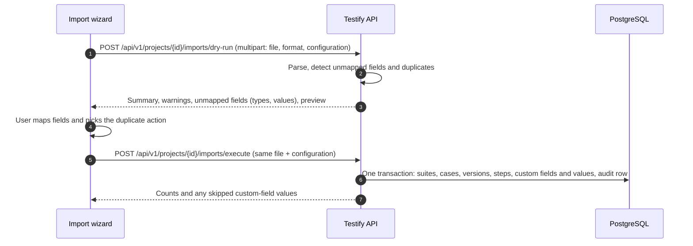

# RFC 03: API Contracts, High-Throughput Ingestion & Multi-Format Migration Engine

**Document Status:** Describes the API as built (§1-4 rewritten 2026-10-12 after the API consistency work; §5-9 updated 2026-10-11)
**Date:** September 8, 2026
**Author:** API & Integration Architecture Team
**Target Platform:** Testify
**Related Documents:** [00_requirements_alignment.md](00_requirements_alignment.md), [rfc_01_domain_model.md](rfc_01_domain_model.md), [rfc_04_rbac_security_matrix.md](rfc_04_rbac_security_matrix.md), [reports_api_and_mcp.md](reports_api_and_mcp.md), [api_roadmap.md](api_roadmap.md)

> This RFC describes the API as it works today. Every running server also serves a generated OpenAPI spec at `/docs/json` and a docs page with "Try it out" at `/docs`, covering every route with its fields, allowed values and errors ([api_roadmap.md](api_roadmap.md) step 3). This document gives the conventions and the overview; the spec has the field-level detail, and [api_getting_started.md](api_getting_started.md) is a step-by-step guide for scripts and CI. Reports, report email and MCP are covered in more depth in [reports_api_and_mcp.md](reports_api_and_mcp.md). Where something from the original design isn't built, the section says so.

---

## 1. Principles & Conventions

The API serves two kinds of client:
1. **The web app:** many small requests while people browse suites, edit cases and record verdicts with hotkeys.
2. **CI runners and agents:** large batches of results (up to 5,000 per request) from GitHub Actions, GitLab CI, Jenkins, Playwright, PyTest and the like, plus report reads over REST and MCP.

```
+-----------------------------------------------------------------------------------+
|                                 API clients                                       |
|  +------------------------------+             +--------------------------------+  |
|  | Web app (session cookie)     |             | CI runners, scripts, agents    |  |
|  +--------------+---------------+             +---------------+----------------+  |
+-----------------|---------------------------------------------|-------------------+
                  | JSON requests                               | Batch POSTs, reports, /mcp
                  v                                             v
+-----------------------------------------------------------------------------------+
|                        Testify server (Fastify, one process)                      |
|  +-----------------------------------------------------------------------------+  |
|  | Authentication (session cookie / Bearer JWT / Bearer tf_ci_...), project     |  |
|  | resolution, permissions, rate limits (middleware/auth.ts, rateLimits.ts)     |  |
|  +-----------------------------------------------------------------------------+  |
|  | Routes (apps/server/src/routes) and services; problem-details errors         |  |
|  +-----------------------------------------------------------------------------+  |
+-----------------|---------------------------------------------|-------------------+
                  v                                             v
+------------------------------------+        +-------------------------------------+
| Specification and plans            |        | Batch results: bulk lookups,        |
| (projects, suites, cases, plans)   |        | multi-row inserts, one transaction  |
+-----------------+------------------+        +-----------------+-------------------+
                  +----------------------+----------------------+
                                         v
+-----------------------------------------------------------------------------------+
|                 PostgreSQL (PGlite in development and tests)                      |
|        One transaction per change; results and audit rows append-only            |
+-----------------------------------------------------------------------------------+
```

### 1.1 Conventions

- **Base path:** `/api/v1` for everything except the MCP endpoint (`POST /mcp`). The API is stable from here on: additions are fine, and breaking changes would go into `/api/v2` ([api_roadmap.md](api_roadmap.md) step 2).
- **Addresses:** lists and creation sit under the parent; each item has its own short address.
  - `GET`/`POST /projects/{projectId}/plans`, then `PATCH`/`DELETE /plans/{planId}`.
  - Path names are short plurals: `/projects`, `/suites`, `/cases`, `/versions`, `/plans`, `/runs`, `/results`.
- **Verbs:**
  - `GET` reads; `POST` creates, or runs an action (`POST /versions/{id}/approve`);
  - `PATCH` changes only the fields sent;
  - `PUT` replaces a whole thing: a custom-field value, a user's set of permission overrides, a report schedule, the email settings;
  - `DELETE` removes.
- **Status codes:**
  - create: `201` with the new item wrapped in its name, e.g. `{ "plan": { ... } }`;
  - read and update: `200`, the item wrapped the same way, a list as `{ "plans": [ ... ] }`;
  - delete: `204` with no body;
  - "delete anyway" (when the item still contains things): `?force=true` in the query. Without it the server answers `409` naming what would be lost.
  - A few actions answer `200` with a summary instead: e.g. removing a whole suite from a plan returns `{ added, removed, retired, skipped }`.
- **Bodies:** JSON, snake_case field names. Only send `Content-Type: application/json` when there is a body; Fastify answers `400` to an empty JSON body.
- **Ids:** UUIDs. A field holding an id is named after its database column, so each id has one name everywhere: `project_id`, `test_suite_id`, `test_case_id`, `test_case_version_id`, `test_plan_id`, `test_plan_case_id` (a case's link to a plan), `test_run_id`, `test_result_id`. Runs and results are never called "builds" or "executions".
- **Readable case ids:** wherever a case id is taken (`:caseId`, `test_case_id`, `case_ids`), the case's readable id works too, e.g. `GET /cases/SHOP-12`. Readable ids are normally unique, but imported cases keep the ids from their file, so two projects can share one; then the request's project (from its other ids, or an API token's project) decides, and without one the answer is `400 AMBIGUOUS_CASE_ID`.
- **The project comes from the ids:** the server works out the project from every id a request names (in the path, query and JSON body) and checks permissions in that project. A request naming ids from two projects is refused with `400 PROJECTS_DIFFER`. An API token is refused on any project but its own (`403 TOKEN_PROJECT_MISMATCH`), and on routes that aren't part of a project at all, such as `/admin/...` (`403 TOKEN_NOT_ALLOWED`).
- **Authentication:** every route except sign-in and `GET /api/v1/health` needs a credential (§7.1, RFC 04 §4).
- **Paging:** lists that grow without bound are paged: a project's cases (`GET /projects/{projectId}/cases`), a run's results (`GET /runs/{runId}/results`), the audit log, and the case-history report. Each takes `limit` (a default and a maximum per list) and `cursor`, and answers `next_cursor`: pass it as `cursor` for the next page; it is null on the last page. Cursors are opaque (keyset paging, so a page never skips or repeats an item when new ones arrive); one the server didn't give out gets `400 INVALID_CURSOR`. Lists that stay small (projects, suites in the spec tree, plans, runs, versions, tokens, users) return everything.
- **Validation:** input is checked before anything is written; a bad request gets a `400` naming each problem field in `invalid_params` (§4).

---

## 2. Route Map

All addresses below are under `/api/v1`. The permission each route needs is in RFC 04 §2; "can read" means `SPEC_VIEW`, or `EXECUTE_RUN` for the reads Execute mode needs.

| Area | Routes |
| :--- | :--- |
| Sign-in | `POST /auth/login` (`session: "cookie"` for the web app), `POST /auth/logout`, `GET /auth/me`, `PATCH /auth/me` (`username`, `email`, `password`, `current_password`) |
| Projects | `GET`/`POST /projects`, `GET`/`PATCH`/`DELETE /projects/{projectId}` |
| Specification | `GET /projects/{projectId}/spec-tree?test_plan_id=&include_deprecated=`, `POST /projects/{projectId}/move`, `POST /projects/{projectId}/suites`, `GET`/`PATCH`/`DELETE /suites/{suiteId}`, `GET /projects/{projectId}/cases` (paged; filters `external_id`, `test_suite_id` + `include_sub_suites`, `version_status`, `priority`), `POST /projects/{projectId}/cases`, `GET`/`PATCH`/`DELETE /cases/{caseId}` (the case with its latest version) |
| Versions | `GET /cases/{caseId}/versions` (every version, newest first), `GET /cases/{caseId}/versions/latest`, `POST /cases/{caseId}/versions` (a new draft from the latest version), `GET`/`PATCH /versions/{versionId}`, `POST /versions/{versionId}/approve`, `/deprecate`, `/restore` |
| Custom field values | `GET /cases/{caseId}/custom-fields`, `PUT`/`DELETE /cases/{caseId}/custom-fields/{definitionId}`; the same under `/suites/{suiteId}` |
| Search | `POST /projects/{projectId}/case-search`, `GET /projects/{projectId}/case-search/fields` |
| Plans | `GET`/`POST /projects/{projectId}/plans`, `GET`/`PATCH`/`DELETE /plans/{planId}`, `GET /plans/{planId}/cases?test_run_id=` (the plan's cases with each one's latest result in the run: Execute mode's queue), `POST /plans/{planId}/cases` (`test_case_id`), `DELETE /plans/{planId}/cases/{caseId}`, `POST`/`DELETE /plans/{planId}/suites/{suiteId}/cases` (every case in the suite's subtree) |
| Runs and results | `GET`/`POST /plans/{planId}/runs`, `GET`/`PATCH`/`DELETE /runs/{runId}`, `GET /runs/{runId}/results` (paged, newest first; filters `verdict`, `test_case_id`, `source`, `latest_only`), `GET /results/{resultId}`, `POST /runs/{runId}/results` (one result), `POST /runs/{runId}/results/batch` (CI, §3), `POST /runs/{runId}/results/junit` (a JUnit XML file, §3.3), and the same two into a run by name: `POST /plans/{planId}/results/batch?run_name=`, `POST /plans/{planId}/results/junit?run_name=` |
| Reports | `GET /projects/{projectId}/reports` (the catalog), `POST /projects/{projectId}/reports/{reportId}[?format=json\|markdown\|csv]` |
| Report email | `POST /projects/{projectId}/report-emails`, `GET`/`POST /projects/{projectId}/report-schedules`, `PUT`/`DELETE /report-schedules/{scheduleId}`, `POST /report-schedules/{scheduleId}/recipients` (`email`), `DELETE /report-schedules/{scheduleId}/recipients/{email}`, `POST /report-schedules/{scheduleId}/send-now` |
| Import | `POST /projects/{projectId}/imports/dry-run`, `POST /projects/{projectId}/imports/execute`, `GET /projects/{projectId}/imports/custom-field-options` (§6) |
| Export | `POST /projects/{projectId}/exports/definitions`, `POST /projects/{projectId}/exports/results` |
| API tokens | `GET`/`POST /projects/{projectId}/api-tokens`, `DELETE /api-tokens/{tokenId}` (revokes) |
| Users and roles | `GET`/`POST /admin/users`, `PATCH /admin/users/{userId}` (status), `PATCH /admin/users/{userId}/roles`, `GET`/`PUT /admin/users/{userId}/permission-overrides[?project_id=]`, `POST /admin/users/{userId}/reset-password`, `GET`/`POST /admin/roles`, `PATCH`/`DELETE /admin/roles/{roleId}`, `GET /admin/permissions` |
| Custom field definitions | `GET`/`POST /admin/custom-fields`, `PATCH`/`DELETE /admin/custom-fields/{fieldId}` |
| Email settings | `GET`/`PUT /admin/email-settings`, `POST /admin/email-settings/test`, `GET /admin/last-email` |
| Audit | `GET /admin/audit-logs` (the Security Audit Log; paged, filters `action`, `actor_id`, `since`) |
| Operations | `GET /health` (no sign-in) |
| MCP | `POST /mcp` (not under `/api/v1`; read-only tools, see [reports_api_and_mcp.md](reports_api_and_mcp.md)) |

### 2.1 Example: creating a test case

`POST /api/v1/projects/{projectId}/cases` creates a case and its first version. The external id is assigned by the server (`PREFIX-n`). The version starts as `DRAFT`, or `APPROVED` when the caller holds `SPEC_AUTO_APPROVE` and no required custom field is left unsatisfied.

```json
{
  "test_suite_id": "0191c4d0-7a1a-7b3c-8e4d-1a2b3c4d5e6f",
  "title": "Refresh tokens rotate",
  "priority": "HIGH",
  "execution_type": "AUTOMATED",
  "summary": "Old refresh tokens stop working once a new pair is issued.",
  "preconditions": "A signed-in user with a refresh token.",
  "steps": [
    { "action": "Refresh with token R1", "expected_result": "200 with a new pair (A2, R2)" },
    { "action": "Refresh with token R1 again", "expected_result": "401" }
  ]
}
```

`priority` is one of CRITICAL, HIGH, MEDIUM, LOW (default MEDIUM) and `execution_type` MANUAL or AUTOMATED (default MANUAL); anything else is `400 INVALID_REQUEST`. Steps without `step_number` are numbered in order. The response (`201`) is `{ "test_case": { "id", "external_id", "title", ... }, "version": { "id", "version_number": 1, "status", ... } }`.

### 2.2 Example: recording one result

`POST /api/v1/runs/{runId}/results` is what Execute mode's verdict buttons and hotkeys call:

```json
{
  "test_plan_case_id": "0191c4d0-aaaa-7000-8000-000000000010",
  "verdict": "FAILED",
  "status": "COMPLETED",
  "notes": "Badge doesn't update",
  "step_results": [{ "test_step_id": "0191c4d0-bbbb-7000-8000-000000000020", "verdict": "FAILED", "actual_result": "Still 0" }]
}
```

- `verdict`: `PASSED`, `FAILED`, `BLOCKED`, `SKIPPED`, `RETEST_REQUIRED` or `KNOWN_ISSUE`. `status` defaults to `COMPLETED`.
- Step results must be steps of the version the case is pinned to in the plan.
- Manual results are never timed: any duration sent is ignored.
- The response (`201`) is `{ "result": { "id", "test_run_id", "test_plan_case_id", "verdict", "status", "created_at" }, "run_status": "OPEN" | "CLOSED" }`. The run closes automatically the first time every case in the plan has a result.

---

## 3. CI Results (`POST /runs/{runId}/results/batch`, `/results/junit`)

CI pipelines send many results at once: as JSON (up to 5,000 per request), or as a JUnit XML file (§3.3). Both are recorded in one transaction by `services/batchResults.ts`. Each also has a form that names the run instead of giving its id (§3.4).

### 3.1 Request and Response

`POST /api/v1/runs/{runId}/results/batch[?all_or_nothing=true]`, with `EXECUTE_RUN` (`EXECUTE_OVERWRITE` too, to change a case's existing result in the run).

- `all_or_nothing=false` (the default): valid results are saved; refused ones are reported per item, and the response is `207 Multi-Status` if any were refused, `201` otherwise.
- `all_or_nothing=true`: if any item is refused, nothing is saved and the whole request fails with that item's error (`400`, `403` or `422`).

```json
{
  "environment": "staging",
  "runner_info": {
    "name": "GitHub Actions",
    "run_id": "98124712",
    "job_name": "e2e / chrome",
    "commit_sha": "a1b2c3d4e5f67890123456789abcdef012345678",
    "url": "https://github.com/acme/shop/actions/runs/98124712"
  },
  "results": [
    {
      "case_identifier": { "external_id": "SHOP-102" },
      "verdict": "PASSED",
      "duration_ms": 3420,
      "executed_at": "2026-09-08T13:15:00Z",
      "environment_tags": { "browser": "chrome-128" },
      "step_results": [{ "step_number": 1, "verdict": "PASSED", "actual_result": "200 returned" }]
    },
    {
      "case_identifier": { "by_path_title": { "suite_path": "Payments / Checkout", "title": "3DS challenge" } },
      "verdict": "FAILED",
      "duration_ms": 12450,
      "failure_message": "3DS frame not visible after 10 s",
      "stack_trace": "TimeoutError: ...\n    at checkout.spec.ts:45:12"
    },
    { "case_identifier": { "by_uuid": "0191c4d0-8b2b-7c4d-9f5e-2b3c4d5e6f7a" }, "verdict": "SKIPPED" }
  ]
}
```

- **`case_identifier`:** `external_id`, `by_uuid` (the case id), or `by_path_title`. A case that isn't in the plan yet is linked to it if it's APPROVED (or the project allows drafts); a case removed from the plan is refused.
- **Each result:** `verdict` as in §2.2; optional `status`, `duration_ms`, `executed_at` (defaults to now), `notes`, `failure_message`, `stack_trace`, `environment_tags` (up to 50 text values), `step_results` (by `test_step_id` or `step_number`).
- **`runner_info.run_id`** is the CI system's own run id, unrelated to Testify's `test_run_id`. Reports link back through `url`.

Response:

```json
{
  "object": "batch_results",
  "summary": { "total_submitted": 3, "successful": 2, "failed": 1, "duration_ms": 42 },
  "results": [
    { "index": 0, "status": 201, "test_result_id": "0191c4d5-1111-7000-8000-000000000001", "test_case_id": "0191c4d0-8b2b-...", "verdict": "PASSED" },
    { "index": 1, "status": 201, "test_result_id": "0191c4d5-2222-7000-8000-000000000002", "test_case_id": "0191c4d0-9c3c-...", "verdict": "FAILED" },
    { "index": 2, "status": 422, "code": "CASE_NOT_FOUND", "detail": "Case identifier not found in test plan", "invalid_params": [{ "name": "results[2].case_identifier", "reason": "Case identifier not found in test plan" }] }
  ],
  "run_status": "OPEN"
}
```

A refused item carries `code`, `detail` and, for invalid input, `invalid_params` (e.g. `results[2].verdict`). Item codes: `INVALID_RESULT`, `CASE_NOT_FOUND`, `CASE_REMOVED_FROM_PLAN`, `RESULT_OVERWRITE_NOT_PERMITTED`, `UNKNOWN_STEP`.

### 3.2 How the Batch Route Stays Fast

How the batch (`apps/server/src/services/batchResults.ts`) records results quickly (2,000 results in about 1.5 s in the test suite):

1. **Validate everything first:** every item is checked (`validateBatchItem`) before anything touches the database. In all-or-nothing mode, all problems come back in one 400.
2. **Look identifiers up in bulk:** the plan's cases are loaded once and the incoming `external_id` / `by_uuid` / `by_path_title` identifiers are resolved in memory. Cases of the project that aren't in the plan yet are looked up in a few queries for the whole batch, not one per item. Step results are matched exactly against the steps of the version each case runs at.
3. **One transaction, multi-row inserts:** auto-links, results, step results and the audit row are written in one transaction, with results and step results inserted 500 rows at a time. A refused item never leaves a plan link behind, and in atomic mode a refusal rolls everything back.
4. **Version binding:** each result belongs to the case's link in the plan, which pins the version the case runs at. Editing or re-approving the case later doesn't change past results.

Failure messages and stack traces are stored in the `test_results` row itself (`failure_message`, `stack_trace`). There's no out-of-band offloading (see §5).

### 3.3 JUnit XML (`POST /runs/{runId}/results/junit`)

The body is a JUnit XML report as test runners write it, sent as is with any content type (`curl --data-binary @report.xml`): up to 20,000 tests and 50 MB. `routes/junitResults.ts` reads it (`parseJUnitResults` in `packages/core/src/ingestion/junitResults.ts`) and turns each `<testcase>` into a batch item, then records them as §3.1-3.2 do. The response is the batch response with each item's `test_name` (`classname.name`).

- **Verdicts:** `<failure>` and `<error>` are FAILED (an error also gets a note saying so), `<skipped>` is SKIPPED with its message as the note, anything else PASSED. Only the first outcome element counts; Surefire's `flakyFailure`/`rerunFailure` are ignored, so a test that passed on a rerun is PASSED.
- **Fields:** `time` (seconds) → `duration_ms`; a failure's `message` attribute (or the first line of its text) → `failure_message`; its text → `stack_trace`.
- **Matching a test to a case:** `external_id` from a `testify_id` property on the test, else a readable id in its name (`SHOP-101 …`, `[SHOP-101] …`); plus `by_path_title` with the suite a JUnit import would have created (the last part of `classname`, or the `<testsuite>` name) and the test's name as title. The batch tries the readable id first, then suite and title within the plan, then the project's cases (preferring the one in the named suite).
- **Query parameters:** `environment`; `ci_name`, `ci_run_id`, `ci_job_name`, `ci_url`, `commit_sha` (stored as `runner_info`); `all_or_nothing`.
- **Errors:** `400 INVALID_JUNIT` for an empty body, a file that isn't JUnit XML (no `<testsuite>`/`<testsuites>`), one without tests, or over 20,000 tests; `413` over 50 MB. Tests that match no case are refused per item (`CASE_NOT_FOUND`, 207).

### 3.4 Runs by Name (`POST /plans/{planId}/results/batch|junit?run_name=`)

One CI build is one run. Rather than looking the run up and creating it, CI names it: the plan's run with that name is used, and created if there is none (that needs `RUN_MANAGE`; using an existing run needs only `EXECUTE_RUN`). Concurrent requests creating the same run end up with one run (`INSERT … ON CONFLICT DO NOTHING` on the unique plan and name). The response adds `run: { id, name, created }`.

CI results never auto-close a run (runs executed in the web app do, RFC 01): a build may send several files, from parallel jobs or one per test class, or be re-run, and only the CI knows when it is done. `close_run=true` on any batch or JUnit upload closes the run after recording (needs `RUN_MANAGE`), and `run_status` says so. A locked or archived plan gets `422 PLAN_LOCKED` before any run is created, and a request with nothing to record (no results, or an unusable JUnit file) is refused without creating one.

---

## 4. Errors

Every error, from every route, is **RFC 7807 problem details** (`Content-Type: application/problem+json`; `sendError` in `apps/server/src/errors.ts`):

| Field | Meaning |
| :--- | :--- |
| `type` | `https://api.testify.dev/errors/{code}` |
| `title` | The HTTP status text, e.g. `Unprocessable Entity` |
| `status` | The HTTP status |
| `code` | A machine-readable code (§4.2); defaults from the status, e.g. `NOT_FOUND` |
| `detail` | A message meant for people; the web app shows it as-is |
| `instance` | The request path |
| `timestamp` | When it happened |
| `invalid_params` | Optional: `[{ "name", "reason" }]`, one per problem field |
| others | Optional extension fields in snake_case, e.g. `required_permission`, `project_ids`, `request_id` |

Unexpected failures (database errors, bugs) answer `500 INTERNAL_ERROR` with a `request_id` that matches the server log; their details never reach the client. Unknown addresses answer `404 NOT_FOUND` in the same format. Three exceptions: `/mcp` answers in JSON-RPC, as the protocol requires; batch per-item results (§3.1) are data inside a normal response; and `GET /health` answers `503` with its own small status body when the database is down.

### 4.1 Closed Runs and Locked Plans

Results stay viewable and exportable forever, but nothing may be added to a closed run or a locked or archived plan:

```http
HTTP/1.1 422 Unprocessable Entity
Content-Type: application/problem+json

{
  "type": "https://api.testify.dev/errors/RUN_CLOSED",
  "title": "Unprocessable Entity",
  "status": 422,
  "code": "RUN_CLOSED",
  "detail": "Test run (ID: 0191c4d0-9a9a-7000-8000-000000000099) is closed. Results can't be added to a closed run; reopen it first.",
  "instance": "/api/v1/runs/0191c4d0-9a9a-7000-8000-000000000099/results/batch",
  "invalid_params": [{ "name": "test_run_id", "reason": "the run is CLOSED" }],
  "timestamp": "2026-09-08T13:20:00Z"
}
```

A locked or archived plan answers the same way with `PLAN_LOCKED`, for results and for changing which cases are in it.

### 4.2 Error Codes

The codes a client is most likely to handle (the code is always in `code`; `detail` says what to do):

| Status | Codes |
| :--- | :--- |
| `400` | `INVALID_REQUEST` (default), `INVALID_PARAMS` (reports, schedules), `INVALID_RESULT`, `INVALID_STEPS`, `INVALID_NAME`, `INVALID_FILTER`, `INVALID_FIELD_VALUE`, `INVALID_VALIDATION_PATTERN`, `PROJECTS_DIFFER`, `AMBIGUOUS_CASE_ID`, `INVALID_CURSOR`, `INVALID_JUNIT`, `CAPABILITY_NOT_GRANTABLE`, `PASSWORD_POLICY_VIOLATION`, `CURRENT_PASSWORD_REQUIRED`, `PASSWORD_UNCHANGED` |
| `401` | `UNAUTHORIZED` (no credential), `SESSION_ENDED` (signed out, expired, or signed by another server key), `INVALID_TOKEN`, `TOKEN_REVOKED`, `TOKEN_EXPIRED`, `TOKEN_ISSUER_INACTIVE` |
| `403` | `FORBIDDEN` (with `required_permission`), `TOKEN_PROJECT_MISMATCH`, `TOKEN_NOT_ALLOWED` (an API token on a route outside any project), `RESULT_OVERWRITE_NOT_PERMITTED`, `CAPABILITY_CEILING_EXCEEDED`, `PASSWORD_CHANGE_REQUIRED`, `CSRF_HEADER_MISSING`, `CURRENT_PASSWORD_INCORRECT`, and the Admin Panel guards `PERMISSION_CEILING`, `TARGET_OUTRANKS_ACTOR`, `ROLE_OUTRANKS_ACTOR` |
| `404` | `NOT_FOUND`, and in reports `PROJECT_NOT_FOUND`, `PLAN_NOT_FOUND`, `RUN_NOT_FOUND`, `CASE_NOT_FOUND`, `REPORT_NOT_FOUND` |
| `409` | "Still contains" on delete without `force`: `PROJECT_IN_USE`, `SUITE_IN_USE`, `CASE_IN_USE`, `PLAN_IN_USE`, `RUN_IN_USE`, `CUSTOM_FIELD_IN_USE`, `ROLE_IN_USE`, `CASE_HAS_RESULTS` (removing a case with results from a plan); also `LAST_ADMIN`, `LAST_RECIPIENT` (a report schedule's only recipient), `USER_EXISTS`, `ROLE_NAME_TAKEN`, `FIELD_NAME_TAKEN`, a taken project prefix or run name |
| `413` | `IMPORT_TOO_LARGE`, `PAYLOAD_TOO_LARGE` |
| `422` | `RUN_CLOSED`, `PLAN_LOCKED`, `CASE_VERSION_LOCKED` (editing an approved version), `CASE_VERSION_NOT_APPROVED` (adding a draft to a plan), `CASE_REMOVED_FROM_PLAN`, `VERSION_NOT_DRAFT`, `VERSION_NOT_APPROVED`, `VERSION_NOT_DEPRECATED`, `VERSION_NOT_LATEST`, `REQUIRED_CUSTOM_FIELDS_MISSING`, `REQUIRED_FIELD_NEEDS_DEFAULT` |
| `429` | `RATE_LIMITED`, `ACCOUNT_LOCKED`, `TOO_MANY_ATTEMPTS`, `IMPORT_BUSY` (with `Retry-After`) |
| `500` | `INTERNAL_ERROR` (with `request_id`) |

---

## 5. Attachments, Logs & Retention

> **Not built.** There are no attachments (screenshots, videos, trace files), no `IStorageProvider`, no pre-signed uploads and no retention purge. The design below stays as the plan for when attachments are added.

What's built today:
- **Results and logs** are stored in the database: verdict, notes, `failure_message` and `stack_trace` (text), environment tags and runner details, per result. Nothing is purged automatically.
- **Audit logs** are append-only forever: database triggers reject UPDATE and DELETE (see RFC 04 §5).

The plan:
- **Attachments and large logs** go to out-of-band storage behind an `IStorageProvider` interface (`putObject`, `getObject`, `deleteObject`, `getPresignedUrl`). The database keeps only a storage key, SHA-256 checksum, size and MIME type.
- **Two providers,** chosen by configuration, independent of the database:
  - `LocalStorageProvider` stores files on disk (`./data/attachments/{project_id}/{year}/{month}/{id}.bin`) and streams them.
  - `S3StorageProvider` works with AWS S3, MinIO, Cloudflare R2 or Google Cloud Storage. Large uploads go straight to the bucket through pre-signed URLs (e.g. `POST /api/v1/results/{resultId}/attachments/presign`, then registering the key and checksum).
- **Retention:** an admin-configurable purge of old results and their attachments (planned default: 365 days), never touching audit logs.

---

## 6. Extensible Multi-Format Ingestion & Migration Engine

Importing existing test repositories into Testify supports five formats through one pipeline: preview (dry run), then execute. The import wizard in the web app (`ImportWizardModal.tsx`) walks through Upload → Field Mapping → Duplicates → Confirm → Results.

```
+-----------------------------------------------------------------------------------+
|  TestLink XML | JUnit XML | Testify JSON | CSV | TestRail CSV (explicit only)     |
+----------------------------------------+------------------------------------------+
                                         v
+-----------------------------------------------------------------------------------+
|        Parsers (packages/core/src/ingestion), one IFileParser per format          |
+----------------------------------------+------------------------------------------+
                                         v
+-----------------------------------------------------------------------------------+
|  POST /projects/{id}/imports/dry-run: counts, warnings, unmapped custom fields     |
|  (with inferred types and distinct values), hierarchy preview. Writes nothing.    |
+----------------------------------------+------------------------------------------+
                                         v  (user chooses field mappings + duplicate action)
+-----------------------------------------------------------------------------------+
|  POST /projects/{id}/imports/execute: the same file again, in one transaction     |
+-----------------------------------------------------------------------------------+
```

### 6.1 Parser Interface
Each format implements `IFileParser` (`packages/core/src/ingestion/types.ts`); a new format is a new parser, without changing the import routes.

```typescript
export interface IFileParser {
  formatId: 'TESTLINK_XML' | 'NATIVE_JSON' | 'STANDARD_CSV' | 'JUNIT_XML' | 'TESTRAIL_CSV';
  canHandle(fileHeader: Buffer, filename: string): boolean;
  parseStream(
    inputStream: Readable | ReadableStream | AsyncIterable<Buffer | string>,
    options?: ParseOptions
  ): AsyncIterable<ParsedSuite>;
}
```

`ParsedSuite` holds `name`, `details`, `node_order`, `sub_suites` and `test_cases`. Each `ParsedCase` has `external_id`, `title`, `summary`, `preconditions`, `importance`, `execution_type`, `steps`, a flat `custom_fields` string map, and any parser warnings.

**Auto-detection** sniffs the first bytes, checking JUnit XML before TestLink XML: both use `<testsuite>`, but JUnit has `tests=`/`classname=` attributes. TestRail CSV is never auto-detected; it has to be chosen explicitly.

### 6.2 Format Mappings

#### TestLink XML

| TestLink XML Element | Testify Field | Rules |
| :--- | :--- | :--- |
| `<testsuite name="...">` | Suite name | Nesting preserved. |
| `<details>` | Suite details | |
| `<testcase name="...">` | Case title | Over 255 characters is trimmed, with a `TITLE_TRUNCATED` warning. |
| `<externalid>` | Case external id | Kept if free in the project; otherwise the next free `PREFIX-n` (§6.4). |
| `<summary>`, `<preconditions>` | Version summary / preconditions | HTML cleaned to plain text: tags removed, `<br>` and `</p>` become line breaks, entities decoded. |
| `<importance>` | Case priority | `1` → LOW, `2` → MEDIUM, `3` → HIGH. |
| `<execution_type>` | Execution type | `1` → MANUAL, `2` → AUTOMATED. |
| `<steps><step>` | Steps | `<step_number>`, `<actions>`, `<expectedresults>`, cleaned like the summary. |
| `<custom_fields><custom_field>` | Custom fields | `<name>` → column, `<value>` → value; mapped in the wizard (§6.4). |

#### Other formats
- **Testify JSON:** mirrors the domain model; the JSON export re-imports through it.
- **CSV:** a header row with columns matched by name, case-insensitively: `Suite Path`, `External ID`, `Title`, `Summary`, `Preconditions`, `Importance`, `Execution Type`, `Step Number`, `Action`, `Expected Result`. Other columns become custom fields; the CSV export writes them as `cf_<name>`. One row per step, with the case's fields repeated. A CSV definitions export re-imports through this parser. Known limits:
  - Any `Importance` other than HIGH, MEDIUM or LOW becomes MEDIUM.
  - A custom field whose name contains a built-in column's word (`title`, `suite`, `action`, `result`...) is read as that column.
- **JUnit XML:** suites nest by the test's dotted `classname`. Status, duration and failure message arrive as the custom fields `junit_status`, `junit_duration_seconds` and `junit_failure_message`. They're case fields, not results; send results through the batch API instead.
- **TestRail CSV:** TestRail's export with one combined `Steps` column and one `Expected Result` column, both as numbered lists. TestRail's `Critical` priority becomes HIGH. The variant with one column per step isn't supported; it gets an `UNSUPPORTED_TESTRAIL_COLUMN_FORMAT` warning.

### 6.3 File Size & Memory

Not built as designed: the original plan was to stream 100 MB+ TestLink exports in bounded memory, with progress events. Today the route holds the uploaded file and its parsed tree in memory (it parses once for the preview and again for the import), so it enforces limits instead:
- At most **50 MB** per file, sent as `multipart/form-data`. A JSON body carrying the file as base64 is limited to 5 MB.
- At most **2 imports at a time** per server (`429 IMPORT_BUSY`).
- No progress events; the request returns when the import finishes.

### 6.4 Field Mapping & Duplicates

#### Custom fields
The dry run lists every column that isn't an existing custom field, with:
- an inferred type: CHECKBOX, NUMBER, DATE, or TEXT (the fallback); select types are never guessed;
- sample values;
- the column's distinct values (up to 200).

The user picks an action for each:
- `DROP`: ignore the column.
- `AUTO_CREATE`: create a new **project-scoped** custom field (TEXT, NUMBER, CHECKBOX, DATE, SINGLE_SELECT or MULTI_SELECT). A select field's options are every distinct value in the file; multi-select splits values on commas.
- `ROUTE_TO_EXISTING`: put the values into an existing global or project custom field.

Values are validated like any other custom-field value. A value that doesn't fit is skipped and reported (`skipped_custom_field_value_warnings`) without failing the import.

```json
{
  "field_mappings": [
    { "incoming_key": "cf_jira_key", "action": "ROUTE_TO_EXISTING", "target_field_id": "..." },
    { "incoming_key": "automationStatus", "action": "AUTO_CREATE", "field_name": "Automation Status", "field_type": "SINGLE_SELECT" }
  ],
  "duplicate_resolution": { "default_action": "VERSION_UP" }
}
```

#### Duplicates
A case counts as a duplicate when its external id matches a case in the project, or its title matches a case in the same suite. Actions:
- `VERSION_UP` (default): add a new version to the existing case, keeping its results.
- `OVERWRITE`: replace the latest version's content.
- `CREATE_NEW`: create a separate case titled `<title> (Copy)`, with a fresh external id.
- `SKIP`: leave the existing case alone.

The API also accepts per-case `overrides` by external id or title; the wizard only sets the default. `apply_to_all_future_duplicates` is accepted but has no effect.

#### External ids
New cases keep the file's id unless it's taken; otherwise they get the next free `PREFIX-n`, assigned under a per-project lock so concurrent imports and case creation never collide.

### 6.5 Dry Run & Execute

`POST /api/v1/projects/{projectId}/imports/dry-run` and `.../imports/execute` take the same `multipart/form-data` request (the project is the one in the address):
- `file`;
- `format` (leave it out to detect the format automatically);
- `configuration`: JSON with the field mappings and duplicate resolution.

Both need `IMPORT_DATA` in the project. An API token may only import into its own project.

The dry run writes nothing and returns:
- `dry_run_summary`: suites and cases detected, to create, to version up, to overwrite, skipped, unmapped fields, warnings;
- `warnings`: e.g. `TITLE_TRUNCATED`, `EMPTY_STEPS` and parser warnings;
- `unmapped_custom_fields`;
- `hierarchy_preview`.

Execute runs the whole import in one transaction, writes an `IMPORT_EXECUTED` audit row, and returns the counts. There's no server-side session or ticket: the client sends the file again.

---

## 7. Authentication, Rate Limiting & Webhooks

### 7.1 Authentication
Every API request needs a credential (RFC 04 §4 has the details):
- **Machine API tokens** (`Authorization: Bearer tf_ci_...`), for CI and agents. Each is created per project in Admin Panel → API Tokens, with chosen capabilities, and is bound to that project and capped by its issuer's current permissions. Tokens can't use the admin routes or hold system-wide permissions (RFC 04 §4.2).
- **Sign-in tokens:** `POST /api/v1/auth/login` returns a JWT for scripts. The web app uses an HttpOnly session cookie instead, plus a `X-Testify-Client: web` header on changes.

There are no personal access tokens or separate runner-token types; a token's capabilities decide what it can do. The built-in Automation Service role's set (`SPEC_VIEW`, `RUN_MANAGE`, `EXECUTE_RUN`) suits CI.

---

### 7.2 Rate Limiting Policies & Response Headers
Limits are generous on purpose -- CI runners, scripts and MCP agents make many more calls than people -- and exist to stop runaway loops and abuse. Each is a **token bucket** per caller: the whole allowance can be used at once, and it refills evenly over the window. The counts are kept in memory per server process (`apps/server/src/services/rateLimits.ts`).

- **Rate Limits:**
  - Every request made with a machine API token (REST, `/runs/{id}/results/batch`, `/mcp`): **1,200 requests per minute per token**. A batch request can carry up to 5,000 results, and a JUnit file up to 20,000 tests.
  - Exports (`.../exports/definitions`, `.../exports/results`): **120 per hour per user or token**.
  - Sending report emails (`.../report-emails` without `preview`, `/report-schedules/{id}/send-now`, `/admin/email-settings/test`): **60 per hour per user or token**.
- **HTTP 429 Too Many Requests Payload:**
```http
HTTP/1.1 429 Too Many Requests
Retry-After: 30
Content-Type: application/problem+json

{
  "type": "https://api.testify.dev/errors/RATE_LIMITED",
  "title": "Too Many Requests",
  "status": 429,
  "code": "RATE_LIMITED",
  "detail": "Too many requests with this API token: the limit is 1200 per minute. Try again in 1 second.",
  "instance": "/api/v1/runs/0191c4d0-9a9a-7000-8000-000000000099/results/batch",
  "timestamp": "2026-09-08T13:20:00Z"
}
```

---

### 7.3 Webhooks

> **Not built.** Nothing pushes events out of Testify yet, except scheduled and manual report emails (see [reports_api_and_mcp.md](reports_api_and_mcp.md)).

The plan:
- **Events:** e.g. `result.failed`, `run.closed`, `test_case.approved`, `import.completed`.
- **Signing:** each delivery is signed so receivers can verify it and reject replays. `X-Signature-Timestamp` holds the Unix time; `X-Signature-SHA256` holds an HMAC-SHA256 over `${timestamp}.${raw_json_body}` with the webhook's secret.

---

## 8. System Workflows

### 8.1 CI Results



### 8.2 Import



---

## 9. Summary

| Area | Design | Status |
| :--- | :--- | :--- |
| **REST conventions** | Resource naming, verbs, status codes, one id name each (§1-2) | Built (2026-10-12). OpenAPI spec at `/docs/json` for every route; no paging yet ([api_roadmap.md](api_roadmap.md) steps 3-4). |
| **CI results** | Batch endpoint with all-or-nothing mode (§3) | Built: up to 5,000 results per request, one transaction. |
| **Errors** | Problem details for every error, with a code registry (§4) | Built. |
| **Closed runs, locked plans** | Writes rejected with HTTP 422 `RUN_CLOSED` / `PLAN_LOCKED` (§4.1) | Built. |
| **Attachments and retention** | `IStorageProvider`, pre-signed uploads, 365-day purge (§5) | Not built. Audit logs append-only forever: built. |
| **Import formats** | Parser interface; TestLink XML, JSON, CSV (§6.1-6.2) | Built, plus JUnit XML and TestRail CSV. |
| **Large files** | Streaming 100 MB+ in bounded memory (§6.3) | Not built: 50 MB cap, held in memory. |
| **Field mapping and duplicates** | Drop / auto-create / map; create / overwrite / version up / skip (§6.4) | Built; per-case duplicate choices are API-only. |
| **Dry run** | `POST /projects/{id}/imports/dry-run` preview before import (§6.5) | Built. |
| **Auth and rate limits** | Bearer tokens, 429 with `Retry-After` (§7.1-7.2) | Built (RFC 04). |
| **Webhooks** | HMAC-SHA256 signed events (§7.3) | Not built. |
