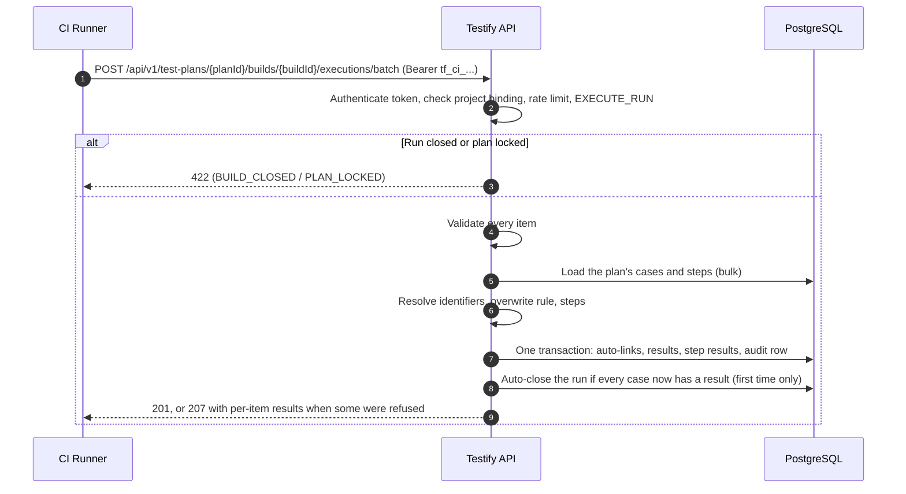
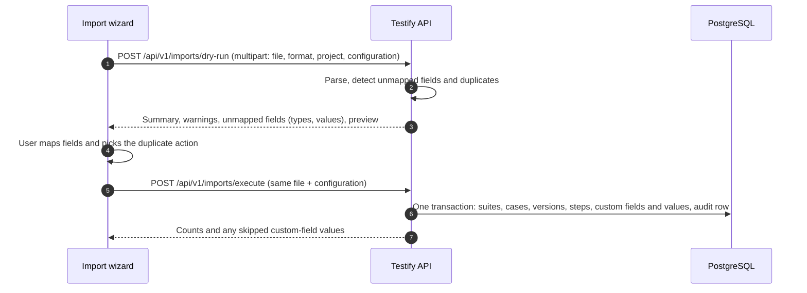

# RFC 03: API Contracts, High-Throughput Ingestion & Multi-Format Migration Engine

**Document Status:** Design document; sections 5-9 updated 2026-10-11 to match what's built
**Date:** September 8, 2026
**Author:** API & Integration Architecture Team
**Target Platform:** Testify
**Related Documents:** [00_requirements_alignment.md](00_requirements_alignment.md), [rfc_01_domain_model.md](rfc_01_domain_model.md)

> **Sections 1-4 (API conventions, endpoint contract, batch schema, error codes) are the original design, not the API as built.** The real API differs in paths, pagination (there's none yet; list endpoints return everything), payloads and error codes, and there's no OpenAPI spec. The API and MCP are due to be revisited, and that work will replace these sections. Until then, the routes in `apps/server/src/routes/` are the reference, along with [reports_api_and_mcp.md](reports_api_and_mcp.md) for reports, CI results and MCP. Sections 5-9 describe what's built, and say plainly what isn't.

---

## 1. Architectural Principles & RESTful API Standards

The Testify API layer is built to solve two contrasting operational demands:
1. **Real-Time Interactive UI:** Low-latency operations (< 50ms p95 response time) for browsing suite hierarchies, editing test cases, and toggling execution verdicts in the web application.
2. **High-Throughput CI/CD Pipeline Ingestion:** Bulk result streaming capable of processing 1,000+ execution results per request from automated test runners (GitHub Actions, GitLab CI, Jenkins, Playwright, PyTest) without table locking or HTTP timeouts.

```
+-----------------------------------------------------------------------------------+
|                                 API Client Layer                                  |
|  +------------------------------+             +--------------------------------+  |
|  | Modern Single-Page App (UI)  |             | Automated CI/CD Test Runners   |  |
|  +--------------+---------------+             +---------------+----------------+  |
+-----------------|---------------------------------------------|-------------------+
                  | (Low-Latency RESTful JSON)                  | (High-Throughput Batch POST)
                  v                                             v
+-----------------------------------------------------------------------------------+
|                             Testify API Gateway                                   |
|  +-----------------------------------------------------------------------------+  |
|  | Authentication (Bearer tf_ci_... / session cookie) & Rate Limiter           |  |
|  +-----------------------------------------------------------------------------+  |
|  | OpenAPI 3.1 Router & RFC 7807 Problem Details Error Handler                 |  |
|  +-----------------------------------------------------------------------------+  |
+-----------------|---------------------------------------------|-------------------+
                  v                                             v
+------------------------------------+        +-------------------------------------+
| Domain Controllers & Spec Service  |        | Bulk Batch Execution Processor      |
| (Projects, Suites, Cases, Plans)   |        | (Stream Mapper, In-Memory Lookup)   |
+-----------------+------------------+        +-----------------+-------------------+
                  |                                             |
                  +----------------------+----------------------+
                                         |
                                         v
+-----------------------------------------------------------------------------------+
|                        PostgreSQL (PGlite in development and tests)               |
|  +-----------------------------------------------------------------------------+  |
|  | Atomic Batch Transactions / UUIDv7 Foreign Keys / Immutable Execution Logs  |  |
|  +-----------------------------------------------------------------------------+  |
+----------------------------------------+------------------------------------------+
                                         | (Out-of-band attachments & raw logs)
                                         v
+-----------------------------------------------------------------------------------+
|            IStorageProvider (Local File System / AWS S3) -- not built             |
+-----------------------------------------------------------------------------------+
```

### 1.1 Specification & Resource Conventions
- **Contract Standard:** Native **OpenAPI 3.1.0** specification, fully typed with JSON Schema (Draft 2020-12). All endpoints strictly enforce `application/json` content types unless streaming raw binary attachments.
- **URI Naming:** Predictable plural nouns with hierarchical nesting for sub-resources:
  - Base Path: `/api/v1`
  - Specification Entities: `/projects`, `/test-suites`, `/test-cases`, `/test-case-versions`
  - Execution Entities: `/test-plans`, `/builds`, `/executions`
  - Migration & Ingestion: `/imports/dry-run`, `/imports/execute`, `/exports/testlink`

### 1.2 Cursor-Based Pagination & Filtering
To guarantee sub-50ms query response times over millions of records, all list endpoints mandate cursor-based pagination using monotonic **UUIDv7** primary keys.

- **Query Parameters:**
  - `limit` (integer, optional): Items per page. Default `50`, maximum `250`.
  - `starting_after` (string, optional): UUIDv7 cursor cursor indicating the last item from the previous page.
  - `direction` (string, optional): `next` (default) or `prev`.
- **Filtering Parameters:**
  - `status` (string/array): Filter by execution or case version status (e.g., `PASSED,FAILED` or `APPROVED`).
  - `priority` (string/array): Filter by importance (`HIGH`, `MEDIUM`, `LOW`).
  - `assigned_to` (string): User UUIDv7 assigned to the test plan case.
  - `suite_id` (string): Filter by test suite tree node.
  - `updated_since` (string): ISO 8601 timestamp for incremental sync.
- **Pagination Header Standards:**
  - `X-Has-More`: Boolean indicating if subsequent pages exist.
  - `X-Next-Cursor`: UUIDv7 string of the final item in the payload.
  - `X-Total-Count`: Integer representing total matching records (calculated asynchronously for large datasets).

---

## 2. OpenAPI 3.1 Endpoint Specifications

### 2.1 Test Specification Core API (`/projects`, `/test-suites`, `/test-cases`)

#### `GET /api/v1/projects/{project_id}/test-suites`
Retrieves the hierarchical test suite tree for a given project.
- **Query Parameters:** `parent_id` (optional, default null for root suites), `include_cases` (boolean).
- **Response (200 OK):**
```json
{
  "object": "list",
  "data": [
    {
      "id": "0191c4d0-7a1a-7b3c-8e4d-1a2b3c4d5e6f",
      "project_id": "0191c4d0-0000-7000-8000-000000000001",
      "parent_id": null,
      "name": "Authentication & Authorization",
      "details": "End-to-end security and login test suites",
      "node_order": 1,
      "created_at": "2026-09-08T10:00:00Z",
      "updated_at": "2026-09-08T10:00:00Z"
    }
  ],
  "has_more": false
}
```

#### `POST /api/v1/test-suites/{suite_id}/test-cases`
Creates a new test case specification and generates its initial `v1` draft version.
- **Request Body:**
```json
{
  "title": "Verify OAuth2 Refresh Token Rotation",
  "external_id": "TC-Auth-102",
  "priority": "HIGH",
  "importance": "HIGH",
  "execution_type": "AUTOMATED",
  "summary": "Ensure that old refresh tokens are invalidated upon issuing a new pair.",
  "preconditions": "User has an active session and valid refresh token.",
  "steps": [
    {
      "step_number": 1,
      "actions": "POST /api/v1/auth/refresh with token R1",
      "expected_results": "Returns HTTP 200 with new token pair (A2, R2)",
      "execution_type": "AUTOMATED"
    },
    {
      "step_number": 2,
      "actions": "POST /api/v1/auth/refresh with token R1 again",
      "expected_results": "Returns HTTP 401 and revokes token family R2",
      "execution_type": "AUTOMATED"
    }
  ],
  "custom_fields": {
    "cf_automation_framework": "Playwright",
    "cf_security_tier": "Tier-1"
  }
}
```
- **Response (201 Created):**
```json
{
  "id": "0191c4d0-8b2b-7c4d-9f5e-2b3c4d5e6f7a",
  "suite_id": "0191c4d0-7a1a-7b3c-8e4d-1a2b3c4d5e6f",
  "external_id": "TC-Auth-102",
  "current_version_number": 1,
  "status": "DRAFT",
  "title": "Verify OAuth2 Refresh Token Rotation",
  "importance": "HIGH",
  "steps_count": 2,
  "created_at": "2026-09-08T12:00:00Z"
}
```

---

### 2.2 Test Plan & Build Management API (`/test-plans`, `/builds`)

#### `POST /api/v1/projects/{project_id}/test-plans`
Creates a new Test Plan container.
- **Request Body:**
```json
{
  "name": "Sprint 42 Regression Suite",
  "notes": "Scope covers Core API and Payment Integration",
  "is_active": true
}
```
- **Response (201 Created):** Returns the `TestPlan` object with state `ACTIVE`.

#### `PUT /api/v1/test-plans/{plan_id}/status`
Transitions a Test Plan between `ACTIVE`, `LOCKED`, and `ARCHIVED`.
- **Request Body:**
```json
{
  "status": "LOCKED",
  "reason": "Release v2.4.0 code freeze enforced."
}
```

#### `POST /api/v1/test-plans/{plan_id}/builds`
Creates a Build entry under an active Test Plan.
- **Request Body:**
```json
{
  "name": "v2.4.0-rc3",
  "notes": "CI Build #981247",
  "is_open": true,
  "release_date": "2026-09-10"
}
```

---

## 3. High-Throughput CI/CD Ingestion Engine (`POST /executions/batch`)

Modern automated test execution streams hundreds to thousands of test results in continuous integration pipelines. To support pipeline execution without causing connection pool exhaustion or lock contention, Testify implements a specialized bulk ingestion endpoint.

### 3.1 Bulk Endpoint Schema Specification

`POST /api/v1/test-plans/{plan_id}/builds/{build_id}/executions/batch`

#### Query Parameters:
- `all_or_nothing` (boolean, optional, default `false`): Controls transaction boundary.
  - `true`: Atomic mode. If any single result validation or case lookup fails, the entire batch is rejected with `HTTP 422 Unprocessable Entity` and no records are saved.
  - `false`: Partial failure mode. Valid results are written, and invalid entries are returned in an error summary payload with `HTTP 207 Multi-Status`.

#### Request Payload (`application/json`):
```json
{
  "environment": "staging-us-east-1",
  "runner_info": {
    "name": "GitHub Actions",
    "run_id": "98124712",
    "job_name": "e2e-regression / chrome-suite",
    "commit_sha": "a1b2c3d4e5f67890123456789abcdef012345678"
  },
  "executions": [
    {
      "case_identifier": {
        "external_id": "TC-Auth-102"
      },
      "verdict": "PASSED",
      "status": "COMPLETED",
      "duration_ms": 3420,
      "executed_at": "2026-09-08T13:15:00Z",
      "notes": "Test executed successfully in Chrome 128 headless.",
      "environment_tags": {
        "browser": "chrome-128",
        "os": "ubuntu-24.04"
      },
      "step_results": [
        {
          "step_number": 1,
          "verdict": "PASSED",
          "actual_result": "HTTP 200 returned with valid tokens."
        },
        {
          "step_number": 2,
          "verdict": "PASSED",
          "actual_result": "HTTP 401 returned and token family revoked."
        }
      ]
    },
    {
      "case_identifier": {
        "by_path_title": {
          "suite_path": "Payments / Checkout Gateway",
          "title": "Verify Stripe 3DS Challenge Flow"
        }
      },
      "verdict": "FAILED",
      "status": "COMPLETED",
      "duration_ms": 12450,
      "executed_at": "2026-09-08T13:15:05Z",
      "stack_trace": "TimeoutError: element ('#stripe-3ds-iframe') not visible after 10000ms\n    at Page.waitForSelector (/tests/checkout.spec.ts:45:12)",
      "notes": "Failed during 3DS challenge frame load.",
      "step_results": [
        {
          "step_number": 1,
          "verdict": "PASSED",
          "actual_result": "Cart initialized."
        },
        {
          "step_number": 2,
          "verdict": "FAILED",
          "actual_result": "Iframe failed to mount within timeout."
        }
      ]
    },
    {
      "case_identifier": {
        "by_uuid": "0191c4d0-8b2b-7c4d-9f5e-2b3c4d5e6f7a"
      },
      "verdict": "SKIPPED",
      "status": "COMPLETED",
      "duration_ms": 0,
      "executed_at": "2026-09-08T13:15:06Z",
      "notes": "Skipped due to dependency flag --disable-payment-tests"
    }
  ]
}
```

#### Response Payload (`207 Multi-Status` / `201 Created`):
```json
{
  "object": "batch_execution_result",
  "summary": {
    "total_submitted": 3,
    "successful": 3,
    "failed": 0,
    "duration_ms": 42
  },
  "results": [
    {
      "index": 0,
      "status": 201,
      "execution_id": "0191c4d5-1111-7000-8000-000000000001",
      "case_id": "0191c4d0-8b2b-7c4d-9f5e-2b3c4d5e6f7a",
      "verdict": "PASSED"
    },
    {
      "index": 1,
      "status": 201,
      "execution_id": "0191c4d5-2222-7000-8000-000000000002",
      "case_id": "0191c4d0-9c3c-7d5e-0f6f-3c4d5e6f7a8b",
      "verdict": "FAILED"
    },
    {
      "index": 2,
      "status": 201,
      "execution_id": "0191c4d5-3333-7000-8000-000000000003",
      "case_id": "0191c4d0-8b2b-7c4d-9f5e-2b3c4d5e6f7a",
      "verdict": "SKIPPED"
    }
  ]
}
```

---

### 3.2 Ingestion Concurrency & Write Optimization Patterns

How the batch route (`apps/server/src/routes/batchExecution.ts`) records results quickly (2,000 results in about 1.5 s in the test suite):

1. **Validate everything first:** every item is checked (`validateBatchItem`) before anything touches the database. In all-or-nothing mode, all problems come back in one 400.
2. **Look identifiers up in bulk:** the plan's cases are loaded once and the incoming `external_id` / `by_uuid` / `by_path_title` identifiers are resolved in memory. Step results are matched exactly against the steps of the version each case runs at.
3. **One transaction, multi-row inserts:** auto-links, results, step results and the audit row are written in one transaction, with results and step results inserted 500 rows at a time. A refused item never leaves a plan link behind, and in atomic mode a refusal rolls everything back.
4. **Version binding:** each result belongs to the case's link in the plan, which pins the version the case runs at. Editing or re-approving the case later doesn't change past results.

Failure messages and stack traces are stored in the `executions` row itself (`failure_message`, `stack_trace`). There's no out-of-band offloading (see §5).

---

## 4. Locked Plan & Closed Build HTTP 422 Standards

Per the locked system constraints in [00_requirements_alignment.md](00_requirements_alignment.md), completed execution results remain permanently viewable and exportable for audit compliance. However, **any operational attempt to create, update, or overwrite execution results against a locked Test Plan or closed Build must be strictly blocked and rejected with HTTP 422 Unprocessable Entity**.

### 4.1 RFC 7807 Error Specification
All operational error responses conform strictly to **RFC 7807 Problem Details for HTTP APIs**.

#### Error Response: Execution Submission to Closed Build
```http
HTTP/1.1 422 Unprocessable Entity
Content-Type: application/problem+json

{
  "type": "https://api.testify.dev/errors/BUILD_CLOSED",
  "title": "Unprocessable Entity",
  "status": 422,
  "code": "BUILD_CLOSED",
  "detail": "Build 'v2.4.0-rc1' (ID: 0191c4d0-9a9a-7000-8000-000000000099) is closed. Executions cannot be added or modified on a closed build.",
  "instance": "/api/v1/test-plans/0191c4d0-1111-7000-8000-000000000005/builds/0191c4d0-9a9a-7000-8000-000000000099/executions/batch",
  "invalid_params": [
    {
      "name": "build_id",
      "reason": "Build status is CLOSED"
    }
  ],
  "timestamp": "2026-09-08T13:20:00Z"
}
```

#### Error Response: Execution Submission to Locked Test Plan
```http
HTTP/1.1 422 Unprocessable Entity
Content-Type: application/problem+json

{
  "type": "https://api.testify.dev/errors/PLAN_LOCKED",
  "title": "Unprocessable Entity",
  "status": 422,
  "code": "PLAN_LOCKED",
  "detail": "Test Plan 'Sprint 41 Final' (ID: 0191c4d0-1111-7000-8000-000000000005) is locked. Plan specifications and execution states are frozen.",
  "instance": "/api/v1/test-plans/0191c4d0-1111-7000-8000-000000000005/builds/0191c4d0-9a9a-7000-8000-000000000099/executions",
  "timestamp": "2026-09-08T13:21:00Z"
}
```

### 4.2 Error Code Registry
| Error Code | HTTP Status | Trigger Condition | Remediation / Resolution |
| :--- | :--- | :--- | :--- |
| `BUILD_CLOSED` | `422` | Attempting to `POST` or `PUT` execution results against a `Closed` build. | Admin must re-open build or target an open build. |
| `PLAN_LOCKED` | `422` | Attempting execution mutation or case assignment on a `Locked` or `Archived` Test Plan. | Admin must transition plan status back to `ACTIVE`. |
| `CASE_VERSION_LOCKED` | `422` | Attempting to modify an `Approved` or frozen `TestCaseVersion`. | User must spawn a new `Draft` version (`v2`). |
| `DRAFT_VERSION_ASSIGNMENT_DISALLOWED` | `422` | Adding a `Draft` test case to a Test Plan when project setting `allow_draft_testing = false`. | Case version must be transitioned to `APPROVED`. |
| `VALIDATION_FAILED` | `422` | JSON Schema validation failure on request payload. | Fix schema violations detailed in `invalid_params`. |

---

## 5. Attachments, Logs & Retention

> **Not built.** There are no attachments (screenshots, videos, trace files), no `IStorageProvider`, no pre-signed uploads and no retention purge. The design below stays as the plan for when attachments are added.

What's built today:
- **Results and logs** are stored in the database: verdict, notes, `failure_message` and `stack_trace` (text), environment tags and runner details, per result. Nothing is purged automatically.
- **Audit logs** are append-only forever: database triggers reject UPDATE and DELETE (see RFC 04 §5).

The plan:
- **Attachments and large logs** go to out-of-band storage behind an `IStorageProvider` interface (`putObject`, `getObject`, `deleteObject`, `getPresignedUrl`). The database keeps only a storage key, SHA-256 checksum, size and MIME type.
- **Two providers,** chosen by configuration, independent of the database:
  - `LocalStorageProvider` stores files on disk (`./data/attachments/{project_id}/{year}/{month}/{id}.bin`) and streams them.
  - `S3StorageProvider` works with AWS S3, MinIO, Cloudflare R2 or Google Cloud Storage. Large uploads go straight to the bucket through pre-signed URLs (`POST /api/v1/executions/{execution_id}/attachments/presign`, then registering the key and checksum).
- **Retention:** an admin-configurable purge of old results and their attachments (planned default: 365 days), never touching audit logs.

---

## 6. Extensible Multi-Format Ingestion & Migration Engine

Importing existing test repositories into Testify supports five formats through one pipeline: preview (dry run), then execute. The import wizard in the web app (`ImportWizardModal.tsx`) walks through Upload → Field Mapping → Duplicates → Confirm → Results.

```
+-----------------------------------------------------------------------------------+
|  TestLink XML | JUnit XML | Testify JSON | CSV | TestRail CSV (explicit only)     |
+----------------------------------------+------------------------------------------+
                                         v
+-----------------------------------------------------------------------------------+
|        Parsers (packages/core/src/ingestion), one IFileParser per format          |
+----------------------------------------+------------------------------------------+
                                         v
+-----------------------------------------------------------------------------------+
|  POST /api/v1/imports/dry-run: counts, warnings, unmapped custom fields           |
|  (with inferred types and distinct values), hierarchy preview. Writes nothing.    |
+----------------------------------------+------------------------------------------+
                                         v  (user chooses field mappings + duplicate action)
+-----------------------------------------------------------------------------------+
|  POST /api/v1/imports/execute: the same file again, applied in one transaction    |
+-----------------------------------------------------------------------------------+
```

### 6.1 Parser Interface
Each format implements `IFileParser` (`packages/core/src/ingestion/types.ts`); a new format is a new parser, without changing the import routes.

```typescript
export interface IFileParser {
  formatId: 'TESTLINK_XML' | 'NATIVE_JSON' | 'STANDARD_CSV' | 'JUNIT_XML' | 'TESTRAIL_CSV';
  canHandle(fileHeader: Buffer, filename: string): boolean;
  parseStream(
    inputStream: Readable | ReadableStream | AsyncIterable<Buffer | string>,
    options?: ParseOptions
  ): AsyncIterable<ParsedSuite>;
}
```

`ParsedSuite` holds `name`, `details`, `node_order`, `sub_suites` and `test_cases`. Each `ParsedCase` has `external_id`, `title`, `summary`, `preconditions`, `importance`, `execution_type`, `steps`, a flat `custom_fields` string map, and any parser warnings.

**Auto-detection** sniffs the first bytes, checking JUnit XML before TestLink XML: both use `<testsuite>`, but JUnit has `tests=`/`classname=` attributes. TestRail CSV is never auto-detected; it has to be chosen explicitly.

### 6.2 Format Mappings

#### TestLink XML

| TestLink XML Element | Testify Field | Rules |
| :--- | :--- | :--- |
| `<testsuite name="...">` | Suite name | Nesting preserved. |
| `<details>` | Suite details | |
| `<testcase name="...">` | Case title | Over 255 characters is trimmed, with a `TITLE_TRUNCATED` warning. |
| `<externalid>` | Case external id | Kept if free in the project; otherwise the next free `PREFIX-n` (§6.4). |
| `<summary>`, `<preconditions>` | Version summary / preconditions | HTML cleaned to plain text: tags removed, `<br>` and `</p>` become line breaks, entities decoded. |
| `<importance>` | Case priority | `1` → LOW, `2` → MEDIUM, `3` → HIGH. |
| `<execution_type>` | Execution type | `1` → MANUAL, `2` → AUTOMATED. |
| `<steps><step>` | Steps | `<step_number>`, `<actions>`, `<expectedresults>`, cleaned like the summary. |
| `<custom_fields><custom_field>` | Custom fields | `<name>` → column, `<value>` → value; mapped in the wizard (§6.4). |

#### Other formats
- **Testify JSON:** mirrors the domain model; the JSON export re-imports through it.
- **CSV:** a header row with columns matched by name, case-insensitively: `Suite Path`, `External ID`, `Title`, `Summary`, `Preconditions`, `Importance`, `Execution Type`, `Step Number`, `Action`, `Expected Result`. Other columns become custom fields; the CSV export writes them as `cf_<name>`. One row per step, with the case's fields repeated. A CSV definitions export re-imports through this parser. Known limits:
  - Any `Importance` other than HIGH, MEDIUM or LOW becomes MEDIUM.
  - A custom field whose name contains a built-in column's word (`title`, `suite`, `action`, `result`...) is read as that column.
- **JUnit XML:** suites nest by the test's dotted `classname`. Status, duration and failure message arrive as the custom fields `junit_status`, `junit_duration_seconds` and `junit_failure_message`. They're case fields, not results; send results through the batch API instead.
- **TestRail CSV:** TestRail's export with one combined `Steps` column and one `Expected Result` column, both as numbered lists. TestRail's `Critical` priority becomes HIGH. The variant with one column per step isn't supported; it gets an `UNSUPPORTED_TESTRAIL_COLUMN_FORMAT` warning.

### 6.3 File Size & Memory

Not built as designed: the original plan was to stream 100 MB+ TestLink exports in bounded memory, with progress events. Today the route holds the uploaded file and its parsed tree in memory (it parses once for the preview and again for the import), so it enforces limits instead:
- At most **50 MB** per file, sent as `multipart/form-data`. A JSON body carrying the file as base64 is limited to 5 MB.
- At most **2 imports at a time** per server (`429 IMPORT_BUSY`).
- No progress events; the request returns when the import finishes.

### 6.4 Field Mapping & Duplicates

#### Custom fields
The dry run lists every column that isn't an existing custom field, with:
- an inferred type: CHECKBOX, NUMBER, DATE, or TEXT (the fallback); select types are never guessed;
- sample values;
- the column's distinct values (up to 200).

The user picks an action for each:
- `DROP`: ignore the column.
- `AUTO_CREATE`: create a new **project-scoped** custom field (TEXT, NUMBER, CHECKBOX, DATE, SINGLE_SELECT or MULTI_SELECT). A select field's options are every distinct value in the file; multi-select splits values on commas.
- `ROUTE_TO_EXISTING`: put the values into an existing global or project custom field.

Values are validated like any other custom-field value. A value that doesn't fit is skipped and reported (`skipped_custom_field_value_warnings`) without failing the import.

```json
{
  "field_mappings": [
    { "incoming_key": "cf_jira_key", "action": "ROUTE_TO_EXISTING", "target_field_id": "..." },
    { "incoming_key": "automationStatus", "action": "AUTO_CREATE", "field_name": "Automation Status", "field_type": "SINGLE_SELECT" }
  ],
  "duplicate_resolution": { "default_action": "VERSION_UP" }
}
```

#### Duplicates
A case counts as a duplicate when its external id matches a case in the project, or its title matches a case in the same suite. Actions:
- `VERSION_UP` (default): add a new version to the existing case, keeping its results.
- `OVERWRITE`: replace the latest version's content.
- `CREATE_NEW`: create a separate case titled `<title> (Copy)`, with a fresh external id.
- `SKIP`: leave the existing case alone.

The API also accepts per-case `overrides` by external id or title; the wizard only sets the default. `apply_to_all_future_duplicates` is accepted but has no effect.

#### External ids
New cases keep the file's id unless it's taken; otherwise they get the next free `PREFIX-n`, assigned under a per-project lock so concurrent imports and case creation never collide.

### 6.5 Dry Run & Execute

`POST /api/v1/imports/dry-run` and `POST /api/v1/imports/execute` take the same `multipart/form-data` request:
- `file`;
- `format` (leave it out to detect the format automatically);
- `target_project_id`;
- `configuration`: JSON with the field mappings and duplicate resolution.

Both need `IMPORT_DATA` in the target project. An API token may only import into its own project.

The dry run writes nothing and returns:
- `dry_run_summary`: suites and cases detected, to create, to version up, to overwrite, skipped, unmapped fields, warnings;
- `warnings`: e.g. `TITLE_TRUNCATED`, `EMPTY_STEPS` and parser warnings;
- `unmapped_custom_fields`;
- `hierarchy_preview`.

Execute runs the whole import in one transaction, writes an `IMPORT_EXECUTED` audit row, and returns the counts. There's no server-side session or ticket: the client sends the file again.

---

## 7. Authentication, Rate Limiting & Webhooks

### 7.1 Authentication
Every API request needs a credential (RFC 04 §4 has the details):
- **Machine API tokens** (`Authorization: Bearer tf_ci_...`), for CI and agents. Each is created per project in Admin Panel → API Tokens, with chosen capabilities, and is bound to that project and capped by its issuer's current permissions.
- **Sign-in tokens:** `POST /api/v1/auth/login` returns a JWT for scripts. The web app uses an HttpOnly session cookie instead, plus a `X-Testify-Client: web` header on changes.

There are no personal access tokens or separate runner-token types; a token's capabilities decide what it can do. The built-in Automation Service role's set (`SPEC_VIEW`, `RUN_MANAGE`, `EXECUTE_RUN`) suits CI.

---

### 7.2 Rate Limiting Policies & Response Headers
Limits are generous on purpose -- CI runners, scripts and MCP agents make many more calls than people -- and exist to stop runaway loops and abuse. Each is a **token bucket** per caller: the whole allowance can be used at once, and it refills evenly over the window. The counts are kept in memory per server process (`apps/server/src/services/rateLimits.ts`).

- **Rate Limits:**
  - Every request made with a machine API token (REST, `/executions/batch`, `/mcp`): **1,200 requests per minute per token**. A batch request can carry up to 5,000 results.
  - Exports (`.../exports/definitions`, `.../exports/execution-results`): **120 per hour per user or token**.
  - Sending report emails (`.../report-emails` without `preview`, `.../report-schedules/:id/send-now`, `/admin/email-settings/test`): **60 per hour per user or token**.
- **HTTP 429 Too Many Requests Payload:**
```http
HTTP/1.1 429 Too Many Requests
Retry-After: 30
Content-Type: application/problem+json

{
  "type": "https://api.testify.dev/errors/RATE_LIMITED",
  "title": "Too Many Requests",
  "status": 429,
  "code": "RATE_LIMITED",
  "detail": "Too many requests with this API token: the limit is 1200 per minute. Try again in 1 second.",
  "instance": "/api/v1/projects/.../plans"
}
```

---

### 7.3 Webhooks

> **Not built.** Nothing pushes events out of Testify yet, except scheduled and manual report emails (see [reports_api_and_mcp.md](reports_api_and_mcp.md)).

The plan:
- **Events:** e.g. `execution.failed`, `build.completed` (a run closed), `test_case.approved`, `import.completed`.
- **Signing:** each delivery is signed so receivers can verify it and reject replays. `X-Signature-Timestamp` holds the Unix time; `X-Signature-SHA256` holds an HMAC-SHA256 over `${timestamp}.${raw_json_body}` with the webhook's secret.

---

## 8. System Workflows

### 8.1 CI Results



### 8.2 Import



---

## 9. Summary

| Area | Design | Status |
| :--- | :--- | :--- |
| **REST conventions** | OpenAPI 3.1, cursor pagination, resource naming (§1-2) | Not as designed; to be replaced by the API revisit. |
| **CI results** | Batch endpoint with all-or-nothing mode (§3) | Built: up to 5,000 results per request, one transaction. |
| **Closed runs, locked plans** | Writes rejected with HTTP 422 `BUILD_CLOSED` / `PLAN_LOCKED` (§4) | Built. |
| **Attachments and retention** | `IStorageProvider`, pre-signed uploads, 365-day purge (§5) | Not built. Audit logs append-only forever: built. |
| **Import formats** | Parser interface; TestLink XML, JSON, CSV (§6.1-6.2) | Built, plus JUnit XML and TestRail CSV. |
| **Large files** | Streaming 100 MB+ in bounded memory (§6.3) | Not built: 50 MB cap, held in memory. |
| **Field mapping and duplicates** | Drop / auto-create / map; create / overwrite / version up / skip (§6.4) | Built; per-case duplicate choices are API-only. |
| **Dry run** | `POST /imports/dry-run` preview before import (§6.5) | Built. |
| **Auth and rate limits** | Bearer tokens, 429 with `Retry-After` (§7.1-7.2) | Built (RFC 04). |
| **Webhooks** | HMAC-SHA256 signed events (§7.3) | Not built. |
