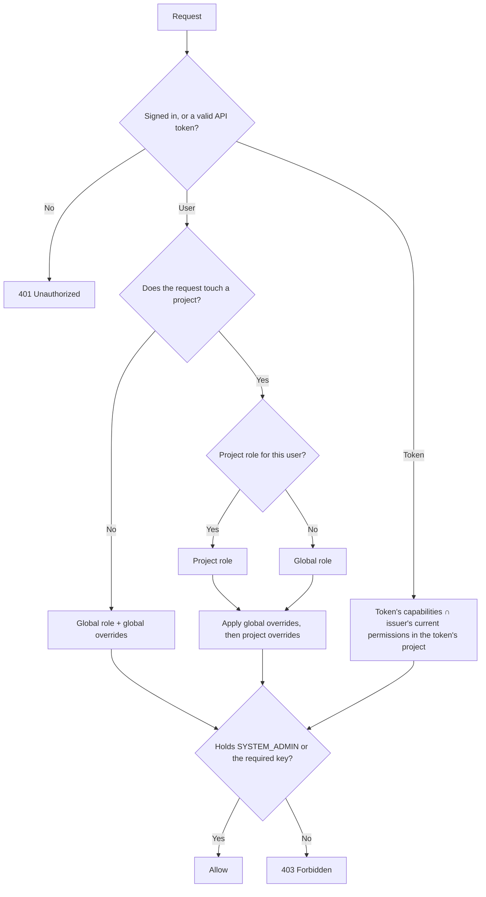
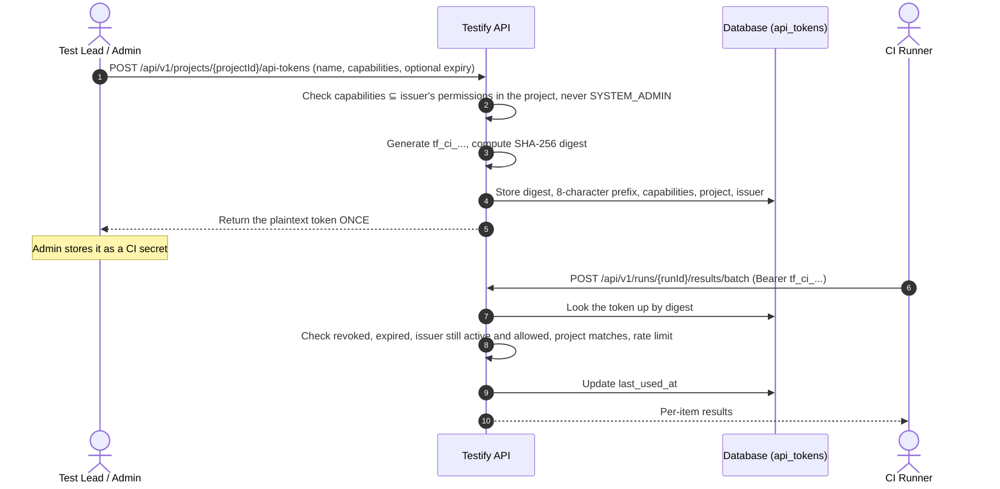
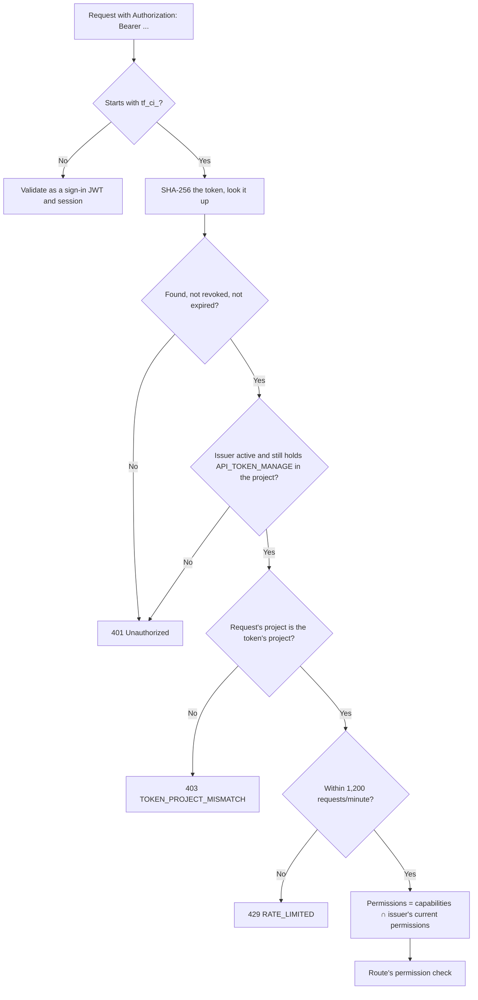
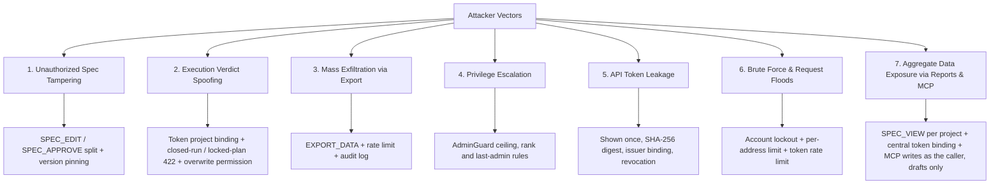

# RFC 04: Role-Based Access Control (RBAC), Token Architecture & Audit Logging Specification

- **Document Status:** Design document, updated 2026-10-11 to match what's built
- **Author:** Security & RBAC Analyst
- **Date:** September 8, 2026
- **Target Version:** Testify v1.0
- **Upstream Alignment:** [00_requirements_alignment.md](00_requirements_alignment.md), [.antigravity/agents/security_rbac.md](../.antigravity/agents/security_rbac.md)

---

## 1. Executive Summary & Security Architecture

### 1.1 Context & Objectives
Legacy TestLink implementations relied on coarse, monolithic and brittle permission models. Permissions were hard to audit, didn't separate human users from automated runners, and allowed silent test case tampering and execution spoofing.

Testify's security model enforces:
1. **String-constant permission keys** instead of bitmasks, from one registry (`packages/core/src/rbac/registry.ts`).
2. **Global roles with per-project roles and per-user overrides**, resolved deterministically for the project each request touches.
3. **Machine API tokens:** high-entropy, project-bound tokens (`tf_ci_...`) shown once and stored only as a SHA-256 digest. A token can never do more than the person who issued it can do now.
4. **An append-only audit log:** the `audit_logs` table is protected by database triggers that reject UPDATE and DELETE, and nothing deletes rows automatically (locked requirement from [00_requirements_alignment.md](00_requirements_alignment.md)).
5. **Defense in depth** against execution spoofing, spec tampering, credential leakage, privilege escalation and data exfiltration.

---

## 2. Permission Key Registry

Permissions are string constants named `<DOMAIN>_<ACTION>`, e.g. `SPEC_APPROVE`, `EXECUTE_RUN`, `API_TOKEN_MANAGE`. The registry holds 20 keys. Any key can be granted globally (through the global role or a global override) or for one project (through a project role or a project override).

### 2.1 Permission Keys

| Permission Key | Group | What it allows | Risk |
| :--- | :--- | :--- | :--- |
| `SYSTEM_ADMIN` | Administration | Everything, in every project. Passes every permission check. Never grantable to an API token. | **CRITICAL** |
| `USER_MANAGE` | Administration | Create users, assign roles and overrides, reset passwords, edit role templates, view the security audit log. | **HIGH** |
| `API_TOKEN_MANAGE` | Administration | Create and revoke machine API tokens for a project. | **HIGH** |
| `CUSTOM_FIELD_MANAGE` | Administration | Create, edit and delete global custom field definitions. | **MEDIUM** |
| `PROJECT_CREATE` | Projects | Create projects, and edit a project's name, prefix and description. | **HIGH** |
| `PROJECT_DELETE` | Projects | Delete a project and everything in it (after a confirmation). | **CRITICAL** |
| `SPEC_VIEW` | Specifications | View test suites, test cases, steps and custom field values, and read reports. | **LOW** |
| `SPEC_CREATE` | Specifications | Create test suites and test cases. | **MEDIUM** |
| `SPEC_EDIT` | Specifications | Edit draft versions and steps, rename and move suites and cases. | **MEDIUM** |
| `SPEC_APPROVE` | Specifications | Approve a draft version; deprecate and restore cases. | **HIGH** |
| `SPEC_DELETE` | Specifications | Delete test suites and test cases (after a confirmation). | **HIGH** |
| `SPEC_AUTO_APPROVE` | Specifications | New cases this user creates start approved instead of as a draft. | **MEDIUM** |
| `PLAN_MANAGE` | Planning | Create, edit and delete test plans; manage which cases are in one; edit custom field values. | **HIGH** |
| `RUN_MANAGE` | Planning | Create, edit, close, reopen and delete test runs (including CI creating a run by name with `run_name`). | **MEDIUM** |
| `EXECUTE_RUN` | Execution | Record results (verdicts and notes) for test cases. | **MEDIUM** |
| `EXECUTE_OVERWRITE` | Execution | Record a new result for a case that already has one in the run. Results are never edited; the new result becomes the latest. | **HIGH** |
| `IMPORT_DATA` | Data | Import suites and cases (TestLink XML, JUnit XML, TestRail CSV, CSV, JSON), including creating project-scoped custom fields while mapping. | **HIGH** |
| `EXPORT_DATA` | Data | Export suites, cases and run results (JSON, CSV). | **HIGH** |
| `REPORT_EMAIL` | Data | Email reports to any address and manage scheduled report emails. | **HIGH** |
| `WEBHOOK_MANAGE` | Data | Set up webhooks that send the project's events to any address. Never grantable to an API token. | **HIGH** |

---

## 3. Built-in Role Templates & Scoping Hierarchy

Testify ships with six built-in role templates. Admins can edit or delete them (once no one holds them) and create their own.

### 3.1 Role Profiles

1. **`Admin`:** holds `SYSTEM_ADMIN`, so it can do everything everywhere.
2. **`Test Lead`:** specification authoring and approval, plans, runs, overwriting results, import and export, API tokens and report emails.
3. **`Tester`:** views and drafts specifications, records results and exports. Can't approve, delete or manage plans and runs.
4. **`Automation Service`:** for CI accounts. Views specifications, manages runs and records results.
5. **`Viewer`:** views specifications and reports, and exports.
6. **`No Access`:** grants nothing. Used as a global role to limit someone to the projects where they're given a project role (see §3.3).

New users default to `Tester`.

### 3.2 Role vs. Permission Key Matrix

✓ = granted by default.

| Permission Key | Admin | Test Lead | Tester | Automation Service | Viewer | No Access |
| :--- | :---: | :---: | :---: | :---: | :---: | :---: |
| `SYSTEM_ADMIN` | ✓ | | | | | |
| `USER_MANAGE` | ✓ | | | | | |
| `API_TOKEN_MANAGE` | ✓ | ✓ | | | | |
| `CUSTOM_FIELD_MANAGE` | ✓ | | | | | |
| `PROJECT_CREATE` | ✓ | | | | | |
| `PROJECT_DELETE` | ✓ | | | | | |
| `SPEC_VIEW` | ✓ | ✓ | ✓ | ✓ | ✓ | |
| `SPEC_CREATE` | ✓ | ✓ | ✓ | | | |
| `SPEC_EDIT` | ✓ | ✓ | ✓ | | | |
| `SPEC_APPROVE` | ✓ | ✓ | | | | |
| `SPEC_DELETE` | ✓ | ✓ | | | | |
| `SPEC_AUTO_APPROVE` | ✓ | ✓ | | | | |
| `PLAN_MANAGE` | ✓ | ✓ | | | | |
| `RUN_MANAGE` | ✓ | ✓ | | ✓ | | |
| `EXECUTE_RUN` | ✓ | ✓ | ✓ | ✓ | | |
| `EXECUTE_OVERWRITE` | ✓ | ✓ | | | | |
| `IMPORT_DATA` | ✓ | ✓ | | | | |
| `EXPORT_DATA` | ✓ | ✓ | ✓ | | ✓ | |
| `REPORT_EMAIL` | ✓ | ✓ | | | | |
| `WEBHOOK_MANAGE` | ✓ | ✓ | | | | |

Because `SYSTEM_ADMIN` passes every check, an Admin effectively holds every key; the Admin role's bundle also lists them all explicitly.

---

### 3.3 Access Evaluation

Every request is evaluated for the project it touches. `authenticateRequest` (`apps/server/src/middleware/auth.ts`) works the project out from the route: `:projectId` or `project_id` if given, otherwise from the plan, run, case or suite ids the route names. Ids from different projects get `400 PROJECTS_DIFFER`.



#### Evaluation Rules
1. **Base permissions:** the user's project role in that project if they have one; it **replaces** the global role there. Otherwise the global role. A user holding `SYSTEM_ADMIN` gets the whole registry.
2. **Overrides:** per-user grants or denials, global ones first and then the project's, so a project override wins a conflict. Overrides have the final say, and can even remove a key from an admin.
3. **Check:** the route's required key, or `SYSTEM_ADMIN`. Routes use `requirePermission(key)` or `requireAnyPermission(keys)`. Reads that executing tests needs accept `SPEC_VIEW` or `EXECUTE_RUN`.
4. **Default deny:** otherwise `403 Forbidden`.

#### Limiting a user to some projects
A global role applies in every project, including ones created later. To limit someone to certain projects, give them the `No Access` global role and a project role in each project they should see (Admin Panel → Privilege & Access Matrix). They see no other project: `GET /api/v1/projects` lists only projects where the caller holds `SPEC_VIEW` or `EXECUTE_RUN`. With each project it returns the caller's permissions there, which the web app uses for the selected project.

#### Changing who can do what
Every role, override, status and password change in the Admin Panel goes through `apps/server/src/services/adminGuard.ts`, in one transaction that rolls back on any violation:
- **Ceiling:** nobody can give anyone (themselves included) a permission they don't hold at that scope (`403 PERMISSION_CEILING`).
- **Rank:** nobody can change a user, or edit or delete a role, that has permissions they don't (`403 TARGET_OUTRANKS_ACTOR` / `ROLE_OUTRANKS_ACTOR`).
- **Last admin:** no change may leave zero active users holding `SYSTEM_ADMIN` (`409 LAST_ADMIN`).

---

## 4. Authentication Architecture & Token Lifecycle

Testify has two kinds of credentials: **sign-ins** for people, and **machine API tokens** for CI pipelines and agents.

### 4.1 Interactive User Sessions
- **Passwords** are checked against a password policy (`packages/core/src/security/passwordPolicy.ts`) and stored as a PBKDF2-SHA512 hash (100,000 iterations) with a per-user salt.
- **Sign-in tokens:** HMAC-SHA256 JWTs carrying `sub` (user id), `username`, `sid` (session id) and `exp`, valid for 7 days, signed with `JWT_SECRET`. The web app keeps its token in an `HttpOnly`, `SameSite=Strict` cookie (`Secure` over HTTPS) and sends `X-Testify-Client: web` on every change, as a CSRF guard. Scripts send the token as `Authorization: Bearer`.
- **Server-side sessions:** every token names a session row (`sessions` table), checked on every request. A session ends when any of these happens:
  - 8 hours pass without a request (each request extends it);
  - 7 days pass since sign-in;
  - the user signs out;
  - the user's password changes (their other sessions);
  - an admin resets the password;
  - the user is disabled.

  There are no separate refresh tokens; the session itself is what's renewed (`apps/server/src/sessionLifetime.ts`).
- **First admin:** on a real database, the first admin's password comes from `ADMIN_PASSWORD`, or is generated, printed once, and must be changed at first sign-in. Until a flagged user changes their password, every route except `/auth/me` and `/auth/credentials` answers `403 PASSWORD_CHANGE_REQUIRED`.
- **Password changes** need the current password. An admin with `USER_MANAGE` can reset another user's password to a temporary one that must be changed at next sign-in.

---

### 4.2 Machine API Token Lifecycle

API tokens let CI runners and agents use the API without a person's credentials.

```
Token format: tf_ci_<64 hex characters>   (32 random bytes)
Example:      tf_ci_64a0e7aa89701aae3a92c2bab4804c9837de313c04c132fb3b8ae5aeac5026bf
```



#### Token Security Specifications
1. **Shown once:** the plaintext token is in the creation response only. It's never stored and can't be retrieved again; the UI shows it once with a copy button.
2. **Stored as a digest:** `api_tokens.token_hash` is an unsalted SHA-256 digest, looked up by value. A 32-byte random token has enough entropy that a slow, salted hash isn't needed (the same approach GitHub and Stripe use).
3. **Bound to one project:** a token used on any other project gets `403 TOKEN_PROJECT_MISMATCH`, checked centrally for every route and every MCP tool call. A route that isn't part of any project (the `/api/v1/admin/...` routes, creating a project, changing your own account) refuses tokens outright with `403 TOKEN_NOT_ALLOWED`: deny by default, except `GET /auth/me`, `GET /projects` (only the token's project) and `/mcp` (which checks each call). See `tokenMayUseRoute` in `middleware/auth.ts`.
4. **Capped by its issuer:** a token's capabilities can't exceed the issuer's permissions at creation. On every use they're intersected with the issuer's **current** permissions in the project. If the issuer is disabled or loses `API_TOKEN_MANAGE` there, the token stops working (`401 TOKEN_ISSUER_INACTIVE`), and disabling the issuer revokes their tokens for good.
5. **System-wide permissions are never grantable** to a token, even by an admin (`TOKEN_EXCLUDED_PERMISSIONS` in `packages/core/src/rbac/registry.ts`): `SYSTEM_ADMIN` (it would be a cross-project superuser), `USER_MANAGE`, `CUSTOM_FIELD_MANAGE`, `PROJECT_CREATE` (their routes reach the whole system), `API_TOKEN_MANAGE` (a token can't issue tokens) and `WEBHOOK_MANAGE` (a webhook sends project data anywhere, so only people set them up). Asking for one is `400 CAPABILITY_NOT_GRANTABLE`; the API Tokens tab doesn't offer them, and a token made before 2026-10-12 that holds one loses it on every use.
6. **Expiry is optional:** no expiry by default, since a token can't outlive its issuer's access.
7. **Revocation:** anyone with `API_TOKEN_MANAGE` on the project can revoke a token at once (`DELETE /api/v1/api-tokens/{tokenId}`). Revoked tokens are kept, greyed out, with their last-used time, for investigation.
8. **Rate limit:** 1,200 requests per minute per token.

---

### 4.3 Token Validation Pipeline



---

## 5. In-Database Append-Only Audit Subsystem

### 5.1 Retention & Immutability Rules
As locked in [00_requirements_alignment.md](00_requirements_alignment.md) Section 1:
- Audit records in `audit_logs` are stored in the primary database with **no automatic deletion**.
- Audit records are **append-only**: database triggers reject every UPDATE and DELETE. Purging requires direct database maintenance by a database administrator.

### 5.2 Schema (`audit_logs`)

```sql
CREATE TABLE audit_logs (
    id            VARCHAR(36) PRIMARY KEY,
    actor_id      VARCHAR(36) NOT NULL,       -- user id, API token id, or 'SYSTEM'
    actor_type    VARCHAR(32) NOT NULL,       -- 'USER', 'SERVICE_ACCOUNT' or 'SYSTEM'
    action        VARCHAR(64) NOT NULL,       -- e.g. 'CASE_VERSION_APPROVED'
    resource_type VARCHAR(64) NOT NULL,
    resource_id   VARCHAR(36) NOT NULL,
    project_id    VARCHAR(36),
    diff          TEXT NOT NULL DEFAULT '{}', -- JSON: what changed
    ip_address    VARCHAR(45),                -- the client's real address (follows TRUST_PROXY)
    user_agent    TEXT,                       -- the client's User-Agent (up to 500 characters)
    created_at    VARCHAR(30) NOT NULL        -- ISO timestamp
);
CREATE INDEX idx_audit_logs_actor ON audit_logs(actor_id, created_at);
CREATE INDEX idx_audit_logs_resource ON audit_logs(resource_type, resource_id);

CREATE OR REPLACE FUNCTION suppress_audit_log_mutation() RETURNS TRIGGER AS $$
BEGIN
    RAISE EXCEPTION 'MUTATION_DENIED: audit_logs table is append-only.';
END;
$$ LANGUAGE plpgsql;

CREATE TRIGGER trg_prevent_audit_update BEFORE UPDATE ON audit_logs
FOR EACH ROW EXECUTE FUNCTION suppress_audit_log_mutation();
CREATE TRIGGER trg_prevent_audit_delete BEFORE DELETE ON audit_logs
FOR EACH ROW EXECUTE FUNCTION suppress_audit_log_mutation();
```

Rows record where an action came from (`requestOrigin` in `apps/server/src/audit.ts`). Actions with no request behind them, such as scheduled emails, have no address.

### 5.3 Audit Events

Actions written today, by area. The Admin Panel's Security Audit Log shows those listed in `securityActions` (`apps/server/src/routes/admin.ts`); every row stays in the table regardless.

| Area | Actions |
| :--- | :--- |
| Users and access | `USER_CREATED`, `USER_DISABLED`, `USER_ACTIVATED`, `ROLE_ASSIGNED`, `PROJECT_ACCESS_GRANTED`, `PERMISSION_OVERRIDES_UPDATED`, `ROLE_CREATED`, `ROLE_UPDATED`, `ROLE_DELETED` |
| Sign-in security | `CREDENTIALS_CHANGED`, `PASSWORD_RESET`, `ACCOUNT_LOCKED`, `ACCOUNT_UNLOCKED` |
| API tokens | `API_TOKEN_GENERATED`, `API_TOKEN_REVOKED` |
| Projects | `PROJECT_CREATED`, `PROJECT_UPDATED`, `PROJECT_DELETED` |
| Specifications | `SUITE_CREATED`, `SUITE_UPDATED`, `SUITE_DELETED`, `CASE_CREATED`, `CASE_UPDATED`, `CASE_DELETED`, `CASE_DRAFT_CREATED`, `CASE_VERSION_UPDATED`, `CASE_VERSION_APPROVED`, `CASE_VERSION_DEPRECATED`, `CASE_VERSION_RESTORED`, `SPEC_ITEMS_MOVED` |
| Plan membership | `PLAN_CASE_ADDED`, `PLAN_CASE_REMOVED`, `PLAN_CASE_RETIRED`, `PLAN_CASE_CASCADE_ADD`, `PLAN_CASE_CASCADE_REMOVE` |
| Results | `RESULT_RECORDED`, `RESULTS_BATCH_RECORDED`, `RUN_AUTO_CLOSED` (rows written before 2026-10-12 say `EXECUTION_RECORDED`, `BATCH_EXECUTION_RECORDED`, `BUILD_AUTO_CLOSED`; audit rows can't be changed) |
| Custom fields | `CUSTOM_FIELD_DEFINITION_CREATED`, `CUSTOM_FIELD_DEFINITION_UPDATED`, `CUSTOM_FIELD_DEFINITION_DELETED` |
| Data and email | `IMPORT_EXECUTED`, `DATA_EXPORTED`, `REPORT_EMAILED`, `REPORT_SCHEDULE_CREATED`, `REPORT_SCHEDULE_UPDATED`, `REPORT_SCHEDULE_DELETED`, `EMAIL_SETTINGS_UPDATED` |
| Webhooks | `WEBHOOK_CREATED`, `WEBHOOK_UPDATED`, `WEBHOOK_DELETED`, `WEBHOOK_SECRET_ROTATED` |
| Agents | `MCP_WRITE` (one per MCP write-tool call) |

Not yet audited: creating, editing and deleting test plans and test runs, and closing or reopening a run by hand.

---

## 6. Threat Model & Mitigation Matrix

Seven attack vectors targeting a test management platform:



### 6.1 Attack Vectors & Controls

#### 1. Unauthorized Test Case / Specification Tampering
- **Risk:** A malicious or compromised user changes test steps or assertions to hide a defective release.
- **Mitigation:**
  - Editing (`SPEC_EDIT`) and approving (`SPEC_APPROVE`) are separate permissions.
  - Content can only be edited in a draft. Changing an approved case means creating a new draft version, which someone must approve.
  - Only approved cases can be added to a plan, unless the project setting `allow_draft_plan_linking` is on (see [00_requirements_alignment.md](00_requirements_alignment.md)).
  - A plan pins each case to a version. Every result keeps the version it ran against, and old versions are never deleted. Approving a new version re-pins only ACTIVE plans; LOCKED and ARCHIVED plans keep theirs.
  - Every content change is audit-logged.

#### 2. Execution Verdict Spoofing
- **Risk:** A compromised CI pipeline or user submits false `PASSED` results, or changes earlier results.
- **Mitigation:**
  - API tokens are bound to one project and to their issuer's current permissions.
  - Results to a closed run or a locked plan are refused with **HTTP 422** (`RUN_CLOSED` / `PLAN_LOCKED`).
  - Results are never edited. Recording a new result for a case that already has one in the run needs `EXECUTE_OVERWRITE`.
  - Results record the real user or token as tester (never a client-supplied name), and are validated (known verdicts, steps that belong to the case).
  - Every result is audit-logged.

#### 3. Mass Data Exfiltration via Export
- **Risk:** An insider uses export to scrape the whole test repository.
- **Mitigation:**
  - `EXPORT_DATA` permission required, per project.
  - Exports are rate limited: 120 exports per hour per user or API token (`apps/server/src/services/rateLimits.ts`). The limit is generous on purpose, for automation; it stops runaway scripts and bulk scraping, not normal use.
  - Every export writes a `DATA_EXPORTED` audit row with the record count and the client's address.

#### 4. Privilege Escalation
- **Risk:** A user with `USER_MANAGE` grants themselves admin rights, demotes the real admins, or takes over an admin's account.
- **Mitigation:** the `AdminGuard` rules in §3.3 (ceiling, rank, last admin). They apply to role assignments (`PATCH /api/v1/admin/users/{userId}/roles`), overrides, role templates, enabling and disabling users, and password resets. Every change is audit-logged.

#### 5. API Token Leakage
- **Risk:** A token ends up in CI logs or a leaked environment.
- **Mitigation:**
  - The distinctive `tf_ci_` prefix makes leaked tokens easy to find with secret scanners and log searches.
  - Tokens are shown once and stored only as a digest, so a database dump yields no usable token.
  - A token is limited to one project and to its issuer's current permissions, and can never hold `SYSTEM_ADMIN`.
  - One-click revocation, with last-used time shown.

#### 6. Brute Force & Request Floods
- **Risk:** Bots guess passwords at `/api/v1/auth/login`, or flood the API with a token.
- **Mitigation:**
  - Sign-in (`apps/server/src/services/loginThrottle.ts`): an account locks for 15 minutes after 20 wrong passwords in a row, and an address is blocked after 50 failed sign-ins in 15 minutes. The current-password check on a password change counts too. Admins can unlock accounts.
  - Every request made with an API token (REST, CI batches, MCP): 1,200 per minute per token, as a token bucket (`apps/server/src/services/rateLimits.ts`). A batch request can carry up to 5,000 results, a JUnit file up to 20,000 tests.
  - Imports: at most 50 MB per file and 2 at a time per server.
  - Over a limit the API answers `429` with `Retry-After`. Address and rate counts are kept in memory per server process; account lockouts are in the database.

#### 7. Aggregate Data Exposure via Reports & the MCP Endpoint
- **Risk:** The reports API (`/api/v1/projects/:projectId/reports/...`) and the MCP endpoint (`POST /mcp`) are read surfaces built for scripts and AI agents. In a few calls they expose a whole project's failure messages, stack traces, CI runner metadata (commit SHAs, CI URLs), environment tags and tester identities. A leaked agent credential, or an agent tricked by prompt injection in test content (case titles, notes and failure messages are user- or CI-controlled text), could read more than intended.
- **Mitigation:**
  - Every report and MCP tool requires `SPEC_VIEW` on the specific project, evaluated per call: project roles and overrides for users, the issuer-capped capabilities for tokens.
  - A token is refused on any project other than its own, centrally for every route and per tool call on `/mcp`.
  - MCP write tools (`apps/server/src/mcp/writeTools.ts`) call the REST routes as the caller (`apps/server/src/internalRequests.ts`): no permission or rule of their own, and an API token is offered only the tools its capabilities allow. Read tools carry `readOnlyHint: true`, write tools `readOnlyHint: false` (and `destructiveHint` for removing cases from a plan), so MCP clients can ask the user before a write.
  - What injected instructions could do through MCP is limited: cases an agent creates are always DRAFT (even with `SPEC_AUTO_APPROVE`), editing an approved case's content creates a new DRAFT, and there are no tools to approve, deprecate, restore or delete. Results go only to approved cases in open runs.
  - Every write is traceable: its usual audit row has "(via Testify MCP)" in its User-Agent and the token as a `SERVICE_ACCOUNT` actor, and each write-tool call adds an `MCP_WRITE` row to the Security Audit Log.
  - Agents should use a dedicated token with only the capabilities they need (`SPEC_VIEW` alone to read), revocable on its own.
- **Gaps:**
  - Report and MCP calls made with an API token count against that token's 1,200 requests per minute, but report reads by signed-in users aren't rate limited.
  - Report reads aren't audit-logged; only exports are.

**Report emails** send report data to arbitrary addresses outside Testify, which makes them a direct exfiltration channel.

Mitigations:
- A dedicated `REPORT_EMAIL` permission (Admin and Test Lead by default), project-scoped like every other route.
- Every send writes a `REPORT_EMAILED` audit row (manual or scheduled, with the recipient count). The most recent email is kept for admins to review.
- At most 50 recipients per email.
- Every user- and CI-supplied string is HTML-escaped, so case titles or failure messages can't inject markup into recipients' mail.
- On every send, a scheduled email re-checks that its creator is still active and still allowed to email that project.
- Sending is rate limited to 60 emails per hour per user or token. That covers manual sends, a schedule's Send now, and the admin's test email; previews and scheduled sends aren't counted.
- The SMTP password is encrypted at rest with `SECRETS_KEY` and never returned by the API.

**Webhooks** send project events to an address someone typed in, from the server: an exfiltration channel like report emails, and a way to make the server call into its own network (server-side request forgery).

Mitigations:
- A dedicated `WEBHOOK_MANAGE` permission (Admin and Test Lead by default), project-scoped, which API tokens can never hold, so a leaked token or an agent can't set one up.
- Creating, changing, deleting a webhook and rotating its secret are audit-logged (`WEBHOOK_*`).
- Addresses (`apps/server/src/services/webhookTargets.ts`): loopback, unspecified, link-local (cloud metadata at 169.254.169.254) and multicast addresses are refused, when the URL is saved and again on every connection, after DNS, so a name that later resolves to 127.0.0.1 can't get through (DNS rebinding). Redirects aren't followed. Private networks are allowed (self-hosted Jenkins or Jira); `WEBHOOK_ALLOW_LOCAL=true` also allows local addresses.
- Only the event is sent: no credentials, and the receiver's answer is kept only as its first 2 KB in the delivery log, visible to `WEBHOOK_MANAGE` holders.
- Each delivery is signed (HMAC-SHA256 with a per-webhook secret, encrypted at rest with `SECRETS_KEY`, shown once), so receivers can reject forgeries and replays.
- Test content in Slack-format messages is escaped, so it can't mention `@channel` or add links.

---

## 7. Verification

The server test suite (`apps/server/tests/`) checks these properties, among others:

1. **Permission isolation:**
   - A `Tester` gets `403` approving a version (`POST /api/v1/versions/{versionId}/approve`).
   - A `Viewer` gets `403` recording a result (`POST /api/v1/runs/{runId}/results`).
   - A token or a per-project role for one project gets `403` on another project's routes, and a request naming ids from two projects gets `400 PROJECTS_DIFFER` (`project_scoping.test.ts`, `api_conventions.test.ts`).
   - `USER_MANAGE` can't be used to escalate (`admin_privilege_guard.test.ts`).
2. **Tokens:**
   - Plaintext tokens never reach the database or the token list.
   - Revoked, expired or issuer-inactive tokens get `401`.
   - `SYSTEM_ADMIN` can't be granted (`api_tokens.test.ts`, `api_token_auth.test.ts`, `api_token_issuer.test.ts`).
3. **Audit log:** an `UPDATE` or `DELETE` on `audit_logs` is rejected by the trigger (`MUTATION_DENIED`) (`packages/db/tests`).
