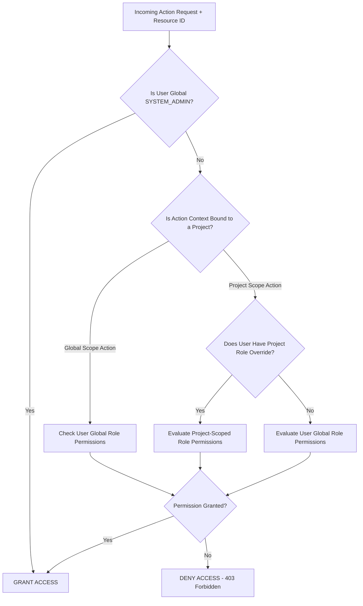
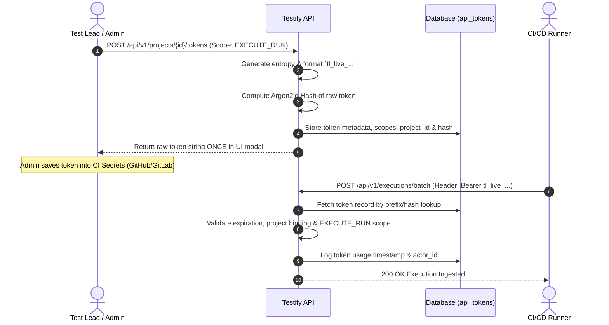
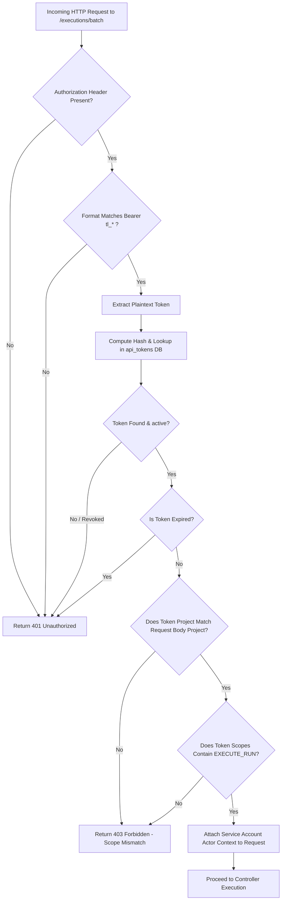
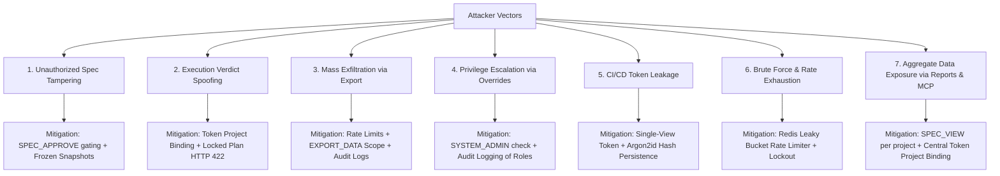

# RFC 04: Role-Based Access Control (RBAC), Token Architecture & Audit Logging Specification

- **Document Status:** Approved & Locked Specification
- **Author:** Security & RBAC Analyst
- **Date:** September 8, 2026
- **Target Version:** Testify v1.0
- **Upstream Alignment:** [00_requirements_alignment.md](file:///home/elliot/Documents/Code/testlink-local/docs/00_requirements_alignment.md), [.antigravity/agents/security_rbac.md](file:///home/elliot/Documents/Code/testlink-local/.antigravity/agents/security_rbac.md)

---

## 1. Executive Summary & Security Architecture

### 1.1 Context & Objectives
Legacy TestLink implementations relied on coarse, monolithic, and brittle permission models. Permissions were difficult to audit, lacked distinction between human interactive users and automated runners, and allowed silent test case tampering and execution spoofing.

Testify introduces an enterprise-grade Zero-Trust Security Framework designed for strict compliance standards (SOC 2 Type II, ISO/IEC 27001, HIPAA). The framework enforces:
1. **Atomic String-Constant Permission Keys:** Replacing arbitrary bitmasks with explicit, audited string constants.
2. **Dual-Scoped RBAC & Project Overrides:** Allowing system-wide default roles with deterministic project-level override resolution.
3. **Machine API Token Lifecycle:** Supporting high-entropy, scope-restricted tokens (`tl_live_...`, `tl_ci_...`) with single-view plaintext disclosure and Argon2id/SHA-256 salted digest persistence.
4. **Append-Only Immutable Audit Log:** In-database `audit_logs` table backed by database-level write-only triggers and zero automatic deletion (locked requirement from [00_requirements_alignment.md](file:///home/elliot/Documents/Code/testlink-local/docs/00_requirements_alignment.md)).
5. **Defense-in-Depth Threat Mitigations:** Comprehensive controls against execution spoofing, spec tampering, credential leakage, and data exfiltration.

---

## 2. Granular Permission Key Registry

Permissions in Testify are immutable string constants scoped across administrative, authoring, execution, and data integration domains.

```
Domain Namespace Structure: <DOMAIN>_<ACTION>
Example: SPEC_APPROVE, EXECUTE_RUN, API_TOKEN_MANAGE
```

### 2.1 Complete Permission Key Specifications

| Permission Key | Namespace | Scoping Level | Description & Operational Impact | Risk Level |
| :--- | :--- | :--- | :--- | :--- |
| `SYSTEM_ADMIN` | System | Global Only | Superuser access. Bypasses all project-level restrictions; allows global config & DB administration. | **CRITICAL** |
| `PROJECT_CREATE` | Workspace | Global | Ability to provision new project workspaces within the instance. | **HIGH** |
| `PROJECT_DELETE` | Workspace | Global / Project | Ability to purge or archive an entire project workspace and all contained assets. | **CRITICAL** |
| `USER_MANAGE` | System | Global / Project | Ability to create users, assign/revoke roles, and adjust global/project memberships. | **HIGH** |
| `SPEC_VIEW` | Authoring | Global / Project | Read-only access to test suites, test cases, steps, requirements, and spec histories. | **LOW** |
| `SPEC_CREATE` | Authoring | Global / Project | Ability to draft new test suites, test cases, and initial step definitions. | **MEDIUM** |
| `SPEC_EDIT` | Authoring | Global / Project | Ability to edit existing draft test case versions, update steps, and modify custom fields. | **MEDIUM** |
| `SPEC_APPROVE` | Authoring | Global / Project | Ability to transition test case versions from `Draft` to `Approved` (production release). | **HIGH** |
| `SPEC_DELETE` | Authoring | Global / Project | Ability to soft-delete or archive test cases and test suite subtrees. | **HIGH** |
| `PLAN_MANAGE` | Execution | Global / Project | Ability to create, lock, unlock, archive, and assign test cases to Test Plans. | **HIGH** |
| `RUN_MANAGE` | Execution | Global / Project | Ability to create, edit, close and delete test runs within a Test Plan. | **MEDIUM** |
| `EXECUTE_RUN` | Execution | Global / Project | Ability to record test execution verdicts (`Passed`, `Failed`, `Blocked`, `Skipped`), log notes, and attach execution artifacts. | **MEDIUM** |
| `EXECUTE_OVERWRITE` | Execution | Global / Project | Ability to edit or overwrite existing, historical execution verdicts and execution notes. | **HIGH** |
| `IMPORT_DATA` | Integrations | Global / Project | Ability to ingest external test suites/cases via XML, JSON, or CSV parsers (includes permission to auto-create custom field definitions mapped during pre-import setup). | **HIGH** |
| `EXPORT_DATA` | Integrations | Global / Project | Ability to export test suites, plans, and execution metrics to external files/APIs. | **HIGH** |
| `API_TOKEN_MANAGE` | Integrations | Global / Project | Ability to issue, rotate, and revoke machine API tokens for CI/CD runners or integrations. | **HIGH** |

---

## 3. Built-in Role Templates & Scoping Hierarchy

Testify ships with five standardized built-in role templates. Every role represents a distinct capability tier.

### 3.1 Role Profiles

1. **`Admin` (System / Project Administrator):**
   - **Global Scope:** Full control over global system settings, user provisioning, project creation, and audit log inspection.
   - **Project Scope:** Full control over project configuration, role assignments, specs, plans, executions, and tokens within the project.
2. **`Test Lead`:**
   - Focuses on test planning, specification authoring, review governance, build management, and assignment strategy.
   - Holds `SPEC_APPROVE`, `PLAN_MANAGE`, `RUN_MANAGE`, and `EXECUTE_OVERWRITE` privileges.
3. **`Tester / QA Engineer`:**
   - Focuses on manual execution and test drafting.
   - Holds `SPEC_VIEW`, `SPEC_CREATE`, `SPEC_EDIT`, `EXECUTE_RUN`, and read access to plans. Cannot approve specs or manage builds by default.
4. **`Automation Service` (Machine Service Account):**
   - Scoped strictly for automated CI/CD runners (e.g., GitHub Actions, GitLab CI, Jenkins).
   - Restricted to `SPEC_VIEW`, `RUN_MANAGE` (optional read/query), and `EXECUTE_RUN`. Strictly barred from administrative or spec approval keys.
5. **`Viewer / Stakeholder`:**
   - Read-only stakeholder role.
   - Holds `SPEC_VIEW` and read-only access to plans, execution reports, metrics dashboards, and audit logs.

### 3.2 Role vs. Permission Key Matrix

Legend:  
- **G**: Valid as Global System Role privilege  
- **P**: Valid as Project-Scoped Role privilege  
- **✓**: Granted by default  
- **✗**: Denied by default  

| Permission Key | Admin (G/P) | Test Lead (G/P) | Tester / QA (G/P) | Automation Service (P) | Viewer (G/P) |
| :--- | :---: | :---: | :---: | :---: | :---: |
| `SYSTEM_ADMIN` | **✓ (G)** | ✗ | ✗ | ✗ | ✗ |
| `PROJECT_CREATE` | **✓ (G)** | ✗ | ✗ | ✗ | ✗ |
| `PROJECT_DELETE` | **✓ (G/P)** | ✗ | ✗ | ✗ | ✗ |
| `USER_MANAGE` | **✓ (G/P)** | ✗ | ✗ | ✗ | ✗ |
| `SPEC_VIEW` | **✓** | **✓** | **✓** | **✓** | **✓** |
| `SPEC_CREATE` | **✓** | **✓** | **✓** | ✗ | ✗ |
| `SPEC_EDIT` | **✓** | **✓** | **✓** | ✗ | ✗ |
| `SPEC_APPROVE` | **✓** | **✓** | ✗ | ✗ | ✗ |
| `SPEC_DELETE` | **✓** | **✓** | ✗ | ✗ | ✗ |
| `PLAN_MANAGE` | **✓** | **✓** | ✗ | ✗ | ✗ |
| `RUN_MANAGE` | **✓** | **✓** | ✗ | **✓ (Read/Query)** | ✗ |
| `EXECUTE_RUN` | **✓** | **✓** | **✓** | **✓** | ✗ |
| `EXECUTE_OVERWRITE` | **✓** | **✓** | ✗ | ✗ | ✗ |
| `IMPORT_DATA` | **✓** | **✓** | ✗ | ✗ | ✗ |
| `EXPORT_DATA` | **✓** | **✓** | **✓** | ✗ | **✓** |
| `API_TOKEN_MANAGE` | **✓** | **✓** | ✗ | ✗ | ✗ |

---

### 3.3 Hierarchical Access Evaluation Algorithm

Permissions resolve deterministically using a **Two-Tier Precedence Cascade**. A user's effective permissions for an operation on a specific project resource are evaluated as follows:



#### Evaluation Rules:
1. **System Admin Override:** If the actor possesses `SYSTEM_ADMIN` globally, access is unconditionally granted (`ALLOW`).
2. **Explicit Project Override:** If an action targets a resource belonging to `Project_X`, the authorization service queries `user_project_roles` for `(user_id, project_id)`. If a project-level role exists, its permission key mapping **replaces** the user's global role mapping for that request context.
3. **Global Fallback:** If no project-level role override exists for `Project_X`, the authorization service falls back to evaluating the user's global system role (`user_global_role`).
4. **Default Deny:** If neither the project role nor the global role explicitly grants the required permission key, the request returns `HTTP 403 Forbidden`.

---

## 4. Authentication Architecture & Token Lifecycle

Testify enforces dual authentication modes: **Interactive User Sessions** for web UI users and **Machine API Tokens** for automated CI/CD pipelines.

### 4.1 Interactive User Sessions
- **Sign-in tokens:** HMAC-SHA256 JWTs carrying `sub` (user id), `username`, `sid` (session id) and `exp`, valid for 7 days. The web app keeps its token in an `HttpOnly`, `SameSite=Strict` cookie (`Secure` over HTTPS) and sends a CSRF header on every change; scripts send the token as `Authorization: Bearer`.
- **Server-side sessions:** every token names a session row (`sessions` table), checked on every request. A session ends after **8 hours without a request** (each request extends it), **7 days after sign-in** at most, on sign-out, when the user's password changes (their other sessions), when an admin resets it, or when the user is disabled. There are no separate refresh tokens: the session itself is what's renewed (`apps/server/src/sessionLifetime.ts`).

---

### 4.2 Machine API Token Lifecycle

Machine API Tokens facilitate automated test execution ingestion from CI/CD runners without exposing interactive user credentials.

```
Token Format: tl_<ENVIRONMENT>_<32_BYTE_HEX_ENTROPY>
Examples:
- Production Runner: tl_live_8f3a9b1c4e7d2f5a6b0c8d9e1f3a5b7c
- CI/CD Sandbox:    tl_ci_a1b2c3d4e5f67890123456789abcdef0
```



#### Token Security Specifications:
1. **Single-View Plaintext Disclosure:** The raw plaintext token (`tl_live_...`) is rendered **strictly once** in the API response modal upon creation. It is never stored in plaintext and cannot be retrieved again.
2. **Cryptographic Digest Persistence:** Database table `api_tokens` stores only salted digests using Argon2id (`memory_cost=65536, time_cost=3, parallelism=4`) or SHA-256 with per-token salt.
3. **Capability Narrowing:** Tokens MUST be bound to:
   - A single specific `project_id`.
   - An explicit array of allowed permission keys (e.g., restricted strictly to `['EXECUTE_RUN', 'SPEC_VIEW']`).
4. **Configurable TTL & Expiry:** Hard expiration timestamps (`expires_at`). CI tokens default to 90 days max TTL unless explicitly renewed or set to non-expiring by an System Administrator.
5. **Instant Revocation:** Any user with `API_TOKEN_MANAGE` on the project can instantly set `is_revoked = true` via UI or API (`DELETE /api/v1/tokens/{id}`).

---

### 4.3 Automated Runner Header Validation Pipeline

When an automated CI/CD runner sends batch test results to `POST /api/v1/executions/batch`, the middleware executes the following validation stack:



---

## 5. In-Database Append-Only Audit Subsystem

### 5.1 Retention & Immutability Rules
As locked in [00_requirements_alignment.md](file:///home/elliot/Documents/Code/testlink-local/docs/00_requirements_alignment.md) Section 1:
- Audit records in `audit_logs` are stored in the primary database with **no automatic deletion**.
- Audit records are **append-only forever** unless explicitly purged by a System Administrator via out-of-band CLI utility or direct database administrative maintenance script.

### 5.2 Relational Database Schema (`audit_logs`)

#### PostgreSQL DDL Specification
```sql
CREATE TABLE audit_logs (
    id UUID PRIMARY KEY DEFAULT gen_random_uuid(),
    actor_id UUID NOT NULL,
    actor_type VARCHAR(32) NOT NULL CHECK (actor_type IN ('USER', 'SERVICE_ACCOUNT', 'SYSTEM')),
    action VARCHAR(64) NOT NULL,
    resource_type VARCHAR(64) NOT NULL,
    resource_id UUID NOT NULL,
    project_id UUID NULL,
    diff JSONB NOT NULL DEFAULT '{}'::jsonb,
    ip_address INET NULL,
    user_agent TEXT NULL,
    created_at TIMESTAMPTZ NOT NULL DEFAULT CURRENT_TIMESTAMP
);

-- Indexes for efficient security reporting & compliance audits
CREATE INDEX idx_audit_logs_actor ON audit_logs(actor_id, created_at DESC);
CREATE INDEX idx_audit_logs_resource ON audit_logs(resource_type, resource_id);
CREATE INDEX idx_audit_logs_project ON audit_logs(project_id, created_at DESC) WHERE project_id IS NOT NULL;
CREATE INDEX idx_audit_logs_action ON audit_logs(action, created_at DESC);

-- Database-Level Immutability Safeguards (Prevents UPDATE and DELETE)
CREATE OR REPLACE FUNCTION suppress_audit_log_mutation()
RETURNS TRIGGER AS $$
BEGIN
    RAISE EXCEPTION 'MUTATION_DENIED: audit_logs table is append-only. UPDATE and DELETE operations are forbidden by security policy.';
END;
$$ LANGUAGE plpgsql;

CREATE TRIGGER trg_prevent_audit_update
BEFORE UPDATE ON audit_logs
FOR EACH ROW EXECUTE FUNCTION suppress_audit_log_mutation();

CREATE TRIGGER trg_prevent_audit_delete
BEFORE DELETE ON audit_logs
FOR EACH ROW EXECUTE FUNCTION suppress_audit_log_mutation();
```

#### SQLite DDL Specification (Development / Local Mode)
```sql
CREATE TABLE audit_logs (
    id TEXT PRIMARY KEY,
    actor_id TEXT NOT NULL,
    actor_type TEXT NOT NULL CHECK (actor_type IN ('USER', 'SERVICE_ACCOUNT', 'SYSTEM')),
    action TEXT NOT NULL,
    resource_type TEXT NOT NULL,
    resource_id TEXT NOT NULL,
    project_id TEXT,
    diff TEXT NOT NULL DEFAULT '{}',
    ip_address TEXT,
    user_agent TEXT,
    created_at TEXT NOT NULL DEFAULT (strftime('%Y-%m-%dT%H:%M:%fZ', 'now'))
);

-- Immutability Triggers for SQLite
CREATE TRIGGER trg_prevent_audit_update_sqlite
BEFORE UPDATE ON audit_logs
BEGIN
    SELECT RAISE(FAIL, 'MUTATION_DENIED: audit_logs table is append-only.');
END;

CREATE TRIGGER trg_prevent_audit_delete_sqlite
BEFORE DELETE ON audit_logs
BEGIN
    SELECT RAISE(FAIL, 'MUTATION_DENIED: audit_logs table is append-only.');
END;
```

---

### 5.3 Audit Event Catalog & Payload Specs

Every state-altering or security-relevant transaction emits an audit event.

| Event Action Key | Triggering Event | Resource Type | Monitored Payload Diff Structure |
| :--- | :--- | :--- | :--- |
| `test_case.deleted` | Soft deletion or archive of test case | `test_case` | `{ "before": { "id": "...", "title": "...", "status": "APPROVED" }, "after": { "deleted_at": "..." } }` |
| `version.approved` | Test Case Version transitioned to Approved | `test_case_version` | `{ "before": { "version": 2, "status": "DRAFT" }, "after": { "version": 2, "status": "APPROVED", "approved_by": "..." } }` |
| `verdict.overwritten` | Execution verdict edited after initial submission | `test_execution` | `{ "before": { "verdict": "PASSED", "notes": "..." }, "after": { "verdict": "FAILED", "notes": "Regressed in build 102" } }` |
| `role.assigned` | User granted Global or Project role | `user_role` | `{ "before": null, "after": { "user_id": "...", "project_id": "...", "role": "Test Lead" } }` |
| `role.revoked` | Role unassigned from user | `user_role` | `{ "before": { "user_id": "...", "role": "Test Lead" }, "after": null }` |
| `project.created` | New project workspace initialized | `project` | `{ "before": null, "after": { "id": "...", "key": "PRJ", "name": "Core Platform" } }` |
| `project.deleted` | Project workspace marked for deletion | `project` | `{ "before": { "name": "Core Platform" }, "after": { "deleted_at": "..." } }` |
| `api_token.generated` | Machine token issued for CI/CD | `api_token` | `{ "before": null, "after": { "token_id": "...", "prefix": "tl_live_8f3a", "scopes": ["EXECUTE_RUN"], "expires_at": "..." } }` |
| `api_token.revoked` | Machine token manually revoked | `api_token` | `{ "before": { "token_id": "...", "is_revoked": false }, "after": { "is_revoked": true, "revoked_by": "..." } }` |
| `plan.locked` | Test plan locked against further runs | `test_plan` | `{ "before": { "status": "ACTIVE" }, "after": { "status": "LOCKED", "locked_at": "..." } }` |
| `data.exported` | Mass export endpoint triggered | `export_job` | `{ "before": null, "after": { "format": "JSON", "record_count": 1450, "filters": {...} } }` |
| `data.imported` | External test suite ingested | `import_job` | `{ "before": null, "after": { "format": "TESTLINK_XML", "cases_created": 120, "cases_updated": 15 } }` |

---

## 6. Threat Model & Mitigation Matrix

A comprehensive threat modeling analysis identifies seven primary security attack vectors targeting Enterprise QA platforms.



### 6.1 Attack Vector Deep Dives & Security Controls

#### 1. Unauthorized Test Case / Specification Tampering
- **Risk:** Malicious or compromised users modify test case steps or assertions in production test suites to cover up defective code releases.
- **Architectural Mitigation:**
  - Strict segregation between `SPEC_EDIT` and `SPEC_APPROVE`.
  - Enforced life-cycle constraint from [00_requirements_alignment.md](file:///home/elliot/Documents/Code/testlink-local/docs/00_requirements_alignment.md): `Draft` test cases cannot be added to active `TestPlans` (unless explicitly toggled by Admin).
  - Executed plans lock historical `TestCaseVersion` snapshots permanently.

#### 2. Automated Execution Verdict Spoofing
- **Risk:** Compromised CI/CD pipeline or runner attempts to submit falsified `PASSED` verdicts to closed test plans or unauthorized projects.
- **Architectural Mitigation:**
  - Token payload capability narrowing (`project_id` & `scopes` validation on every batch ingest call).
  - As defined in [00_requirements_alignment.md](file:///home/elliot/Documents/Code/testlink-local/docs/00_requirements_alignment.md), any execution POST to a locked plan or closed build immediately halts with **HTTP 422 Unprocessable Entity** (`BUILD_CLOSED` / `PLAN_LOCKED`).

#### 3. Mass Data Exfiltration via Export Endpoints
- **Risk:** Malicious insider uses `EXPORT_DATA` endpoints to scrape entire proprietary test case repositories and vulnerability suites.
- **Architectural Mitigation:**
  - `EXPORT_DATA` permission required.
  - Export requests are rate limited: 120 exports per hour per user or API token (`apps/server/src/services/rateLimits.ts`). Generous on purpose, for automation; it stops runaway scripts and bulk scraping, not normal use.
  - High-volume export events trigger an immutable `data.exported` audit log record containing record counts and IP addresses.

#### 4. Privilege Escalation via Project Override Manipulation
- **Risk:** A low-privileged user attempts to craft API calls modifying `user_project_roles` to grant themselves `Admin` status on target projects.
- **Architectural Mitigation:**
  - `USER_MANAGE` permission key is strictly required to invoke role assignment endpoints (`POST /api/v1/projects/{id}/roles`).
  - Authorization middleware checks target user's current role hierarchy before allowing modification.

#### 5. Machine Token Leakage in CI Logs or Environment Variables
- **Risk:** CI runner logs spill raw API tokens during build failures.
- **Architectural Mitigation:**
  - Tokens use distinct high-entropy prefixes (`tl_live_`, `tl_ci_`), enabling standard CI log secret scrubbers (e.g., GitHub Actions secret masking) to detect and redact tokens automatically.
  - Instant token revocation via UI/API.

#### 6. Authentication Brute-Force & Denial of Service
- **Risk:** Automated botnets flood `/api/v1/auth/login` or token ingestion endpoints with brute-force credential guesses.
- **Architectural Mitigation:**
  - Sign-in (`apps/server/src/services/loginThrottle.ts`): an account locks for 15 minutes after 20 wrong passwords in a row, and an address is blocked after 50 failed sign-ins in 15 minutes.
  - Every request made with a machine API token (REST, CI batches, MCP): 1,200 per minute per token, as a token bucket (`apps/server/src/services/rateLimits.ts`). A batch request can carry up to 5,000 results.
  - Over a limit the API answers `429 RATE_LIMITED` with `Retry-After`. The counts are kept in memory per server process.

#### 7. Aggregate Data Exposure via Reports & the MCP Endpoint
- **Risk:** The reports API (`/api/v1/projects/:projectId/reports/...`) and the MCP endpoint (`POST /mcp`) are read surfaces built for scripts and AI agents. They expose failure messages, stack traces, CI runner metadata (commit SHAs, CI URLs), environment tags and tester identities across a whole project in a few calls. A leaked agent credential, or an agent tricked by prompt injection in test content (case titles, notes and failure messages are user/CI-controlled text), could read more than intended.
- **Architectural Mitigation (implemented):**
  - Every report and MCP tool requires `SPEC_VIEW` on the specific project, evaluated per call: project-scoped role overrides for users, frozen capabilities for tokens.
  - A machine token is refused on any project other than its own. This is enforced centrally in `authenticateApiToken` for every `/projects/:projectId/...` route and per tool call on `/mcp`.
  - Every report and MCP tool is read-only; MCP tools carry `readOnlyHint`. There are no write tools yet, so injected instructions can't change data through MCP.
  - Agents should use a dedicated token with only `SPEC_VIEW`, revocable on its own.
- **Gaps:**
  - Report and MCP calls made with an API token count against that token's 1,200 requests per minute; report reads by signed-in users aren't rate limited.
  - Report reads aren't audit-logged; only exports are.

**Report emails (added 2026-10-06)** send report data to arbitrary addresses outside Testify, which makes them a direct exfiltration channel.

Mitigations:
- A dedicated `REPORT_EMAIL` permission (Admin and Test Lead by default), project-scoped like every other route.
- Every send writes a `REPORT_EMAILED` audit row (manual or scheduled, with the recipient count). The most recent email is kept for admins to review.
- At most 50 recipients per email.
- Every user- and CI-supplied string is HTML-escaped, so case titles or failure messages can't inject markup into recipients' mail.
- Scheduled sends re-check, on every send, that the schedule's creator is still active and still allowed to email that project.
- Sending is rate limited to 60 emails per hour per user or token (manual sends, a schedule's Send now, and the admin's test email; previews and scheduled sends aren't counted).
- The SMTP password is encrypted at rest with `SECRETS_KEY` and never returned by the API.

---

## 7. Verification & Compliance Sign-Off Criteria

To consider RBAC implementation complete during development, the system must pass the following security test suites:

1. **RBAC Isolation Tests:**
   - Verify that a `Tester` attempting `POST /api/v1/cases/{id}/approve` receives `403 Forbidden`.
   - Verify that a `Viewer` attempting `POST /api/v1/executions` receives `403 Forbidden`.
   - Verify that a Project Admin for `Project A` receives `403 Forbidden` when attempting to edit specs in `Project B`.
2. **Token Hash Integrity Tests:**
   - Verify that plaintext API tokens are never saved to database tables or application logs.
   - Verify that an expired or revoked API token receives `401 Unauthorized` on `/executions/batch`.
3. **Audit Log Persistence Tests:**
   - Attempt an `UPDATE` or `DELETE` query directly against `audit_logs` in PostgreSQL/SQLite and verify DB-level trigger rejection (`MUTATION_DENIED`).
